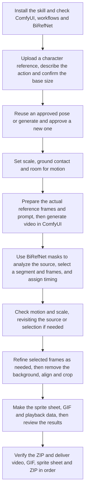

# ComfyUI Video to Sprite

[繁體中文](README.md) · [简体中文](README.zh-CN.md) · [日本語](README.ja.md) · [한국어](README.ko.md) · **English**

Upload a character reference and describe a movement to create a 2D game animation. The skill normally uses GPT Image for the static starting pose and local ComfyUI for video generation.

## Overview and examples

[Loop (`loop`) · Right-facing walk in place](examples/right-facing-walk-loop/README.en.md)

[Return to the starting pose (`return_to_start`) · Right-facing ground kick](examples/right-facing-kick/README.en.md)

[Hold the final pose (`hold_end_pose`) · Backward knockdown](examples/right-facing-knockdown/README.en.md)

## Installation and setup

Give Codex this repository URL and ask it to install the `comfyui-video2sprite` skill from the repository root. Use Python 3.10 or newer and make FFmpeg and ffprobe available in your terminal. Start local ComfyUI (default `http://127.0.0.1:8188`). Export working video-generation and PNG image-editing workflows as API-format JSON and give them to Codex together with the workspace location. Background removal uses the included BiRefNet workflow. Place `birefnet.safetensors` in `ComfyUI/models/background_removal/`.

[Download the model](https://huggingface.co/Comfy-Org/BiRefNet/blob/main/background_removal/birefnet.safetensors) · [ComfyUI background removal guide](https://docs.comfy.org/tutorials/utility/remove-background-birefnet) · [Workflow setup (繁體中文)](references/setup.md)

## First animation

> Use `$comfyui-video2sprite` to make a right-facing ground kick from my uploaded character reference. Use a base size of 256.

Choose 128, 256, 512, or a custom base character size. Codex asks if it is missing. It reuses an approved pose when suitable or prepares a new one for review. Movement such as walking defaults to a right-facing side profile. Kicks use a right-facing three-quarter guard. Once the pose is approved, video generation goes straight to the requested action. The initial video is about three seconds by default. Request an idle animation explicitly to generate one. To add another move, describe it in the same conversation. The character size and suitable pose carry over.

## Workflow and ZIP contents

One ZIP per action contains the character reference, pose image, actual video inputs and prompts, source video, all original frames, selected frames, transparent PNGs, GIF, and sprite sheet. Standalone alpha masks stay in the workspace. Ground actions that return to the starting pose default to about one second at 25 FPS. Read `playback.fps` and `playback.sequence` from `variants/clean/animation.json` to play the zero-based sprite cells in order.

## Troubleshooting

Compare the source video, GIF and sprite sheet. If the source cuts off the character or lacks part of the action, check video generation and framing. If a source pose is missing from the sprite sheet, check segment and frame selection. If all poses are present but playback stalls, check frame timings. For residual effects or missing edges, compare the matching original and transparent frames. Report a timestamp or sprite sheet cell.
