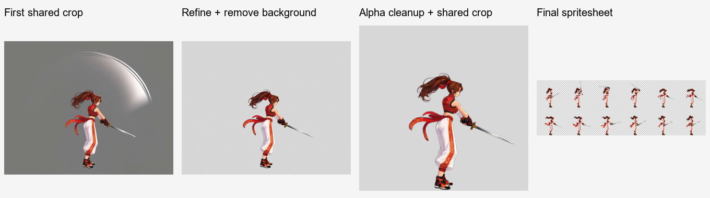

# ComfyUI Video to Sprite

[繁體中文](README.md) · [简体中文](README.zh-CN.md) · [日本語](README.ja.md) · [한국어](README.ko.md) · [English](README.en.md)

A character animation Skill for Codex. Upload a character image and describe an action to create a transparent sprite sheet and GIF preview using local ComfyUI. You can also supply an existing video and continue with frame selection and delivery.

Codex interprets requests, writes prompts, and reviews results. Local Python handles layout, scaling, job waiting, frame selection, cropping, packing, and validation. ComfyUI handles image processing and video generation. Conversation, confirmation options, and delivery explanations follow your language or explicit preference; workflow prompts use the language appropriate for the model.

<table>
  <tr><th>Character showcase</th><th>Walking loop</th></tr>
  <tr>
    <td align="center"></td>
    <td align="center"><br>8 frames · 0.8 seconds · Transparent</td>
  </tr>
</table>

- [Loop: walking](examples/right-profile-walk/README.en.md)
- [Return to start: attack](examples/right-profile-attack/README.en.md)
- [Hold end pose: death](examples/right-profile-death/README.en.md)
- [Sword attack: preserve the physical weapon and remove incidental effects](examples/right-profile-sword/README.en.md)

## Motion types

- **Loop**: The end joins the beginning for continuous playback.
- **Return to start**: Perform the action once and return to the same starting pose. Play once per trigger.
- **Hold end pose**: Perform the action once and hold the target end pose.



Follow the actual results from the standing reference and performance canvas through the gray-background video to the transparent sheet, including assets you can reuse.

## Copy this request to Codex

```text
Please install this Codex Skill: https://github.com/yuwechang/comfyui-video2sprite . Follow the repository's installation instructions to install it and check the environment. Ask me only when required information is missing.
```

Codex follows the installation and update instructions to download the Skill and check Python packages and FFmpeg/ffprobe. If an external program is missing, it asks whether you want installation help. You do not need to copy folders, choose installation paths, or run Python yourself.

## What you need

- A Codex environment with access to local files and ComfyUI.
- Working ComfyUI, models, and nodes. Start ComfyUI before use.
- API-format workflow JSON files: one for video generation and one for image processing. For existing videos, start with the image workflow only.

The Skill does not include models, nodes, FFmpeg, or ffprobe. Codex checks the environment and installs only missing dependencies with the necessary approval.

## First use

Tell Codex which working folder should hold your assets and results, and provide your workflow JSON files. It first tries `http://127.0.0.1:8188`, asks for another address only if that fails, then helps identify and save node mappings.

After setup, follow “Create an animation” below in a new chat. Codex collects the necessary choices and briefly explains the production order and save locations: review stance references, complete Idle, then make and deliver the selected actions. Existing settings are reused; reference ambiguities are clarified only when they affect production.

Provide API workflows that can generate action videos from character images and edit images from text instructions with transparent PNG output. Codex helps check suitability. Supported resolution and video length depend on your hardware and workflows.

This project's example uses **MiniMax H3** for video and **Qwen Image 2.1** for images. This is a tested combination, not a model restriction: the Skill connects through node mappings. You provide model weights, nodes, and API workflows; installing the Skill does not install them.


## Create an animation

After installing the Skill and configuring workflows, start a new chat, attach a character reference, and say:

> Use `$comfyui-video2sprite` to create game animations for this character.

**One character per chat.** Supplementary references for that character stay in the same chat; use a new chat for another character. Uploading an image alone does not start production.

The initial setup asks for three choices together, without asking again for information already supplied:

1. **Stances (multiple selections):** normal / combat. Combat means a ready stance, not an additional attack animation.
2. **Additional actions (multiple selections, optional):** walk / run / jump / death.
3. **Character baseline size:** 128×128 / 256×256 (recommended) / 512×512, or a custom size. This sets the final character's scale, not the video resolution.

**Idle is always created for every selected stance; no checkbox is needed.** Selecting both stances produces two versions of Idle and every selected action. With no additional actions, only Idle is made. All animations face right in a side view; mirror them in the game engine for left-facing playback.

Confirm the stance references, shared scale and ground position, then complete each stance's Idle animation before extending it into other actions. Final shared-crop cells may be rectangular or exceed the baseline during extended movements. The plan, baseline size, assets and progress are saved in the working folder and reused without repeating setup questions.

After delivery, say **“Create a new action”** and choose:

1. **Stances:** normal / combat, multiple selections.
2. **Action environment:** ground / air, one selection.
3. **Action description:** free text.

Ground actions use the corresponding Idle as their reference and retain the complete performance, including any time spent off the ground. Air actions use an airborne reference, with movement controlled by the game engine. Choices already supplied are reused. A new stance first receives Idle; missing airborne references first receive jump assets. Both stances produce two versions, using the current chat's character.

Selecting jump delivers separate rising and falling animations; later air actions reuse the saved reference.

Frames are selected to preserve the action and its rhythm; single actions can use an adaptive frame count. Each action receives its own deliverables:

- `spritesheet.png`: transparent sheet with equal-sized cells, ordered left to right, then top to bottom.
- `preview.gif`: transparent GIF preview made from the final sheet.
- `animation.json`: dimensions, sampling, playback timing, and other output data.
- A ZIP containing the uploaded image, stance reference, video input, source video, all extracted and selected frames, actual prompts, and final outputs.

When importing into a game engine, use the per-frame durations in the supplied animation data to preserve the action's rhythm.

Image and video processing run in local ComfyUI. Prompt preparation, conversation, and visual review still use Codex usage allowance.

Keep the character and equipment clearly visible. Frame cleanup can remove incidental effects and repair motion blur, but cannot reliably reconstruct completely hidden body parts or equipment.

The results remove backgrounds and unwanted effects, preserve natural translucent edges, and use a shared crop to maintain consistent character scale and placement.

## Use an existing video

Provide a video and describe the action interval, playback duration and size you need. Codex can clean up the frames and create the deliverables without first running the character-image creation process.

Suitable videos have:

- The complete character and action, without clipped limbs, hair, or accessories.
- A simple, distinguishable background with sufficient separation from the character; avoid complex scenery, captions, and occlusions.
- Clear enough action frames to select.

Videos do not need the Skill's performance padding. The crop is calculated from selected frames. Slight background color differences between frames are acceptable; complex scenes are outside the currently supported scope.

If a generated result is unsatisfactory, ask Codex for the prepared input image and actual prompt, experiment in ComfyUI, then bring a suitable video back to continue processing.

## Local data and updates

Workflow files and mappings live in the working folder's `.local/`, intermediate tasks in `work/`, and deliverables in `outputs/`. These are separate from the Skill installation and are not distributed with it.

To update, tell Codex:

```text
Please update comfyui-video2sprite following this repository's installation and update instructions, preserving my workflow settings, assets, and outputs: https://github.com/yuwechang/comfyui-video2sprite
```
