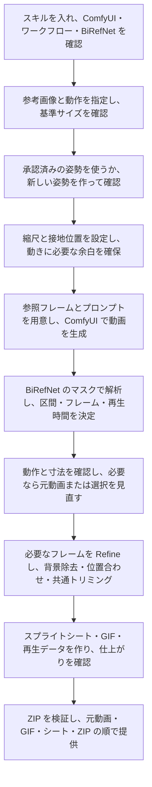

# ComfyUI Video to Sprite

[繁體中文](README.md) · [简体中文](README.zh-CN.md) · **日本語** · [한국어](README.ko.md) · [English](README.en.md)

キャラクターの参考画像をアップロードし、動きを指定すると、ゲーム用の 2D アニメーションを作れます。開始姿勢の静止画には通常 GPT Image、動画生成にはローカルの ComfyUI を使用します。

## 概要と作例

[ループ (`loop`) · 右向きのその場歩き](examples/right-facing-walk-loop/README.ja.md)

[開始姿勢に戻る (`return_to_start`) · 右向きの地上キック](examples/right-facing-kick/README.ja.md)

[終了姿勢を保持する (`hold_end_pose`) · 被弾して後方に倒れる](examples/right-facing-knockdown/README.ja.md)

## インストールと初回設定

このリポジトリの URL を Codex に渡し、ルートにある `comfyui-video2sprite` スキルのインストールを依頼します。Python 3.10 以上と、端末から実行できる FFmpeg・ffprobe を用意し、ローカルの ComfyUI（既定は `http://127.0.0.1:8188`）を起動します。動作確認済みの動画生成ワークフローと PNG を出力する画像編集ワークフローを API 形式の JSON で書き出し、作業フォルダーとともに Codex に渡します。背景除去には同梱の BiRefNet ワークフローを使用します。`birefnet.safetensors` を `ComfyUI/models/background_removal/` に置いてください。

[モデルのダウンロード](https://huggingface.co/Comfy-Org/BiRefNet/blob/main/background_removal/birefnet.safetensors) · [ComfyUI の背景除去ガイド](https://docs.comfy.org/tutorials/utility/remove-background-birefnet) · [ワークフロー設定 (繁體中文)](references/setup.md)

## 初めてのアニメーション

> アップロードした参考画像から `$comfyui-video2sprite` で右向きの地上キックを作ってください。基準サイズは 256 です。

キャラクターの基準サイズは 128、256、512 または任意の値を指定できます。未指定の場合は Codex が確認します。承認済みの姿勢が適していれば再利用し、必要に応じて新しい姿勢を生成して確認します。歩行は右向きの真横、キックは右向きの斜めの構えが既定です。確認後は指定した動作を直接生成します。初回の動画は既定で約 3 秒です。待機アニメーションが必要な場合は明示してください。動作を追加するには同じ会話で次の動きを指定します。サイズと適切な姿勢は引き継がれます。

## 処理の流れと ZIP の内容

動作ごとに 1 つの ZIP に、キャラクター参考画像、姿勢画像、動画生成に使った画像とプロンプト、元動画、全元フレーム、選択フレーム、透過 PNG、GIF、スプライトシートが入ります。個別のアルファマスクは作業フォルダーに残ります。開始姿勢に戻る地上動作の既定は約 1 秒、25 FPS です。`variants/clean/animation.json` の `playback.fps` と `playback.sequence` を使い、0 始まりのセル番号順に再生できます。

## トラブルシューティング

元動画、GIF、スプライトシートを順に比較します。元動画で動きが欠けたり体が画面外に出たりする場合は、動画生成と余白を確認します。元動画にある姿勢がシートにない場合は区間とフレームの選択、姿勢が揃っているのに動きが止まって見える場合は各フレームの再生時間を確認します。エフェクトの残りや輪郭の欠けがある場合は、同じ元フレームと透過結果を比べ、時刻またはセル番号を添えて報告してください。
