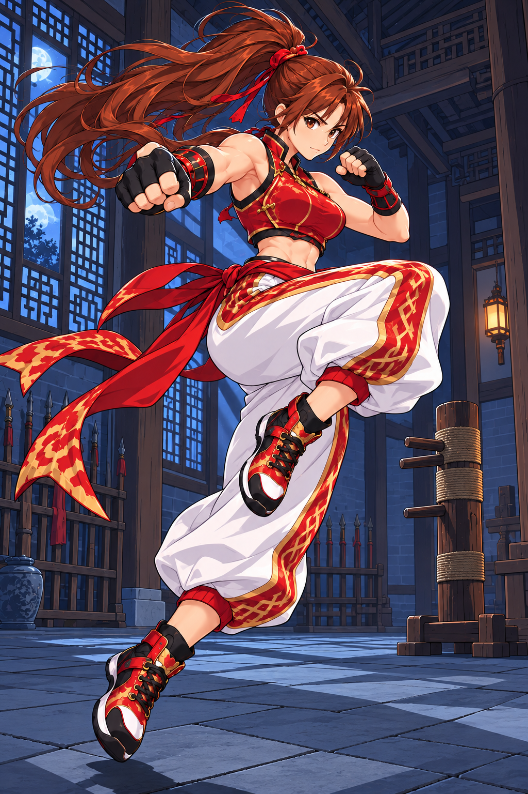
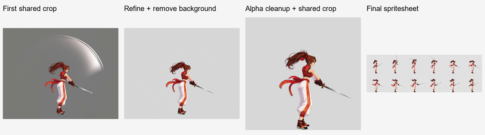

# ComfyUI Video to Sprite

[繁體中文](README.md) · [简体中文](README.zh-CN.md) · [日本語](README.ja.md) · [한국어](README.ko.md) · [English](README.en.md)

Codex 用のキャラクターアニメーション Skill です。キャラクター画像をアップロードして動作を伝えると、ローカルの ComfyUI で透過スプライトシートと GIF プレビューを作成できます。生成済みの動画から、フレーム選択以降の処理を行うこともできます。

Codex は要望の理解、プロンプト作成、結果の確認を担当します。ローカルの Python はレイアウト、拡縮、ジョブの待機、フレーム選択、切り抜き、結合、検証を担当し、ComfyUI は画像処理と動画生成を担当します。対話、確認の選択肢、納品説明は使用中または指定された言語に合わせます。ワークフローのプロンプトはモデルに適した言語で作成します。

<table>
  <tr><th>キャラクター紹介画像</th><th>歩行ループの完成例</th></tr>
  <tr>
    <td align="center"></td>
    <td align="center"><br>8 フレーム · 0.8 秒 · 透過背景</td>
  </tr>
</table>

- [ループ動作：歩行](examples/right-profile-walk/README.ja.md)
- [開始姿勢に戻る動作：攻撃](examples/right-profile-attack/README.ja.md)
- [終了姿勢を保持する動作：倒れる動作](examples/right-profile-death/README.ja.md)
- [剣攻撃：実体の武器を維持し付随エフェクトを除去](examples/right-profile-sword/README.ja.md)

## 動作タイプ

- **ループ動作**: 末尾から先頭へつながり、繰り返し再生できます。
- **開始姿勢に戻る動作**: 一度動作して同じ開始姿勢に戻ります。トリガーごとに一度再生します。
- **終了姿勢を保持する動作**: 一度動作して目標の終了姿勢を保持します。



自然な立ち姿、動作用の余白を備えたキャンバス、グレー背景の動画、透過シートまで、実際の成果と素材の再利用方法を紹介します。

## この依頼文を Codex にコピー

```text
この Codex Skill をインストールしてください：https://github.com/yuwechang/comfyui-video2sprite 。リポジトリのインストール手順に従ってインストールと環境チェックを行い、必要な情報が不足している場合に質問してください。
```

Codex がインストール・更新手順に従ってダウンロードし、Python パッケージと FFmpeg／ffprobe を確認します。外部プログラムが不足していれば、インストールを手伝うか確認します。手動でフォルダーをコピーしたり、インストール先を設定したり、Python を操作する必要はありません。

## 用意するもの

- ローカルファイルと ComfyUI にアクセスできる Codex 環境。
- 正常に動作する ComfyUI、モデル、ノード。使用前に ComfyUI を起動してください。
- API 形式のワークフロー JSON。動画生成用と画像処理用を各 1 つ用意します。既存動画のみ処理する場合は、まず画像処理用だけで構いません。

モデル、ノード、FFmpeg、ffprobe は付属しません。環境と依存関係は Codex が確認し、不足分だけを補います。

## 初回利用

素材と成果物を保存する作業フォルダーを Codex に伝え、ワークフロー JSON を渡してください。最初に `http://127.0.0.1:8188` を試し、接続できない場合だけ実際の URL を確認します。その後、ノードの対応関係を特定して保存します。

設定後は下の制作案内に従って新しいチャットで参考画像と依頼を送ります。必要な選択と姿勢参考の確認を行います。

キャラクター画像から動作動画を生成する API ワークフローと、文章で画像を編集して透過 PNG を出力する API ワークフローを用意します。Codex が適合性を確認します。解像度や動画の長さは機器とワークフローに依存します。

本プロジェクトの実例では、動画に **MiniMax H3**、画像に **Qwen Image 2.1** を使用しています。参考になる組み合わせですが、Skill はノードの対応付けで接続するため、特定モデルには限定されません。モデルの重み、ノード、API ワークフローは利用者が用意します。Skill のインストールでは導入されません。


## アニメーションを作成

インストールとワークフロー設定後、新しいチャットにキャラクター参考画像を添付し、次のように依頼します。

> `$comfyui-video2sprite` を使って、このキャラクターのゲーム用アニメーションを作成してください。

**1 チャットにつき 1 キャラクターです。** 同じキャラクターの追加参考は同じチャットで扱い、別のキャラクターは新しいチャットで開始します。画像のアップロードだけでは制作を開始しません。

初回は次の 3 項目をまとめて確認し、指定済みの情報は再質問しません。

1. **姿勢（複数選択）**：通常／戦闘。戦闘は待機の構えであり、攻撃技の追加を意味しません。
2. **追加動作（複数選択・省略可）**：歩行／走行／ジャンプ／死亡。
3. **キャラクターの基準サイズ**：128×128／256×256（推奨）／512×512、またはカスタムサイズ。成果物のキャラクターの大きさの基準であり、動画の解像度ではありません。

**選択した各姿勢の Idle（待機アニメーション）は必ず作成し、選択不要です。** 両姿勢を選ぶと Idle と各選択動作を 2 種類ずつ作成します。追加動作なしなら Idle のみです。すべて右向きの真横視点で、左向きはゲームエンジンで反転できます。

姿勢参考と共通の大きさ・足元位置を確認し、各 Idle 動画を完成させてから対応する動作へ展開します。最終セルは共通クロップにより長方形や基準を超える大きさにもなります。計画・基準サイズ・素材・進捗を作業フォルダーに保存し、以後は再利用します。

納品後は **「新しい動作を作成」** と入力し、次を指定します。

1. **姿勢**：通常／戦闘、複数選択。
2. **動作環境**：地上／空中、単一選択。
3. **動作説明**：自由記述。

地上動作は対応する Idle を基準とし、離地する部分も含めて全体を保持します。空中動作は空中姿勢を基準とし、移動はゲームエンジンで制御します。指定済みの選択は再質問しません。新しい姿勢には先に Idle、空中基準がなければ先にジャンプ素材を作成します。両姿勢なら各 1 種類、同じチャットのキャラクターを使用します。

ジャンプを選ぶと上昇・下降を別々に納品します。以後の空中動作では保存した基準を再利用できます。

フレーム数は既定の 8 枚から、動作に応じて調整します。動作ごとに次を個別に納品します。

- `spritesheet.png`：全セルが同じ寸法の透過シート。左から右、上から下の順。
- `preview.gif`：最終シートから作成する透過 GIF プレビュー。
- `animation.json`：寸法、サンプリング、再生時間などの情報。
- ZIP 素材集：アップロード画像、姿勢参考、動画入力画像、元動画、全フレームと選択フレーム、使用したプロンプト、成果物。

ゲームエンジンへ取り込む際は、動作のリズムを保つため、付属のアニメーションデータに記録された各フレームの表示時間を使用してください。

画像と動画はローカルの ComfyUI で処理します。プロンプト作成、対話、画像の確認には Codex の利用枠を使用します。

キャラクターと装備が明瞭な素材を使用してください。不要な効果や動きのぼけは整理しますが、完全に隠れた身体や装備の復元は保証できません。

背景と不要な効果を除去し、自然な半透明の縁を保ちます。共通範囲で切り抜くことで、大きさと位置の関係を維持します。

## 既存動画を使う

動画と、残したい動作区間・再生時間・サイズを伝えると、Codex がフレーム整理と背景除去を行い、成果物を作成します。キャラクター画像からの制作手順を先に行う必要はありません。

適した動画の条件は次のとおりです。

- キャラクターと動作全体が収まり、手足、髪、装飾が画面外で切れていない。
- キャラクターと区別しやすい単純な背景。複雑な場面、字幕、遮蔽物は避ける。
- 選択できる程度に各動作フレームが鮮明。

Skill の動作用余白を事前に設ける必要はありません。切り抜き範囲は選択したフレームから求めます。背景色の多少の変動は許容しますが、複雑な場面は現在の対応範囲に含まれません。

生成結果に満足できない場合は、準備した入力画像と実際のプロンプトを Codex から受け取り、ComfyUI で試せます。良い動画ができたら Codex に渡し、後半の処理を続けられます。

## ローカルデータと更新

作業フォルダー内の `.local/` にワークフローとノード対応、`work/` に中間データ、`outputs/` に成果物を保存します。Skill のインストール先とは分離され、Skill と一緒に配布する必要はありません。

更新も Codex に依頼できます。

```text
このリポジトリのインストール・更新手順に従って comfyui-video2sprite を更新してください。ワークフロー設定、素材、成果物は保持してください：https://github.com/yuwechang/comfyui-video2sprite
```
