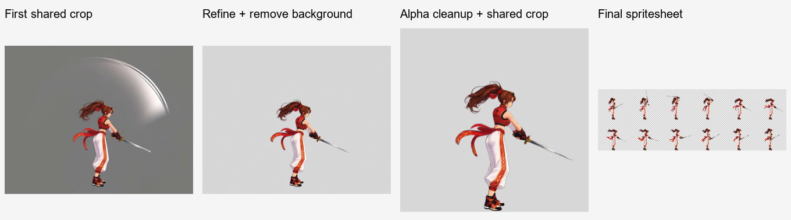

# ComfyUI Video to Sprite

[繁體中文](README.md) · [简体中文](README.zh-CN.md) · [日本語](README.ja.md) · [한국어](README.ko.md) · [English](README.en.md)

Codex용 캐릭터 애니메이션 Skill입니다. 캐릭터 이미지를 올리고 동작을 설명하면 로컬 ComfyUI로 투명 배경 스프라이트 시트와 GIF 미리보기를 만듭니다. 이미 생성한 동영상을 제공하여 프레임 선택 이후의 작업을 이어갈 수도 있습니다.

Codex는 요청 해석, 프롬프트 작성, 결과 검토를 담당합니다. 로컬 Python은 배치, 크기 조절, 작업 대기, 프레임 선택, 자르기, 합치기, 검증을 담당하며, ComfyUI는 이미지 처리와 동영상 생성을 담당합니다. 대화, 확인 선택지, 결과 안내는 사용 중이거나 지정한 언어로 제공됩니다. 워크플로 프롬프트는 모델에 적합한 언어로 작성합니다.

<table>
  <tr><th>캐릭터 소개 이미지</th><th>걷기 루프 결과</th></tr>
  <tr>
    <td align="center"></td>
    <td align="center"><br>8 프레임 · 0.8초 · 투명 배경</td>
  </tr>
</table>

- [루프 동작: 걷기](examples/right-profile-walk/README.ko.md)
- [시작 자세로 돌아오는 동작: 공격](examples/right-profile-attack/README.ko.md)
- [종료 자세를 유지하는 동작: 쓰러지기](examples/right-profile-death/README.ko.md)
- [검 공격: 실제 무기는 보존하고 부가 효과는 제거](examples/right-profile-sword/README.ko.md)

## 동작 유형

- **루프 동작**: 끝과 시작이 이어져 계속 반복 재생할 수 있습니다.
- **시작 자세로 돌아오는 동작**: 동작을 한 번 수행하고 같은 시작 자세로 돌아옵니다. 트리거마다 한 번 재생합니다.
- **종료 자세를 유지하는 동작**: 동작을 한 번 수행한 후 목표 종료 자세를 유지합니다.



자연스러운 서 있는 자세, 동작 여백을 둔 캔버스, 회색 배경 동영상, 투명 시트까지 실제 결과와 자료 재사용 방법을 단계별로 소개합니다.

## 이 요청을 Codex에 복사하세요

```text
이 Codex Skill을 설치해 주세요: https://github.com/yuwechang/comfyui-video2sprite . 저장소의 설치 안내에 따라 설치와 환경 점검을 진행하고, 필요한 정보가 없을 때 질문해 주세요.
```

Codex가 설치 및 업데이트 안내에 따라 다운로드하고 Python 패키지와 FFmpeg／ffprobe를 확인합니다. 외부 프로그램이 없으면 설치를 도와드릴지 묻습니다. 직접 폴더를 복사하거나 설치 경로를 설정하거나 Python을 실행할 필요가 없습니다.

## 준비할 것

- 로컬 파일과 ComfyUI에 접근할 수 있는 Codex 환경.
- 정상 작동하는 ComfyUI, 모델, 노드. 사용 전에 ComfyUI를 실행하세요.
- API 형식의 워크플로 JSON: 동영상 생성용과 이미지 처리용 각 1개. 기존 동영상만 처리할 때는 이미지 워크플로부터 제공하면 됩니다.

Skill에는 모델, 노드, FFmpeg, ffprobe가 포함되지 않습니다. Codex가 환경과 의존성을 확인하고 부족한 항목만 보충합니다.

## 처음 사용하기

자료와 결과를 저장할 작업 폴더를 Codex에 알려주고 워크플로 JSON을 제공하세요. 먼저 `http://127.0.0.1:8188`에 연결하고, 실패한 경우에만 실제 주소를 묻습니다. 이후 노드를 파악해 연결 정보를 저장합니다.

설정 후 아래 제작 안내에 따라 새 채팅에 참조 이미지와 요청을 보내세요. 필요한 선택 사항을 확인하고 제작 순서와 저장 위치를 간단히 안내합니다. 자세 참조를 확인한 뒤 Idle을 완성하고 선택한 동작을 제작하여 전달합니다. 기존 설정은 재사용하며 참조 이미지의 모호한 부분이 제작에 영향을 줄 때만 추가로 확인합니다.

캐릭터 이미지로 동작 영상을 생성하는 API 워크플로와, 텍스트로 이미지를 편집하여 투명 PNG를 출력하는 API 워크플로를 준비하세요. Codex가 적합성을 확인합니다. 해상도와 영상 길이는 장비와 워크플로에 따라 다릅니다.

이 프로젝트의 실측 예제는 동영상에 **MiniMax H3**, 이미지에 **Qwen Image 2.1**을 사용합니다. 참고할 수 있는 조합이며, Skill은 노드 연결을 통해 워크플로를 사용하므로 특정 모델에 종속되지 않습니다. 모델 가중치, 노드, API 워크플로는 사용자가 준비하며 Skill 설치에 포함되지 않습니다.


## 애니메이션 만들기

Skill 설치와 워크플로 설정 후 새 채팅에 캐릭터 참조를 첨부하고 요청하세요.

> `$comfyui-video2sprite`로 이 캐릭터의 게임 애니메이션을 만들어 주세요.

**채팅 하나에 캐릭터 하나만 사용합니다.** 같은 캐릭터의 추가 참조는 현재 채팅에 올리고, 다른 캐릭터는 새 채팅에서 시작합니다. 이미지 업로드만으로 제작을 시작하지 않습니다.

첫 요청에서는 세 항목을 함께 확인하며 이미 제공한 정보는 다시 묻지 않습니다.

1. **자세 (복수 선택):** 일반 / 전투. 전투는 대기 자세이며 공격 기술을 추가한다는 뜻이 아닙니다.
2. **추가 동작 (복수 선택, 생략 가능):** 걷기 / 달리기 / 점프 / 사망.
3. **캐릭터 기준 크기:** 128×128 / 256×256(권장) / 512×512 또는 사용자 지정 크기. 결과물의 캐릭터 크기 기준이며 동영상 해상도가 아닙니다.

**선택한 자세마다 Idle(대기 애니메이션)을 반드시 제작하므로 선택할 필요가 없습니다.** 두 자세를 선택하면 Idle과 선택한 모든 동작을 두 버전씩 만듭니다. 추가 동작이 없으면 Idle만 만듭니다. 모두 오른쪽을 보는 측면 시점이며 왼쪽은 게임 엔진에서 반전할 수 있습니다.

자세 참조와 공통 크기·발 위치를 확인하고 각 Idle 영상을 완성한 뒤 해당 자세의 다른 동작을 만듭니다. 최종 공통 자르기의 셀은 직사각형이거나 기준보다 클 수 있습니다. 계획, 기준 크기, 소재, 진행 상황을 작업 폴더에 저장하고 이후 재사용합니다.

전달 후 **“새 동작 만들기”** 를 입력하고 다음을 선택하세요.

1. **자세:** 일반 / 전투, 복수 선택.
2. **동작 환경:** 지상 / 공중, 단일 선택.
3. **동작 설명:** 자유 입력.

지상 동작은 해당 Idle을 기준으로 하며 공중에 뜨는 부분도 포함하여 전체 동작을 보존합니다. 공중 동작은 공중 자세를 기준으로 하고 이동은 게임 엔진이 제어합니다. 이미 지정한 선택은 다시 묻지 않습니다. 새 자세에는 Idle을 먼저 만들고 공중 기준이 없으면 점프 소재를 먼저 만듭니다. 두 자세를 선택하면 각각 제작하며 현재 채팅의 캐릭터를 사용합니다.

점프를 선택하면 상승과 하강 애니메이션을 따로 전달합니다. 이후 공중 동작은 저장된 기준을 재사용합니다.

동작과 리듬을 유지하도록 프레임을 선택하며, 단발 동작의 프레임 수는 자동으로 조정할 수 있습니다. 각 동작을 별도로 제공합니다.

- `spritesheet.png`: 모든 셀 크기가 같고 왼쪽에서 오른쪽, 위에서 아래 순서인 투명 시트.
- `preview.gif`: 최종 시트에서 만든 투명 GIF 미리보기.
- `animation.json`: 크기, 샘플링, 재생 시간 등의 정보.
- ZIP 자료 묶음: 업로드 이미지, 자세 참고 이미지, 동영상 입력 이미지, 원본 동영상, 전체 프레임과 선택 프레임, 실제 프롬프트, 결과물.

게임 엔진으로 가져올 때는 동작의 리듬을 유지하도록 제공된 애니메이션 데이터의 프레임별 재생 시간을 사용하세요.

이미지와 동영상은 로컬 ComfyUI가 처리합니다. 프롬프트 작성, 대화, 시각 검토에는 Codex 사용량이 소비됩니다.

캐릭터와 장비가 명확히 보이는 소재를 사용하세요. 부가 효과와 동작 흐림은 정리하지만 완전히 가려진 신체나 장비의 복원은 보장하지 않습니다.

배경과 불필요한 효과를 제거하고 자연스러운 반투명 가장자리를 유지합니다. 공통 범위로 잘라 캐릭터의 크기와 위치 관계를 유지합니다.

## 기존 동영상 사용하기

동영상과 원하는 동작 구간, 재생 시간, 크기를 알려주면 Codex가 프레임 정리와 배경 제거를 거쳐 결과물을 만듭니다. 캐릭터 이미지 제작 절차를 먼저 실행할 필요는 없습니다.

적합한 동영상은 다음 조건을 갖춥니다.

- 캐릭터와 동작이 온전히 들어 있고 팔다리, 머리카락, 장식이 화면에 잘리지 않음.
- 캐릭터와 충분히 구별되는 단순한 배경. 복잡한 장면, 자막, 가림 요소는 피함.
- 선택할 수 있을 만큼 선명한 동작 프레임.

이 Skill의 동작 여백이 미리 적용되어 있을 필요는 없습니다. 선택 프레임으로 자르기 영역을 계산합니다. 프레임 사이의 작은 배경 색 차이는 허용하지만, 복잡한 장면은 현재 지원 범위에 포함되지 않습니다.

생성 결과가 만족스럽지 않다면 Codex에서 준비된 입력 이미지와 실제 프롬프트를 받아 ComfyUI에서 직접 시험하세요. 적합한 동영상을 얻은 뒤 Codex에 제공하면 나머지 처리를 이어갈 수 있습니다.

## 로컬 데이터와 업데이트

작업 폴더의 `.local/`에 워크플로와 노드 연결 정보, `work/`에 중간 작업, `outputs/`에 결과물을 저장합니다. Skill 설치 폴더와 분리되어 있으며 Skill과 함께 배포할 필요가 없습니다.

업데이트도 Codex에 요청할 수 있습니다.

```text
이 저장소의 설치 및 업데이트 안내에 따라 comfyui-video2sprite를 업데이트하고 제 워크플로 설정, 자료, 결과물은 보존해 주세요: https://github.com/yuwechang/comfyui-video2sprite
```
