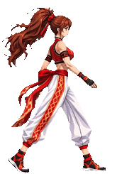
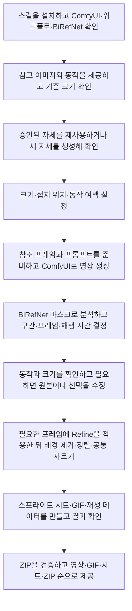

# ComfyUI Video to Sprite

[繁體中文](README.md) · [简体中文](README.zh-CN.md) · [日本語](README.ja.md) · **한국어** · [English](README.en.md)

캐릭터 참고 이미지를 업로드하고 동작을 설명하면 게임용 2D 애니메이션을 만들 수 있습니다. 기본적으로 GPT Image로 정지 시작 자세를 만들고 로컬 ComfyUI로 동작 영상을 생성합니다.

## 개요 및 예제

[반복 (`loop`) · 오른쪽을 향해 제자리 걷기](examples/right-facing-walk-loop/README.ko.md)

[시작 자세로 복귀 (`return_to_start`) · 오른쪽을 향한 지상 발차기](examples/right-facing-kick/README.ko.md)

[마지막 자세 유지 (`hold_end_pose`) · 피격 후 뒤로 넘어지기](examples/right-facing-knockdown/README.ko.md)

## 설치 및 초기 설정

이 저장소 URL을 Codex에 주고 루트에 있는 `comfyui-video2sprite` 스킬을 설치해 달라고 요청합니다. Python 3.10 이상과 터미널에서 실행할 수 있는 FFmpeg 및 ffprobe를 준비합니다. 로컬 ComfyUI를 시작합니다(기본 주소 `http://127.0.0.1:8188`). 실행 가능한 영상 생성 워크플로와 PNG를 출력하는 이미지 편집 워크플로를 API 형식 JSON으로 내보내고 작업 폴더 위치와 함께 Codex에 전달합니다. 배경 제거는 내장 BiRefNet 워크플로를 사용합니다. `birefnet.safetensors`를 `ComfyUI/models/background_removal/`에 넣습니다.

[모델 다운로드](https://huggingface.co/Comfy-Org/BiRefNet/blob/main/background_removal/birefnet.safetensors) · [ComfyUI 배경 제거 안내](https://docs.comfy.org/tutorials/utility/remove-background-birefnet) · [워크플로 설정 (繁體中文)](references/setup.md)

## 첫 애니메이션 만들기

> 업로드한 참고 이미지로 `$comfyui-video2sprite`를 사용해 오른쪽을 향한 지상 발차기를 만들어 주세요. 기준 크기는 256입니다.

캐릭터 기준 크기는 128, 256, 512 또는 원하는 값으로 지정합니다. 지정하지 않으면 Codex가 확인합니다. 적합한 승인 자세를 재사용하거나 새 자세를 생성해 확인합니다. 걷기는 오른쪽 정측면, 발차기는 오른쪽을 향한 사선 전투 자세를 기본으로 사용합니다. 확인한 자세로 요청한 동작 영상을 바로 생성하며, 첫 영상은 기본 약 3초입니다. 대기 애니메이션을 원하면 직접 요청합니다. 같은 대화에서 다음 동작을 설명하면 캐릭터 크기와 적합한 자세를 이어서 사용합니다.

## 작업 흐름 및 ZIP 구성

동작당 ZIP 하나에 캐릭터 참고 이미지, 자세 이미지, 실제 영상 입력 이미지와 프롬프트, 원본 영상, 모든 원본 프레임, 선택 프레임, 투명 PNG, GIF 및 스프라이트 시트가 들어 있습니다. 개별 알파 마스크는 작업 폴더에 남습니다. 시작 자세로 복귀하는 지상 동작은 기본 약 1초, 25 FPS입니다. `variants/clean/animation.json`의 `playback.fps`와 `playback.sequence`를 읽어 0부터 시작하는 셀 번호 순서대로 재생합니다.

## 문제 해결

원본 영상, GIF, 스프라이트 시트를 차례로 비교합니다. 원본에서 동작이 누락되거나 캐릭터가 잘리면 영상 생성과 여백을 확인합니다. 원본에 있는 핵심 자세가 시트에서 빠졌다면 구간과 프레임 선택을 확인합니다. 자세가 모두 있는데 멈춘 듯 보이면 프레임별 시간을 확인합니다. 효과가 남거나 윤곽이 잘렸다면 같은 원본 프레임과 투명 결과를 비교하고 시간 또는 셀 번호를 알려 주세요.
