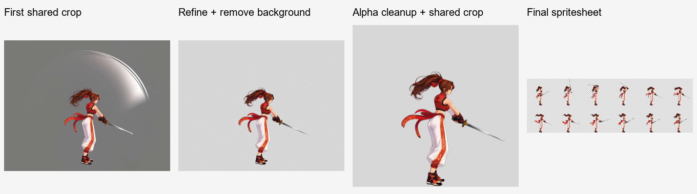

# ComfyUI Video to Sprite

[繁體中文](README.md) · [简体中文](README.zh-CN.md) · [日本語](README.ja.md) · [한국어](README.ko.md) · [English](README.en.md)

供 Codex 使用的角色動畫 Skill。上傳角色圖片、描述動作，即可透過本機 ComfyUI 製作透明背景動畫影格表及 GIF 預覽；也能提供已生成的影片，接續選幀與交付處理。

Codex 負責理解需求、準備提示詞與檢視結果；本機 Python 負責版面、縮放、等待任務、選幀、裁切、拼接及檢查；ComfyUI 負責圖片處理與影片生成。

對話、確認選項與交付說明會跟隨你使用或指定的語言；工作流提示詞依模型需要撰寫。

<table>
  <tr><th align="center">角色展示圖</th><th align="center">走路循環成品</th></tr>
  <tr>
    <td align="center"></td>
    <td align="center"><br>8 格 · 0.8 秒 · 透明背景</td>
  </tr>
</table>

- [循環動作：走路](examples/right-profile-walk/README.md)
- [返回起始動作：攻擊](examples/right-profile-attack/README.md)
- [保持結束姿態動作：死亡](examples/right-profile-death/README.md)
- [揮劍：保留實體武器並移除附帶特效](examples/right-profile-sword/README.md)

## 動作類型

- **循環動作**: 首尾銜接，可持續重播。
- **返回起始動作**: 完成一次動作後回到相同起始姿態；每次觸發播放一次。
- **保持結束姿態動作**: 完成一次動作後保持目標結束姿態。



從自然站立參考、固定演出版面、灰底影片到透明影格表，逐階段展示實際成果與素材重用方式。

## 複製這句話給 Codex

將下面整段貼給 Codex：

```text
請幫我安裝這個 Codex Skill：https://github.com/yuwechang/comfyui-video2sprite 。請依儲存庫的安裝指引完成安裝與環境檢查，缺少必要資訊時再詢問我。
```

Codex 會依 安裝與更新指引 下載安裝、檢查 Python 套件與 FFmpeg／ffprobe。缺少外部程式時，會詢問是否協助安裝。你不需要手動複製資料夾、設定安裝路徑或操作 Python。

## 你需要準備的東西

- 可存取本機檔案及 ComfyUI 的 Codex 環境。
- 已能正常執行的 ComfyUI、模型與節點；使用前先啟動 ComfyUI。
- API 格式的工作流 JSON：影片生成與圖片處理各一份。只處理既有影片時，先提供圖片工作流即可。

Skill 不隨附模型、節點、FFmpeg 或 ffprobe。環境與套件檢查交由 Codex 處理，只補上缺少的項目。

## 第一次使用

告訴 Codex 要把素材與成品放在哪個工作資料夾，提供工作流 JSON。它會先測試預設 ComfyUI 網址 `http://127.0.0.1:8188`；連不上才詢問實際網址，接著協助辨識節點並保存對應。

設定完成後，依下方「開始製作」在新對話提供角色圖片與需求；Codex 以選項或文字收集必要資訊。開工時會簡短說明製作順序與儲存位置：先展示姿態參考供確認，再完成 Idle，接著製作所選動作並交付。已有設定會沿用，參考圖有影響製作的歧義時才補問。

提供能以角色圖片生成動作影片，以及能依文字指示編輯圖片並輸出透明 PNG 的 API 工作流。Codex 會協助確認是否適用。可處理的解析度與影片長度取決於本機設備及工作流。

本專案實測使用 **MiniMax H3** 生成影片、**Qwen Image 2.1** 處理圖片。這是可參考的搭配；Skill 透過節點對應接入工作流，不綁定這些模型。模型權重、節點與 API 工作流由使用者準備，安裝 Skill 不會一併安裝它們。


## 開始製作

Skill 安裝並完成工作流設定後，開新對話、附上角色參考圖，輸入：

> 使用 `$comfyui-video2sprite`，替這個角色建立遊戲動畫。

**一個對話只處理一個角色。** 同角色的補充參考可留在原對話；第二個角色請另開新對話。單純上傳圖片不會自動開始製作。

首次會一起確認三項，已明確提供的內容不重問：

1. **姿態（可複選）**：一般／攻擊。攻擊指戰鬥待機架勢，不代表額外製作出招。
2. **其他動作（可複選，也可不選）**：走路／跑步／跳躍／死亡。
3. **角色基準大小**：128×128／256×256（建議）／512×512，也可自訂。這是成品角色的尺度基準，不是影片解析度。

**每個所選姿態都會自動製作 Idle（待機動畫），不需勾選。** 兩種姿態都選時，Idle 與所有勾選動作各做兩份；未選其他動作就只做 Idle。全部面朝右、正側視角，左向可由遊戲引擎鏡像。

先建立並確認姿態參考、共用尺度及站位，再完成各自的 Idle 動畫，其他動作由對應 Idle 延伸。最終共同裁切的格子可為長方形或因動作伸展超出基準框。製作清單、基準大小、素材與進度保存於工作資料夾，後續沿用，不反覆詢問。

交付後可輸入 **「建立新動作」**，依序選擇：

1. **姿態**：一般／攻擊，可複選。
2. **動作環境**：地面／空中，單選。
3. **動作描述**：自由文字。

地面動作以對應待機姿態為基準，可包含離地過程並保留完整演出；空中動作以空中姿態為基準，移動由遊戲引擎控制。已明確提供的選擇不重問。新姿態先建立 Idle；缺少空中基準時會先建立跳躍素材。兩姿態都選就各做一份，仍使用本對話角色。

選擇「跳躍」會交付上升、下落兩份動畫；後續空中動作可重用已建立的基準。

成品預設從 8 格開始，按動作需要調整。每個動作獨立交付：

- `spritesheet.png`：透明背景影格表，每格尺寸一致，依左至右、上至下排列。
- `preview.gif`：從最終影格表製作的透明 GIF 預覽。
- `animation.json`：成品尺寸、取樣與播放時間等資料。
- ZIP 素材包：保存上傳圖、姿態參考、影片輸入、來源影片、全部與選中影格、實際提示詞及成品。

匯入遊戲引擎時，請沿用隨附動畫資料的逐格播放時間，以保留動作節奏。

圖片與影片由本機 ComfyUI 執行。提示詞準備、對話與視覺檢視仍會使用 Codex 額度。

角色與裝備需保持清楚可見。額外特效與動態模糊會在影格整理時清理，但完全被遮住的肢體或裝備不保證能恢復。

成品會清理背景及多餘效果，保留自然的半透明邊緣，並以共同範圍裁切，維持動畫中的尺度與位置一致。

## 使用已有影片

提供影片並描述要保留的動作區間、播放時間與尺寸需求，即可交由 Codex 整理影格、去背並製作成品，不必先執行角色圖片的製作流程。

適用的影片應具備：

- 完整角色與所需動作，手腳、頭髮及配件沒有被畫面截斷。
- 簡單且可辨識的背景，與角色有足夠區別，避免複雜場景、字幕或遮擋物。
- 足夠清楚的動作影格，以供選取。

影片不必先留出本 Skill 的演出空間；裁切範圍依選中影格計算。背景可在不同影格略有色差，但複雜場景不屬於目前保證能處理的範圍。

若生成結果不滿意，可請 Codex 提供已準備的輸入圖與實際提示詞，自己在 ComfyUI 測試；取得合適影片後再提供給 Codex，接續後半流程。

## 本機資料與更新

工作流與節點對應存於工作資料夾的 `.local/`；任務中間資料在 `work/`，交付成品在 `outputs/`。它們與 Skill 安裝目錄分開，不需要隨 Skill 分發。

更新時也可以直接告訴 Codex：

```text
請依這個儲存庫的安裝與更新指引，更新 comfyui-video2sprite，保留我的工作流設定、素材與成品：https://github.com/yuwechang/comfyui-video2sprite
```
