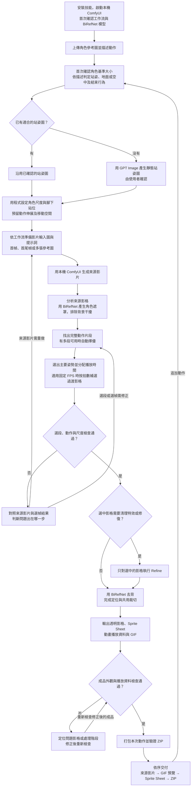

# ComfyUI Video to Sprite

上傳一張角色參考圖，描述想要的動作，就能製作遊戲用的 2D 角色動畫。以踢擊為例，技能會先用 GPT Image 準備一張靜態戰鬥站姿圖。確認後，這張圖會作為首幀，直接透過本機 ComfyUI 生成踢擊影片。

## 用途與成品

[回到起始姿態（`return_to_start`）範例：朝右地面踢擊](examples/right-facing-kick/README.md)

[循環（`loop`）範例：朝右原地走路](examples/right-facing-walk-loop/README.md)

[停在結束姿態（`hold_end_pose`）範例：受擊倒地](examples/right-facing-knockdown/README.md)

首次製作若未提供角色基準大小，Codex 會先詢問。以踢擊為例，採用朝右的斜側戰鬥站姿，結束行為是收腿後回到起始姿態。新站姿經確認後，程式會準備影片用的畫布，把角色尺度與腳下站位固定，再依動作範圍留出空間。這個範例用處理後的靜態戰鬥站姿當首幀，直接生成踢擊影片。只有使用者要求待機動畫時，才會生成 Idle 影片。

選幀前的角色遮罩用來排除背景干擾，讓程式專注分析角色動作。選幀後，再將選中的影格做成透明成品，並使用共用的裁切範圍保留各格的相對站位。

聊天中依序交付：

1. **來源影片**，可直接播放。
2. **GIF 預覽**，可預覽選幀後的動作與節奏。
3. **Sprite Sheet**，直接顯示在 GIF 下方。
4. **素材 ZIP**，提供一份下載連結。

ZIP 收錄這個動作實際使用的角色參考圖、GPT Image 站姿圖、影片生成輸入圖和提示詞，以及來源影片、全部來源影格、程式選中的影格、去背後的透明影格、GIF 和 Sprite Sheet。獨立 Alpha 遮罩留在工作目錄。

## 安裝與首次設定

### 1. 安裝 Codex 技能

把這個儲存庫的網址貼給 Codex，請它安裝根目錄的 `comfyui-video2sprite` 技能。

> 請從 https://github.com/yuwechang/comfyui-video2sprite 安裝 `comfyui-video2sprite` 技能。

### 2. 準備本機環境

- **Python 3.10 以上**，用來執行選幀、影像處理與打包。Codex 會檢查並協助安裝 `requirements.txt` 裡缺少的套件。
- **FFmpeg 與 ffprobe**，用來讀取影片資訊及拆幀。兩者都需要能從終端機呼叫。
- **本機 ComfyUI**，請先啟動。預設連線位址為 `http://127.0.0.1:8188`。如果使用不同位址，請一併提供給 Codex。

### 3. 準備 ComfyUI 工作流與去背模型

- **影片生成**：提供一份已能在你的 ComfyUI 執行、可接收角色圖片和提示詞的工作流，並匯出成 **API 格式的 JSON**。依工作流支援的方式使用首幀、首尾幀或多張參考圖。
- **影像編輯**：提供一份能接收圖片和編輯提示詞、輸出 PNG 的 API 格式工作流，供需要清除殘留特效時使用。初始站姿預設由 GPT Image 準備。
- **BiRefNet 去背**：下載 `birefnet.safetensors`，放到本機的 `ComfyUI/models/background_removal/`。技能會使用內建的去背工作流。若模型沒有出現在背景移除模型清單中，重新啟動 ComfyUI 後再檢查。[模型下載](https://huggingface.co/Comfy-Org/BiRefNet/blob/main/background_removal/birefnet.safetensors) · [ComfyUI 官方去背教學](https://docs.comfy.org/tutorials/utility/remove-background-birefnet)

首次使用時，將工作流 JSON 和要存放素材的工作資料夾交給 Codex。Codex 會檢查環境、確認輸入與輸出節點，並將設定保存在工作資料夾，供同一專案後續沿用。[工作流設定細節](references/setup.md)

## 第一次怎麼用

在 Codex 上傳角色參考圖，接著送出這句話：

> 將上傳的角色參考圖，用 `$comfyui-video2sprite` 做出朝右的地面踢擊。角色基準大小用 256。

角色基準大小可以用 128、256、512 或自訂邊長，用來決定角色在成品中的尺度。影片解析度和影格表的格子尺寸會依實際工作流與動作範圍決定。若開場沒寫基準大小，Codex 會先詢問。

Codex 會依動作準備站姿。踢擊使用朝右的斜側戰鬥站姿，走路等一般移動預設使用朝右的正側面站姿。看到站姿圖後，可直接回覆「採用，繼續製作」，或指出要改的地方。確認後會直接生成你要求的動作。首次影片預設約 3 秒，至少要有一次完整可用的演出。

### 再做一個動作

在同一個角色的對話中直接說：

> 再來我想要產生一個朝右的地面出拳動作。

Codex 會沿用角色基準大小，並重用適合新動作的站姿首幀。若新動作需要另一種站姿，會先準備新的首幀，再生成該動作。

## 流程與 ZIP 內容

生成影片後，程式用 BiRefNet 的角色遮罩分析動作，自動選取完整片段、挑出影格並分配播放時間。選中的影格若有重疊特效或色彩殘留，會先用 Refine 清理，再由 BiRefNet 去背。透明影格經定位與統一裁切後，會用來製作無限重播的 GIF 和 Sprite Sheet。

以一個踢擊為例，交付的一份 ZIP 會包含：

| 素材 | 內容 |
| --- | --- |
| 角色與站姿 | 原始角色參考圖、GPT Image 產生的靜態戰鬥站姿圖。 |
| 影片生成 | 實際送進工作流的首幀、尾幀或其他參考圖，以及提示詞和完整來源影片。 |
| 全部來源影格 | 從來源影片拆出的所有原始影格。 |
| 程式選中的影格 | 選中的原始影格，以及對應的來源格號和逐格播放時間。 |
| 透明成品影格 | 選中影格經必要清理、去背、定位與裁切後的透明 PNG。 |
| 預覽與影格表 | GIF 預覽 和 Sprite Sheet。 |

BiRefNet 產生的獨立 Alpha 遮罩保留在工作目錄。

地面返回起始姿態的動作，遊戲播放預設為 25 FPS、約 1 秒。從 ZIP 的 `variants/clean/animation.json` 讀取 `playback.fps` 與 `playback.sequence`，每拍依序取用指定的影格表格號，格號從 0 開始。程式在多拍的區間補入有姿勢變化的來源影格，近乎靜止時讓同一格連續顯示。GIF 使用同一份播放順序和節奏。

## 遇到問題怎麼辨認

先播放**來源影片**，再對照 **GIF** 和 **Sprite Sheet**，找出問題最早出現在哪一步。

| 看到的問題 | 怎麼確認 |
| --- | --- |
| **動作本身不對，或角色在影片裡被裁掉** | 查看來源影片。如果原本就缺少出招、收招，或腳已超出畫面，就要先檢查影片生成或輸入圖的演出空間。 |
| **來源動作完整，GIF 卻漏了關鍵姿勢** | 對照影格表。若來源中清楚可見的伸腿或收腿姿勢沒有出現在影格表，先檢查選段與選幀。 |
| **影格表有關鍵姿勢，但 GIF 看起來像卡住** | 檢查逐格播放時間。指出停頓出現在蓄勢、出招還是收招，方便對照來源節奏。 |
| **成品殘留特效、背景，或人物邊緣缺了一塊** | 對照 ZIP 裡同一格的原始影格和透明成品。指出具體位置，例如踢出的鞋尖或頭髮邊緣，方便檢查去背或 Refine。 |

回報時提供**來源影片的時間點**或 **Sprite Sheet 的格位**，再描述看到的差異。例如「來源影片有完整收腿，但 GIF 從伸腿直接跳回防守」。
