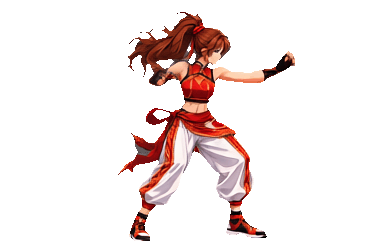
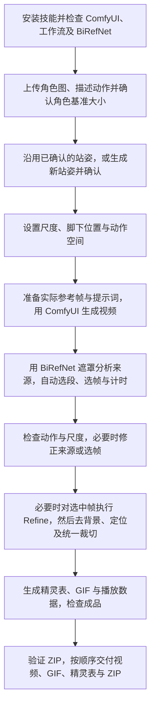

# ComfyUI Video to Sprite

[繁體中文](README.md) · **简体中文** · [日本語](README.ja.md) · [한국어](README.ko.md) · [English](README.en.md)

上传角色参考图并描述动作，即可制作游戏用的 2D 角色动画。技能默认用 GPT Image 准备静态站姿，再通过本机 ComfyUI 生成动作视频。

## 用途与成品

[循环 (`loop`) · 朝右原地行走](examples/right-facing-walk-loop/README.zh-CN.md)

[回到起始姿势 (`return_to_start`) · 朝右地面踢击](examples/right-facing-kick/README.zh-CN.md)

[停在结束姿势 (`hold_end_pose`) · 受击倒地](examples/right-facing-knockdown/README.zh-CN.md)

## 安装与首次设置

将本仓库网址交给 Codex，请它安装根目录的 `comfyui-video2sprite` 技能。准备 Python 3.10 以上、可从终端调用的 FFmpeg 和 ffprobe，并启动本机 ComfyUI（默认 `http://127.0.0.1:8188`）。把可运行的生成视频工作流和用于 Refine 的 PNG 图像编辑工作流导出为 API 格式 JSON，连同工作目录交给 Codex。技能内置 BiRefNet 去背景工作流，将 `birefnet.safetensors` 放在 `ComfyUI/models/background_removal/`。

[模型下载](https://huggingface.co/Comfy-Org/BiRefNet/blob/main/background_removal/birefnet.safetensors) · [ComfyUI 去背景指南](https://docs.comfy.org/tutorials/utility/remove-background-birefnet) · [工作流设置 (繁體中文)](references/setup.md)

## 第一次使用

> 将上传的角色参考图用 `$comfyui-video2sprite` 制作朝右地面踢击，角色基准大小 256。

角色基准大小可选 128、256、512 或自定义。未指定时 Codex 会询问。符合动作的已确认站姿可直接沿用，否则由 GPT Image 生成并请你确认。普通移动默认朝右正侧面，踢击使用朝右的斜侧战斗姿势。确认后直接生成目标动作，首次视频默认约 3 秒。仅在明确要求待机动画时才生成 Idle 视频。追加动作时直接描述新动作，沿用角色大小和适合的站姿。

## 流程与 ZIP 内容

每个动作交付一个 ZIP，包含原始角色参考图、姿势图、实际视频输入与提示词、来源视频、全部原始帧、程序选中的帧、透明 PNG、GIF 和精灵表。独立 Alpha 遮罩留在工作目录。返回起始姿势的地面动作默认约 1 秒、25 FPS，引擎可以读取 `variants/clean/animation.json` 的 `playback.fps` 和 `playback.sequence`，按从 0 开始的格号播放。

## 问题排查

先看来源视频，再对比 GIF 和精灵表。来源中动作不完整或出画时检查视频生成与留白。来源动作完整但 GIF 漏了关键姿势时检查选段与选帧。姿势齐全却出现不自然的停顿时检查逐帧时间。边缘缺损或残留特效时对比同一原始帧与透明成品，并报告时间点或格位。
