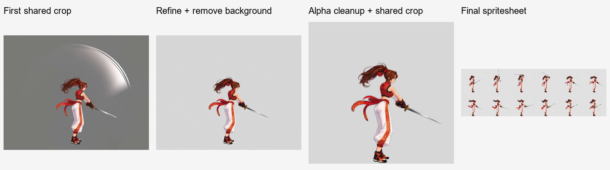

# ComfyUI Video to Sprite

[繁體中文](README.md) · [简体中文](README.zh-CN.md) · [日本語](README.ja.md) · [한국어](README.ko.md) · [English](README.en.md)

供 Codex 使用的角色动画 Skill。上传角色图片、描述动作，即可通过本机 ComfyUI 制作透明背景动画精灵图集及 GIF 预览；也能提供已经生成的视频，继续选帧与交付处理。

Codex 负责理解需求、准备提示词与检查结果；本机 Python 负责布局、缩放、等待任务、选帧、裁剪、拼接及检查；ComfyUI 负责图片处理与视频生成。对话、确认选项与交付说明会使用你当前使用或指定的语言；工作流提示词按模型需要编写。

<table>
  <tr><th>角色展示图</th><th>行走循环成品</th></tr>
  <tr>
    <td align="center"></td>
    <td align="center"><br>8 帧 · 0.8 秒 · 透明背景</td>
  </tr>
</table>

- [循环动作：行走](examples/right-profile-walk/README.zh-CN.md)
- [返回起始动作：攻击](examples/right-profile-attack/README.zh-CN.md)
- [保持结束姿态动作：死亡](examples/right-profile-death/README.zh-CN.md)
- [挥剑：保留实体武器并移除附带特效](examples/right-profile-sword/README.zh-CN.md)

## 动作类型

- **循环动作**: 首尾衔接，可持续重播。
- **返回起始动作**: 完成一次动作后回到相同起始姿态；每次触发播放一次。
- **保持结束姿态动作**: 完成一次动作后保持目标结束姿态。



从自然站立参考、固定动作画布、灰底视频到透明精灵图集，逐阶段展示实际成果与素材复用方式。

## 复制这段话给 Codex

```text
请帮我安装这个 Codex Skill：https://github.com/yuwechang/comfyui-video2sprite 。请依照仓库的安装指南完成安装与环境检查，缺少必要信息时再询问我。
```

Codex 会依照安装与更新指南下载安装，检查 Python 包和 FFmpeg／ffprobe。缺少外部程序时，会询问是否协助安装。你不需要手动复制文件夹、设置安装路径或操作 Python。

## 你需要准备的内容

- 能访问本机文件与 ComfyUI 的 Codex 环境。
- 能正常运行的 ComfyUI、模型与节点；使用前先启动 ComfyUI。
- API 格式的工作流 JSON：视频生成与图片处理各一份。只处理已有视频时，先提供图片工作流即可。

Skill 不附带模型、节点、FFmpeg 或 ffprobe。环境和依赖检查交给 Codex，只补充缺少的项目。

## 首次使用

告诉 Codex 存放素材与成品的工作文件夹，并提供工作流 JSON。它会先测试默认 ComfyUI 地址 `http://127.0.0.1:8188`；连接失败才询问实际地址，接着协助识别节点并保存映射。

设置后按下方“开始制作”在新对话提供角色图片与需求；Codex 用选项或文字收集必要信息。开工时会简短说明制作顺序与保存位置：先展示姿态参考供确认，再完成 Idle，接着制作所选动作并交付。已有设置会沿用，参考图有影响制作的歧义时才补问。

提供能以角色图片生成动作视频，以及能按文字指示编辑图片并输出透明 PNG 的 API 工作流。Codex 会协助确认是否适用。分辨率与视频长度取决于本机设备及工作流。

本项目实测使用 **MiniMax H3** 生成视频、**Qwen Image 2.1** 处理图片。这是可参考的组合；Skill 通过节点映射接入工作流，不绑定这些模型。模型权重、节点与 API 工作流由用户准备，安装 Skill 不会同时安装它们。


## 开始制作

安装 Skill 并完成工作流设置后，在新对话附上角色参考图，输入：

> 使用 `$comfyui-video2sprite`，为这个角色建立游戏动画。

**一个对话只处理一个角色。** 同角色补充参考可留在原对话，第二个角色请另开新对话。单纯上传图片不会自动开始制作。

首次会一起确认三项，已明确提供的内容不再询问：

1. **姿态（可多选）**：一般／攻击。攻击指战斗待机架势，不代表额外制作出招。
2. **其他动作（可多选，也可不选）**：走路／跑步／跳跃／死亡。
3. **角色基准大小**：128×128／256×256（推荐）／512×512，也可自定义。这是成品角色的尺度基准，不是视频分辨率。

**每个所选姿态都会自动制作 Idle（待机动画），无需勾选。** 两种姿态都选时，Idle 与所有勾选动作各做两份；不选其他动作就只做 Idle。全部朝右、正侧视角，左向可由游戏引擎镜像。

先建立并确认姿态参考、共用尺度与站位，完成各自的 Idle 动画，再从对应 Idle 延伸其他动作。最终共同裁切的格子可以是长方形，也可能因动作伸展超出基准框。清单、基准大小、素材与进度保存在工作文件夹，后续沿用，不反复询问。

交付后输入 **“建立新動作”**（或直接要求追加动画），依次选择：

1. **姿态**：一般／攻击，可多选。
2. **动作环境**：地面／空中，单选。
3. **动作描述**：自由文字。

地面动作以对应待机姿态为基准，可包含离地过程并保留完整演出；空中动作以空中姿态为基准，移动由游戏引擎控制。明确提供的选择不重问。新姿态先建立 Idle，缺少空中基准时先建立跳跃素材。两姿态都选就各做一份，仍使用本对话角色。

选择“跳跃”会交付上升、下落两份动画；后续空中动作可复用已有基准。

帧数按动作需要选取，兼顾动作完整性与节奏；单次动作可自动调整张数。每个动作独立交付：

- `spritesheet.png`：透明背景精灵图集，每格尺寸一致，按从左到右、从上到下排列。
- `preview.gif`：由最终图集制作的透明 GIF 预览。
- `animation.json`：成品尺寸、采样与播放时间等数据。
- ZIP 素材包：上传图、姿态参考、视频输入、源视频、全部帧与选中帧、实际提示词及成品。

导入游戏引擎时，请沿用随附动画数据的逐帧播放时间，以保留动作节奏。

图片和视频由本机 ComfyUI 处理。提示词准备、对话与视觉检查仍会使用 Codex 额度。

角色与装备需清楚可见。额外特效与动态模糊会在整理帧时清理，但完全被遮住的肢体或装备不保证能恢复。

成品会清理背景与多余效果，保留自然半透明边缘，并按共同范围裁切，保持动画中的尺度与位置一致。

## 使用已有视频

提供视频并描述要保留的动作区间、播放时间与尺寸要求，即可由 Codex 整理帧、去背并制作成品，无需先执行角色图片的制作流程。

适用视频应具备：

- 完整的角色与所需动作，手脚、头发及配件没有被画面截断。
- 简单、可辨识且与角色有足够区别的背景，避免复杂场景、字幕和遮挡物。
- 足够清晰、可供选取的动作帧。

视频不必预先留出本 Skill 的动作空间；裁剪范围按选中帧计算。不同帧的背景可以略有色差，但复杂场景不属于目前保证支持的范围。

如果生成结果不满意，可请 Codex 提供已准备的输入图与实际提示词，自己在 ComfyUI 测试；取得合适视频后再提供给 Codex，继续后续处理。

## 本机数据与更新

工作流和节点映射存于工作文件夹的 `.local/`；任务中间数据在 `work/`，交付成品在 `outputs/`。它们与 Skill 安装目录分开，不需要随 Skill 分发。

更新时可告诉 Codex：

```text
请依照这个仓库的安装与更新指南，更新 comfyui-video2sprite，保留我的工作流配置、素材与成品：https://github.com/yuwechang/comfyui-video2sprite
```
