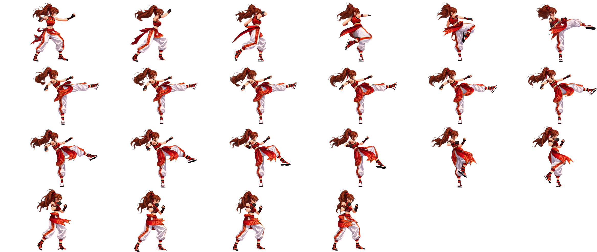

# Return to the starting pose (`return_to_start`) · Right-facing ground kick

[繁體中文](README.md) · [简体中文](README.zh-CN.md) · [日本語](README.ja.md) · [한국어](README.ko.md) · **English**

[Back to home](../../README.en.md)

## Example prompt

> Use `$comfyui-video2sprite` to make a right-facing ground kick from my uploaded character reference. Use a base size of 256.

The kick starts from the approved GPT Image combat stance at a base size of 256. The program kept eight main poses and added 14 transition frames from 73 source frames. In game, one trigger plays one kick before returning to the combat idle. The ZIP records the cell order in `playback.sequence`.

[Original character reference](character-reference.png) · [GPT Image standing pose](combat-stance.png) · [Actual first frame sent to ComfyUI](video-input.png)

## Deliverables

1. **Source video**

   [Source video (MP4)](https://cdn.jsdelivr.net/gh/yuwechang/comfyui-video2sprite@main/examples/right-facing-kick/source-compatible.mp4)

2. **GIF preview**

   

3. **Sprite sheet**

   

4. **Asset ZIP**

   [Asset ZIP](kick-assets.zip)
