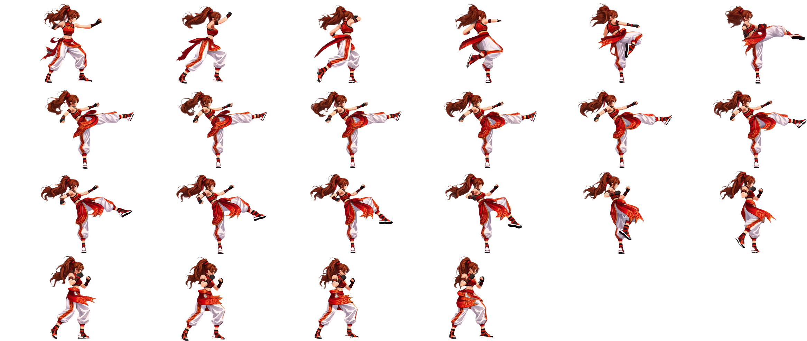

# 開始姿勢に戻る (`return_to_start`) · 右向きの地上キック

[繁體中文](README.md) · [简体中文](README.zh-CN.md) · **日本語** · [한국어](README.ko.md) · [English](README.en.md)

[ホームに戻る](../../README.ja.md)

## 入力例

> アップロードした参考画像から `$comfyui-video2sprite` で右向きの地上キックを作ってください。基準サイズは 256 です。

承認済みの GPT Image の構えと基準サイズ 256 を使用します。元の 73 フレームから主要な 8 姿勢を選び、移行用に 14 フレームを追加しました。ゲームでは操作ごとに一度再生し、構えに戻ります。再生するセル番号は ZIP 内の `playback.sequence` に記録されています。

[元のキャラクター参考画像](character-reference.png) · [GPT Image の立ち姿](combat-stance.png) · [ComfyUI に渡した開始フレーム](video-input.png)

## 成果物

1. **元動画**

   [元動画 (MP4)](https://cdn.jsdelivr.net/gh/yuwechang/comfyui-video2sprite@main/examples/right-facing-kick/source-compatible.mp4)

2. **GIF プレビュー**

   

3. **スプライトシート**

   

4. **素材 ZIP**

   [素材 ZIP](kick-assets.zip)
