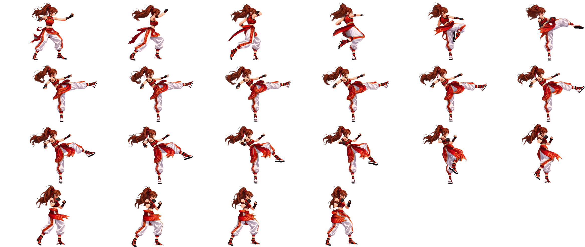

# 시작 자세로 복귀 (`return_to_start`) · 오른쪽을 향한 지상 발차기

[繁體中文](README.md) · [简体中文](README.zh-CN.md) · [日本語](README.ja.md) · **한국어** · [English](README.en.md)

[홈으로 돌아가기](../../README.ko.md)

## 요청 예시

> 업로드한 참고 이미지로 `$comfyui-video2sprite`를 사용해 오른쪽을 향한 지상 발차기를 만들어 주세요. 기준 크기는 256입니다.

승인한 GPT Image 전투 자세와 기준 크기 256을 사용합니다. 원본 73프레임에서 핵심 자세 8개를 선택하고 전환 프레임 14개를 추가했습니다. 게임에서는 한 번 재생한 뒤 전투 대기 상태로 돌아갑니다. ZIP의 `playback.sequence`에 셀 재생 순서가 기록됩니다.

[캐릭터 원본 참고 이미지](character-reference.png) · [GPT Image 시작 자세](combat-stance.png) · [ComfyUI에 사용한 첫 프레임](video-input.png)

## 결과물

1. **원본 영상**

   [원본 영상 (MP4)](https://cdn.jsdelivr.net/gh/yuwechang/comfyui-video2sprite@main/examples/right-facing-kick/source-compatible.mp4)

2. **GIF 미리보기**

   

3. **스프라이트 시트**

   

4. **소재 ZIP**

   [소재 ZIP](kick-assets.zip)
