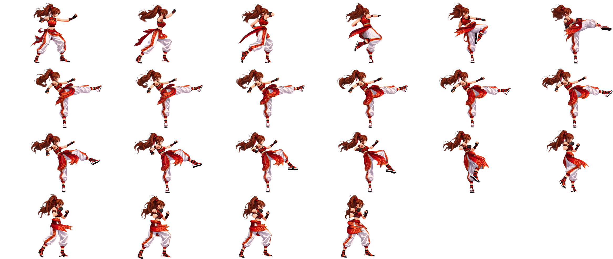

# 回到起始姿態（`return_to_start`）· 朝右地面踢擊

把插畫角色做成 2D 遊戲用的地面踢擊，角色基準大小為 256。

角色從戰鬥站姿起腳，朝右踢出，收腿落地後回到可接下一個動作的戰鬥姿態。遊戲中每次觸發播放一次，播完接回角色的戰鬥待機。GIF 在聊天或文件中持續重播，方便看清動作。

## 使用者怎麼說

> 將上傳的角色參考圖，用 `$comfyui-video2sprite` 做出朝右的地面踢擊。角色基準大小用 256。

從角色參考圖生成靜態戰鬥站姿。站姿確認後，程式補足踢擊所需的演出空間，將版面處理後的圖片直接送入 ComfyUI 作為踢擊影片首幀。

[原始角色參考圖](character-reference.png) · [GPT Image 戰鬥站姿](combat-stance.png) · [實際送入 ComfyUI 的首幀](video-input.png)

## 交付成果

1. **來源影片**

   [播放原始踢擊影片](source.mp4)

2. **無特效 GIF**

   

3. **Sprite Sheet**

   

4. **素材 ZIP**

   [下載踢擊素材 ZIP](kick-assets.zip)

來源影片中的白色尾跡可與成品對照。程式從 73 張來源影格選出 8 個主要姿勢，再從有變化的區間補入 14 格。選中的 22 格經 Refine 與 BiRefNet 處理後，輸出透明成品。

**遊戲引擎中的播放節奏**

遊戲引擎可依專案需求設定播放速率。素材 ZIP 裡的 `variants/clean/animation.json` 提供 `playback.sequence`，可依序讀取其中的 Sprite Sheet 格號（從 0 開始）。
