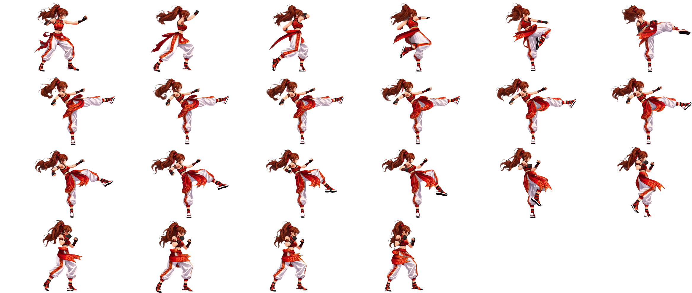

# 回到起始姿势 (`return_to_start`) · 朝右地面踢击

[繁體中文](README.md) · **简体中文** · [日本語](README.ja.md) · [한국어](README.ko.md) · [English](README.en.md)

[ComfyUI Video to Sprite](../../README.zh-CN.md)

## 使用示例

> 将上传的角色参考图用 `$comfyui-video2sprite` 制作朝右地面踢击，角色基准大小 256。

从已确认的 GPT Image 战斗站姿开始，基准为 256。从 73 张来源帧中选出 8 个主要姿势，再补入 14 张过渡帧。游戏每次触发播放一次，收腿后接回战斗待机。ZIP 中的 `playback.sequence` 提供播放格号。

[原始角色参考图](character-reference.png) · [GPT Image 站姿](combat-stance.png) · [实际视频首帧](video-input.png)

## 交付成果

1. **来源视频**

   [来源视频 (MP4)](https://cdn.jsdelivr.net/gh/yuwechang/comfyui-video2sprite@ae6133f/examples/right-facing-kick/source.mp4)

2. **GIF 预览**

   

3. **精灵表**

   

4. **素材 ZIP**

   [素材 ZIP](kick-assets.zip)
