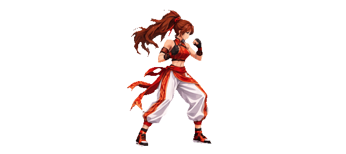
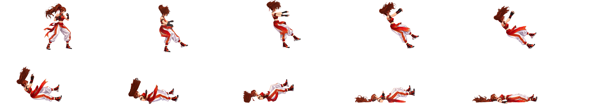

# Hold the final pose (`hold_end_pose`) · Backward knockdown

[繁體中文](README.md) · [简体中文](README.zh-CN.md) · [日本語](README.ja.md) · [한국어](README.ko.md) · **English**

[Back to home](../../README.en.md)

## Example prompt

> Next, make a knockdown. Start in a right-facing combat guard, fall backward and remain on the ground.

This example reuses the approved combat pose and base size of 256. The program selected 10 of 73 frames and used Refine and BiRefNet to clean up the shockwave and remove the background. In game, play once and hold the last frame until the state changes.

[Original character reference](../right-facing-kick/character-reference.png) · [GPT Image standing pose](../right-facing-kick/combat-stance.png) · [Actual first frame sent to ComfyUI](../right-facing-kick/video-input.png)

## Deliverables

1. **Source video**

   [Source video (MP4)](source.mp4)

2. **GIF preview**

   

3. **Sprite sheet**

   

4. **Asset ZIP**

   [Asset ZIP](knockdown-assets.zip)
