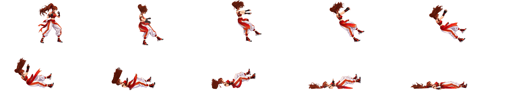

# 終了姿勢を保持する (`hold_end_pose`) · 被弾して後方に倒れる

[繁體中文](README.md) · [简体中文](README.zh-CN.md) · **日本語** · [한국어](README.ko.md) · [English](README.en.md)

[ComfyUI Video to Sprite](../../README.ja.md)

## 入力例

> 次は被弾して倒れる動作を作ってください。右向きの構えから後ろに倒れ、地面で最後の姿勢を保持します。

承認済みの構えと基準サイズ 256 を再利用しました。73 フレームから 10 フレームを選び、Refine と BiRefNet で衝撃波と背景を除去しました。ゲームでは一度再生し、状態が変わるまで最後のフレームを表示します。

[元のキャラクター参考画像](../right-facing-kick/character-reference.png) · [GPT Image の立ち姿](../right-facing-kick/combat-stance.png) · [ComfyUI に渡した開始フレーム](../right-facing-kick/video-input.png)

## 成果物

1. **元動画**

   [元動画 (MP4)](source.mp4)

2. **GIF プレビュー**

   

3. **スプライトシート**

   

4. **素材 ZIP**

   [素材 ZIP](knockdown-assets.zip)
