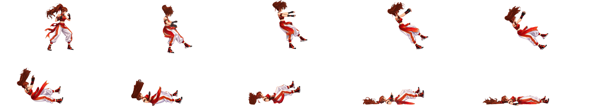

# 마지막 자세 유지 (`hold_end_pose`) · 피격 후 뒤로 넘어지기

[繁體中文](README.md) · [简体中文](README.zh-CN.md) · [日本語](README.ja.md) · **한국어** · [English](README.en.md)

[홈으로 돌아가기](../../README.ko.md)

## 요청 예시

> 다음은 피격 후 넘어지는 동작입니다. 오른쪽을 향한 전투 자세에서 뒤로 넘어지고 바닥에 누운 자세를 유지해 주세요.

승인한 전투 자세와 기준 크기 256을 재사용합니다. 원본 73프레임에서 10프레임을 선택하고 Refine과 BiRefNet으로 충격파와 배경을 제거했습니다. 게임에서는 한 번 재생하고 상태가 바뀔 때까지 마지막 프레임을 유지합니다.

[캐릭터 원본 참고 이미지](../right-facing-kick/character-reference.png) · [GPT Image 시작 자세](../right-facing-kick/combat-stance.png) · [ComfyUI에 사용한 첫 프레임](../right-facing-kick/video-input.png)

## 결과물

1. **원본 영상**

   [브라우저에서 MP4 재생](https://cdn.jsdelivr.net/gh/yuwechang/comfyui-video2sprite@main/examples/right-facing-knockdown/source-compatible.mp4)

2. **GIF 미리보기**

   

3. **스프라이트 시트**

   

4. **소재 ZIP**

   [소재 ZIP](knockdown-assets.zip)
