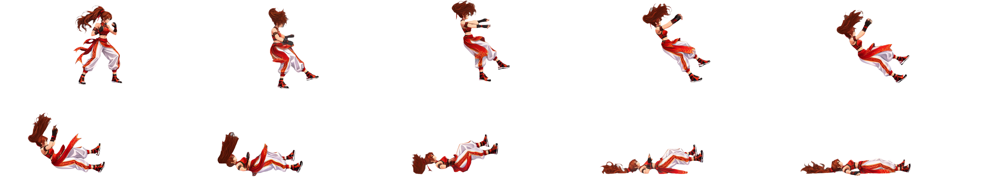

# 停在結束姿態（`hold_end_pose`）· 受擊倒地

**繁體中文** · [简体中文](README.zh-CN.md) · [日本語](README.ja.md) · [한국어](README.ko.md) · [English](README.en.md)

[回到主頁](../../README.md)

沿用踢擊範例的角色與 256 基準大小。角色從朝右的戰鬥站姿開始，受擊後失去平衡、向後倒地，最後維持仰躺姿勢。

## 使用者怎麼說

> 再來我想要產生一個地面受擊倒地動作。角色從朝右的戰鬥站姿開始，向後倒下，落地後維持倒地姿勢。

這次直接沿用已確認的戰鬥站姿與影片首幀。[角色參考圖](../right-facing-kick/character-reference.png) · [GPT Image 戰鬥站姿](../right-facing-kick/combat-stance.png) · [影片首幀](../right-facing-kick/video-input.png)

## 交付成果

1. **來源影片**

   [開啟原始倒地 MP4](source.mp4)

2. **GIF 預覽**

   

3. **Sprite Sheet**

   

4. **素材 ZIP**

   [下載受擊倒地素材 ZIP](knockdown-assets.zip)

程式從 73 張來源影格中選出 10 格，保留受擊、失衡、落地及最後的仰躺姿勢。選中的影格經 Refine 與 BiRefNet 清除白色衝擊波並去背。

遊戲中每次觸發只播放一次，播完後保持最後一格，直到遊戲切換狀態。GIF 會持續重播，方便檢查整段動作。
