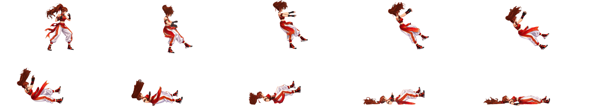

# 停在结束姿势 (`hold_end_pose`) · 受击倒地

[繁體中文](README.md) · **简体中文** · [日本語](README.ja.md) · [한국어](README.ko.md) · [English](README.en.md)

[返回主页](../../README.zh-CN.md)

## 使用示例

> 再制作一个受击倒地动作，从朝右战斗站姿向后倒下，落地后保持倒地姿势。

沿用相同角色、已确认的战斗站姿和 256 基准。程序从 73 张来源帧中选出 10 张，经 Refine 和 BiRefNet 清理冲击波并去背景。游戏播放一次后保持最后一帧，直到状态切换。

[原始角色参考图](../right-facing-kick/character-reference.png) · [GPT Image 站姿](../right-facing-kick/combat-stance.png) · [实际视频首帧](../right-facing-kick/video-input.png)

## 交付成果

1. **来源视频**

   [来源视频 (MP4)](source.mp4)

2. **GIF 预览**

   

3. **精灵表**

   

4. **素材 ZIP**

   [素材 ZIP](knockdown-assets.zip)
