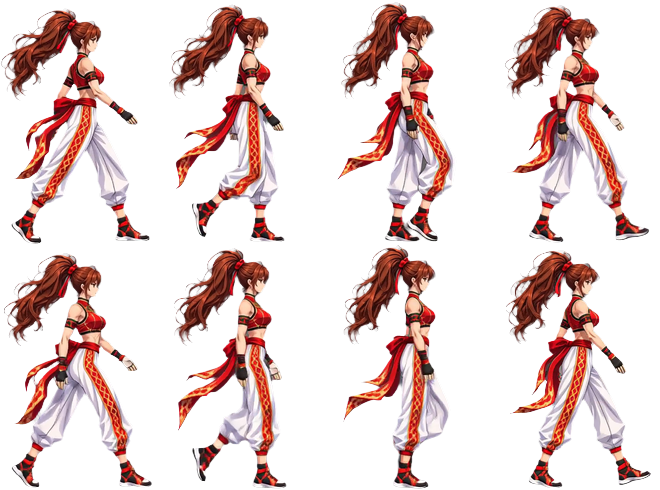

# Loop (`loop`) · Right-facing walk in place

[繁體中文](README.md) · [简体中文](README.zh-CN.md) · [日本語](README.ja.md) · [한국어](README.ko.md) · **English**

[Back to home](../../README.en.md)

## Example prompt

> Use `$comfyui-video2sprite` to make a right-facing walk-in-place loop from my uploaded character reference. Use a base size of 256.

The same illustrated character uses a base size of 256 and a GPT Image side-profile starting pose. The program found two complete cycles in 73 source frames, chose the second for its closer seam, and selected eight frames. In-game playback loops from the last frame to the first.

[Original character reference](../right-facing-kick/character-reference.png) · [GPT Image standing pose](standing-pose.png) · [Actual first frame sent to ComfyUI](video-input.png)

## Deliverables

1. **Source video**

   [Source video (MP4)](source.mp4)

2. **GIF preview**

   

3. **Sprite sheet**

   

4. **Asset ZIP**

   [Asset ZIP](walk-assets.zip)
