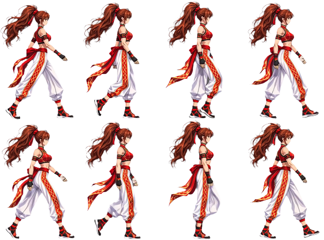

# ループ (`loop`) · 右向きのその場歩き

[繁體中文](README.md) · [简体中文](README.zh-CN.md) · **日本語** · [한국어](README.ko.md) · [English](README.en.md)

[ホームに戻る](../../README.ja.md)

## 入力例

> アップロードした参考画像から `$comfyui-video2sprite` で右向きのその場歩きループを作ってください。基準サイズは 256 です。

同じキャラクターと基準サイズ 256 を使い、GPT Image の横向きの立ち姿から始めます。元の 73 フレームから完全な周期を 2 つ検出し、継ぎ目の差が小さい 2 つ目から 8 フレームを選びました。ゲームでは最後から最初に戻って繰り返します。

[元のキャラクター参考画像](../right-facing-kick/character-reference.png) · [GPT Image の立ち姿](standing-pose.png) · [ComfyUI に渡した開始フレーム](video-input.png)

## 成果物

1. **元動画**

   [元動画 (MP4)](source.mp4)

2. **GIF プレビュー**

   

3. **スプライトシート**

   

4. **素材 ZIP**

   [素材 ZIP](walk-assets.zip)
