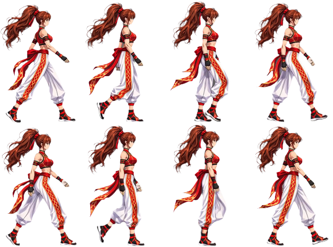

# 반복 (`loop`) · 오른쪽을 향해 제자리 걷기

[繁體中文](README.md) · [简体中文](README.zh-CN.md) · [日本語](README.ja.md) · **한국어** · [English](README.en.md)

[ComfyUI Video to Sprite](../../README.ko.md)

## 요청 예시

> 업로드한 참고 이미지로 `$comfyui-video2sprite`를 사용해 오른쪽을 향한 제자리 걷기 루프를 만들어 주세요. 기준 크기는 256입니다.

같은 캐릭터와 기준 크기 256을 사용하며 GPT Image의 오른쪽 측면 자세로 시작합니다. 원본 73프레임에서 두 개의 완전한 주기를 찾았고 이음새가 더 자연스러운 두 번째 주기에서 8프레임을 골랐습니다. 게임에서는 마지막 프레임에서 첫 프레임으로 이어 반복합니다.

[캐릭터 원본 참고 이미지](../right-facing-kick/character-reference.png) · [GPT Image 시작 자세](standing-pose.png) · [ComfyUI에 사용한 첫 프레임](video-input.png)

## 결과물

1. **원본 영상**

   [원본 영상 (MP4)](source.mp4)

2. **GIF 미리보기**

   

3. **스프라이트 시트**

   

4. **소재 ZIP**

   [소재 ZIP](walk-assets.zip)
