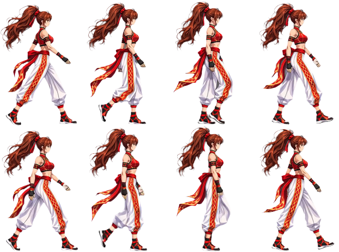

# 循環（`loop`）· 朝右原地走路

把踢擊範例的同一個插畫角色做成 2D 遊戲用的原地走路動畫，角色基準大小為 256。左右腳各走一步是一輪。遊戲可在角色持續移動時循環播放步伐，角色在場景中的位移由引擎控制。

## 使用者怎麼說

> 將上傳的角色參考圖，用 `$comfyui-video2sprite` 做出朝右 90° 的原地走路循環。角色基準大小用 256。

用 GPT Image 準備朝右的正側面一般站姿。確認後，程式設定角色尺度與腳下站位，再將準備好的首幀送入 ComfyUI 生成走路影片。

[原始角色參考圖](../right-facing-kick/character-reference.png) · [GPT Image 一般站姿](standing-pose.png) · [實際送入 ComfyUI 的首幀](video-input.png)

## 交付成果

1. **來源影片**

   [開啟原始走路 MP4](source.mp4)

2. **GIF 預覽**

   

3. **Sprite Sheet**

   

4. **素材 ZIP**

   [下載原地走路素材 ZIP](walk-assets.zip)

程式從 73 張來源影格中找到兩個完整循環，選擇首尾較接近的第二段，從中取出 8 格並去背。影格表保留左右腳交替落地與擺動的順序。遊戲依序播放 8 格，再由最後一格接回第一格。
