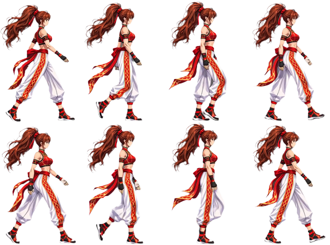

# 循环 (`loop`) · 朝右原地行走

[繁體中文](README.md) · **简体中文** · [日本語](README.ja.md) · [한국어](README.ko.md) · [English](README.en.md)

[返回主页](../../README.zh-CN.md)

## 使用示例

> 将上传的角色参考图用 `$comfyui-video2sprite` 制作朝右 90° 的原地走路循环，角色基准大小 256。

沿用同一个插画角色及 256 基准，从 GPT Image 生成的一般站姿开始。程序从 73 张来源帧中找到两个完整循环，选择首尾较接近的第二轮并取出 8 帧。游戏持续播放，最后一帧接回第一帧。

[原始角色参考图](../right-facing-kick/character-reference.png) · [GPT Image 站姿](standing-pose.png) · [实际视频首帧](video-input.png)

## 交付成果

1. **来源视频**

   [来源视频 (MP4)](source.mp4)

2. **GIF 预览**

   

3. **精灵表**

   

4. **素材 ZIP**

   [素材 ZIP](walk-assets.zip)
