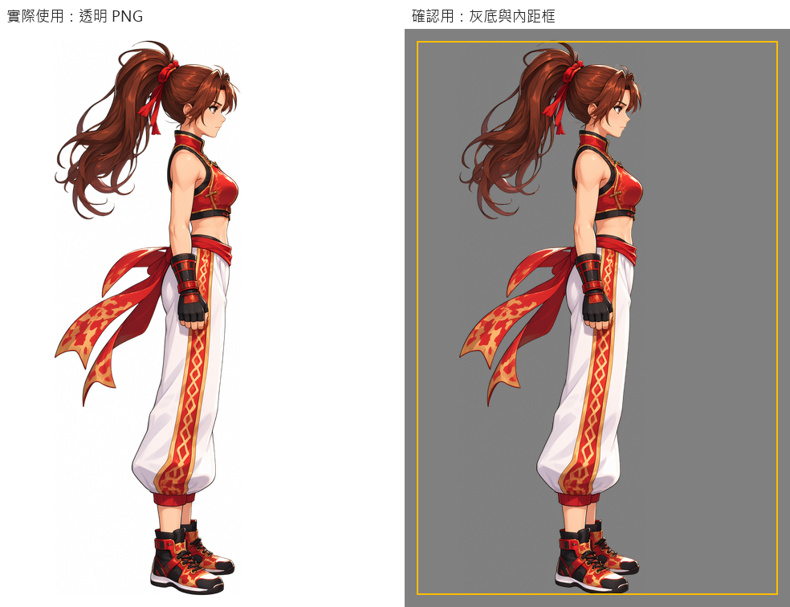
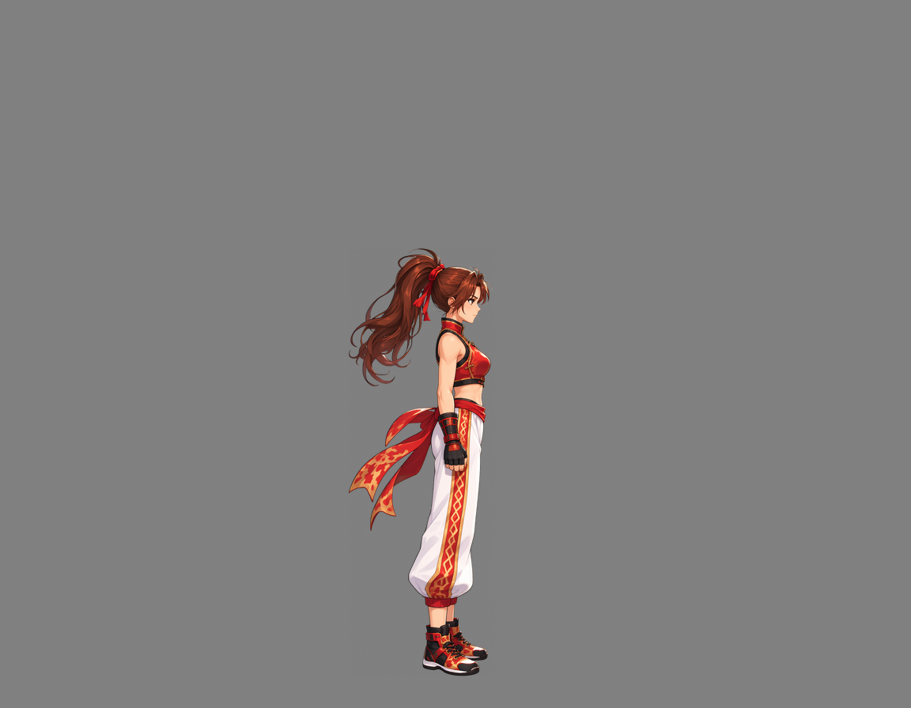
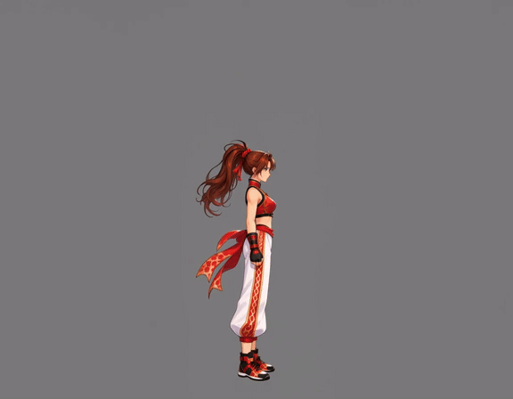
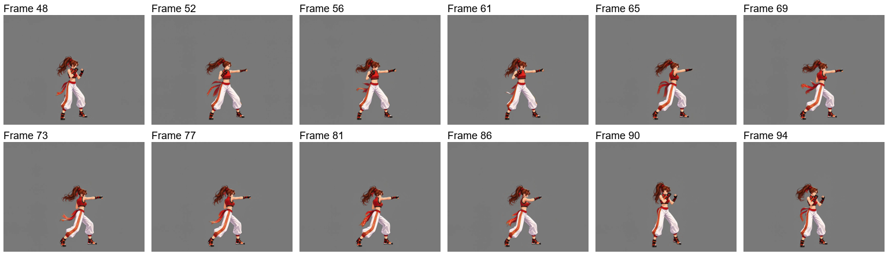
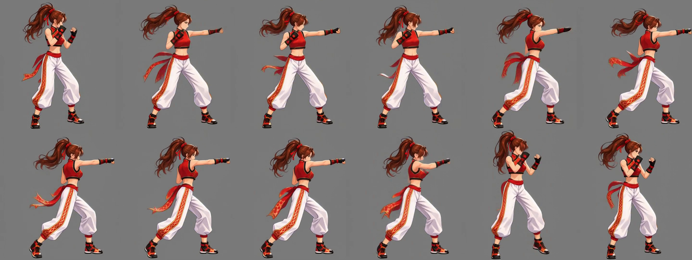
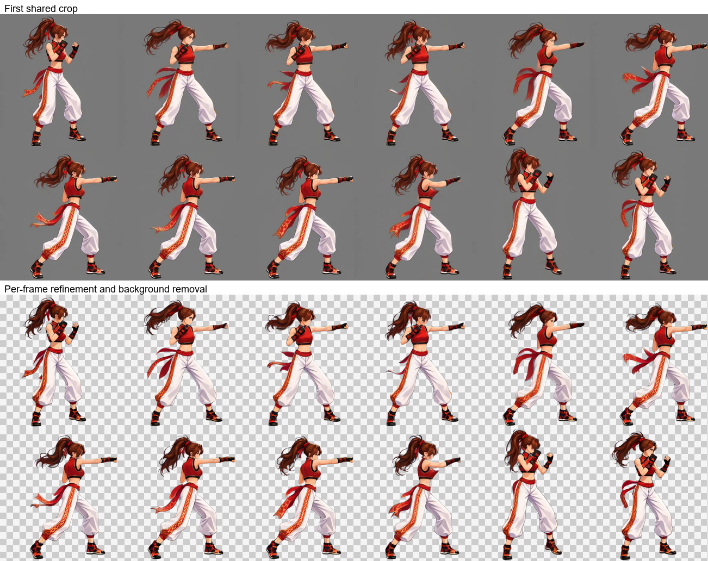
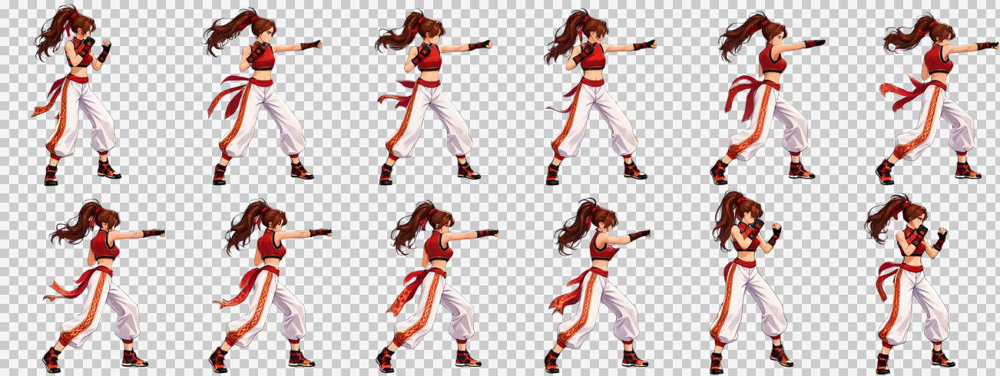
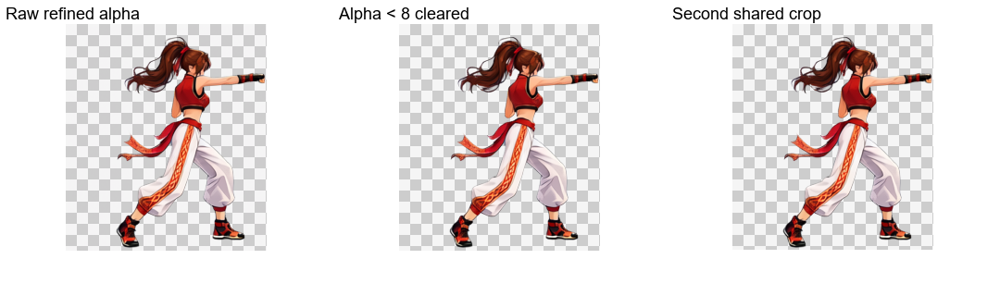
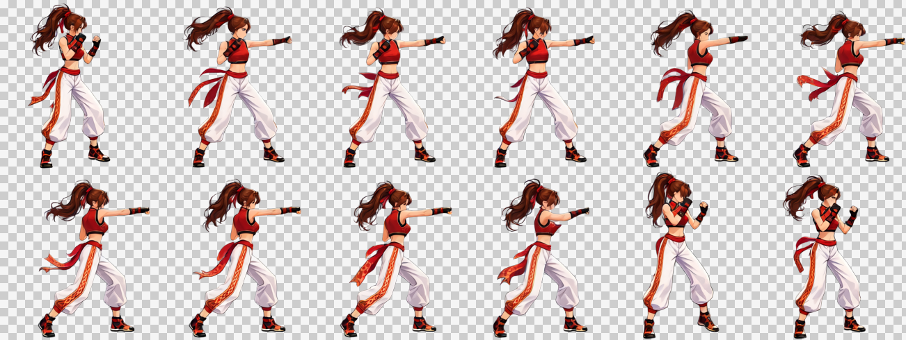
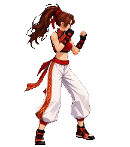

# パンチ攻撃：開始姿勢に戻る動作

[繁體中文](README.md) · [简体中文](README.zh-CN.md) · [日本語](README.ja.md) · [한국어](README.ko.md) · [English](README.en.md)

[← README](../../README.ja.md)

このページは 1 つの動作の実素材と成果を示し、新規キャラクターの初回制作全体を説明するものではありません。制作はメインガイドの姿勢・動作選択から始めます。各姿勢には Idle が含まれます。

元動画、整理前後のフレーム、最終成果を比較し、実素材とプロンプトをダウンロードできます。

## 1. キャラクター参考画像

[PNG](images/character-reference.png)

## 2. 姿勢参考

本例では以下の自然な立ち姿を使用しています。グレー背景と黄色の枠は確認用で、透過素材には含まれません。

[PNG](images/standing.png) · [実際のプロンプト](prompts/standing.txt)

## 3. 動画入力画像

手足、髪、装備が画面外に出にくいよう、動作のための余白を確保します。

[PNG](images/video-input.png)

## 4. 元動画

[MP4](video/source.mp4) · [実際のプロンプト](prompts/video.txt)

## 5. 選択フレーム

## 6. 共通切り抜き

全選択フレームを共通範囲で切り抜き、動作中の位置関係を保ちます。

## 7. フレームの修整と背景除去

動きのぼけ、不要な効果、背景を整理します。比較画像の上段が処理前、下段が処理後です。

[実際のプロンプト](prompts/refine.txt)

## 8. 透過の縁の整理と成果物

透過の縁を整理し、全フレームのキャラクター範囲で再び共通切り抜きします。市松模様は透明部分を示すプレビュー背景です。

| フレーム数 | セル | 配置 | シート | 再生時間 |
| --- | --- | --- | --- | --- |
| 12 | 217×245 | 6×2 | 1302×490 | 0.8 s |

[PNG](result/spritesheet.png) · [GIF](result/preview.gif) · [JSON](result/animation.json) · [全素材 ZIP](attack-complete.zip)

ZIP にはキャラクター参考、動画入力、元動画、各段階のフレーム、実際のプロンプト、PNG／GIF／JSON 成果物が含まれます。
