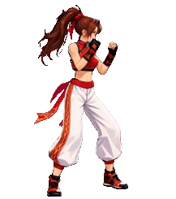
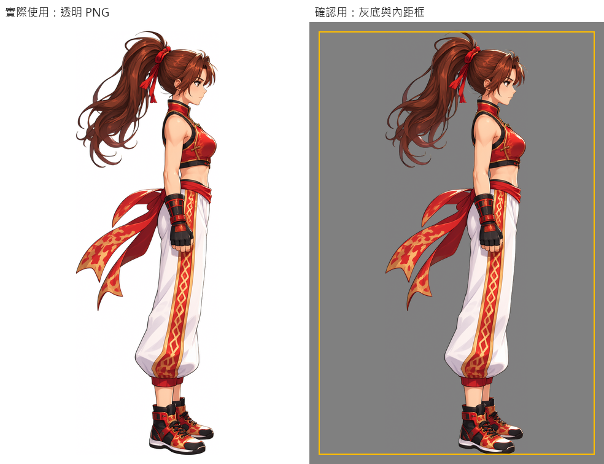
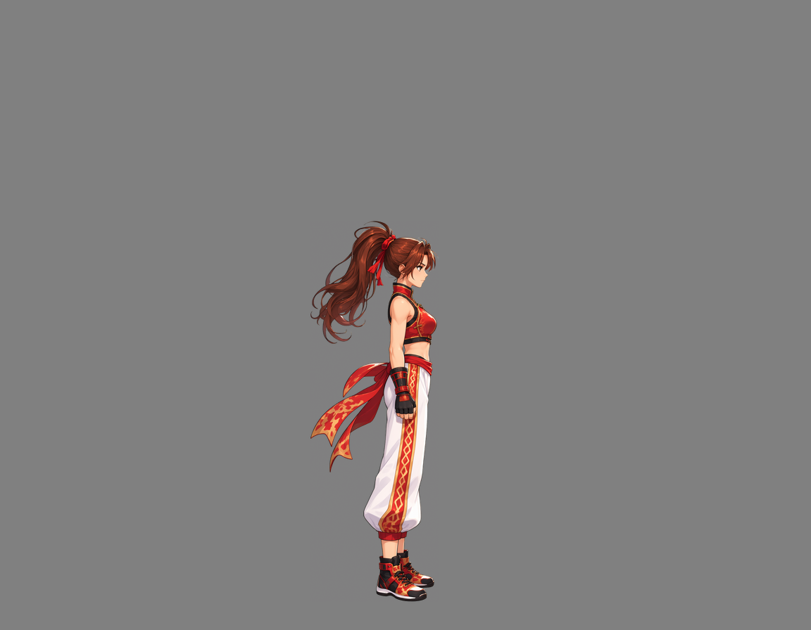
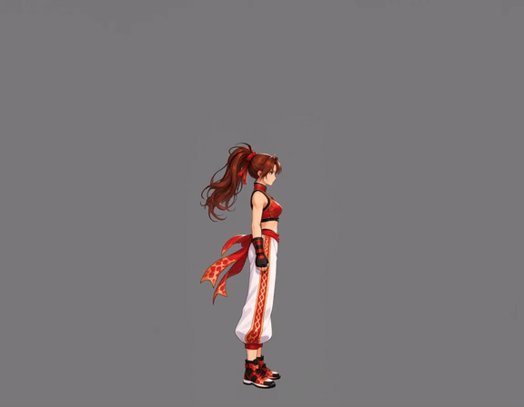
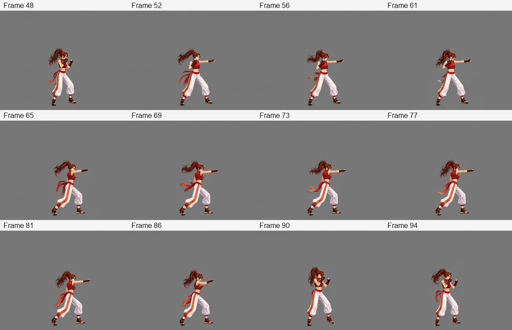
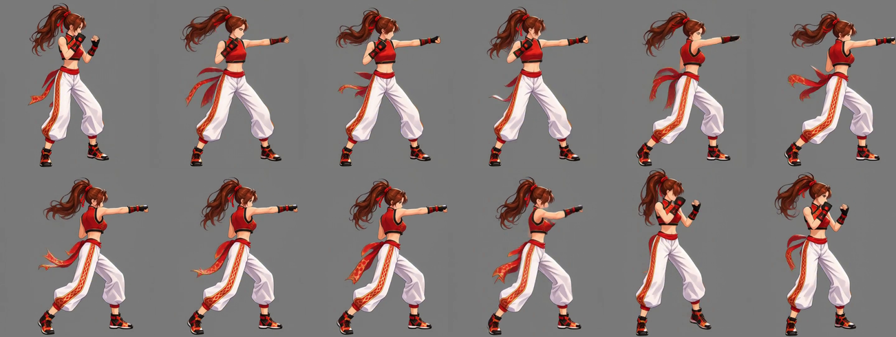
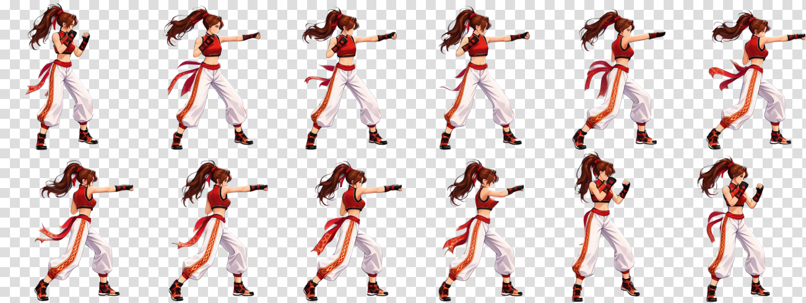

# パンチ攻撃：停止を伴うループ

[繁體中文](README.md) · [简体中文](README.zh-CN.md) · [日本語](README.ja.md) · [한국어](README.ko.md) · [English](README.en.md)

[← インストールと使い方](../../README.ja.md)

自然な立ち姿とグレー背景の動作用キャンバスを再利用し、直接動作を生成します。Python が姿勢の移行を除外して区間を選び、等間隔で抽出した後、共通切り抜き、結合、背景除去、納品を行います。

<table><tr><th>キャラクター参考画像</th><th>透過成果物</th></tr><tr><td align="center"></td><td align="center"></td></tr></table>

> 右向きのパンチ攻撃。最後は戦闘の構えに戻る。キャラクター基準サイズは 256×256。

動画には MiniMax H3、画像には Qwen Image 2.1 を使用しました。以下は実際に使った素材とプロンプトです。

## 1. 参考画像をアップロード

**利用者**が画像と要望を渡します。**Codex**は、遠近感と動きのある宣伝イラストのため、全身の自然な立ち姿を先に用意すると判断します。

[元画像](images/character-reference.png)

## 2. 自然な立ち姿と固定位置を確立

**ComfyUI**が立ち姿を作成し、**Python**が短辺の 3% の内側余白を設けます。参考画像は **1024×1536、余白 31 px**。動作用キャンバスでは足元を水平アンカーと下端基準にして、髪や帯で身体の位置がずれないようにします。**Codex**が確認用に表示します。

左は実際の透過 PNG、右は確認用のグレー背景と黄色い余白ガイドです。背景と枠は原本に入りません。共用画像内の表記は繁体字中国語です。

[透過立ち姿](images/standing.png) · [立ち姿プロンプト](prompts/standing.txt)

## 3. 動画入力キャンバスを直接作成

**動作用キャンバスは手足、髪、装飾が動く空間を確保し、見切れを減らします。** **Python**が固定アンカーで立ち姿を配置し、画素数予算に合わせてスケールを決め、寸法の倍数制約に合わせます。納品時は動作全体を共通範囲で切り抜きます。

| 項目 | 実測値 |
| --- | --- |
| 目標基準枠 | 256×256 |
| 生成キャンバス | 1152×896 |
| 背景 | 単色グレー RGB（128, 128, 128） |
| 画素数 | 寸法補正前 998,280、補正後 1,032,192。余白による少量の超過を許容 |
| 共通の縮小倍率 | 256÷564 ≈ 0.453901 |

[実際の入力画像](images/video-input.png)

## 4. 立ち姿から目標動作を生成

**Codex**が立ち姿から構えに移り、動作するプロンプトを作成します。**Python**が送信、ローカルでの待機、取得を担当し、**ComfyUI**が動画を生成します。

実際の動画では連続してパンチした後に構えに戻ります。成果物は選択区間の実際の動きを保持しています。

元動画：**1152×896、24 FPS、107 フレーム、約 4.46 秒**。GIF はウェブ用プレビューで、MP4 は元の解像度を保持します。

[MP4 を表示・取得](video/source.mp4) · [動画プロンプト](prompts/video.txt)

## 5. 区間とフレームを自動選択

**Codex**は `paused` を指定します。似た構えに戻り、ループ接続点で停止できます。**Python**が準備と復帰の安定姿勢を選び、両端を含めます。

自動区間：**48～94 フレーム**、両端を含みます。等間隔の **12 枚**：**48, 52, 56, 61, 65, 69, 73, 77, 81, 86, 90, 94**。番号は 0 始まりです。

## 6. 共通倍率で縮小し、切り抜いて結合

**Python**が全選択フレームに同じ倍率を適用し、動画の中心線に対して左右対称な共通切り抜き範囲を求めます。各フレームの中央寄せ、下端合わせ、個別拡縮はしません。下に 1 px を加え、左から右、上から下へ **6 列×2 行**に並べます。

各セル **217×245 px**、全体 **1302×490 px**。256×256 はスケール基準で、切り抜きは動作全体と相対的な移動を保持します。

[背景除去前のシート](images/spritesheet-before-removal.png)

## 7. シート全体の背景を除去して納品

**ComfyUI**がシート全体の背景を一度に除去します。**Python**が寸法、透過、GIF 時間を検証して素材をまとめ、**Codex**が確認して表示します。市松模様は表示用で、元 PNG は透過です。

GIF は攻撃区間を **0.8 秒**で繰り返します。開始と終了の構えは似ており、接続点に停止を残します。

| ダウンロード | 内容 |
| --- | --- |
| [透過 PNG シート](result/spritesheet.png) | 12 · 6×2 · 217×245 px |
| [GIF プレビュー](result/preview.gif) | 0.8 s |
| [全素材 ZIP](attack-complete.zip) | 約 27 MB。原画像、立ち姿、入力画像、元動画、全 107 フレーム、選択 12 枚、実際のプロンプト、成果物。 |
| [成果物 JSON](result/animation.json) | 自動区間選択、抽出、切り抜き、再生時間 |
| [背景除去プロンプト](prompts/background-removal.txt) | シート全体に使用した文面 |

## 保存しておくと役立つ素材

- 立ち姿とキャンバス：別動作でスケール、位置、外観を再利用。
- 元動画と全フレーム：再生成せずに区間、手動選択、再生タイミングを変更。
- 実際のプロンプトと入力画像：ComfyUI で試し、動画を Skill に戻して処理。

[連続ループ：歩行](../right-profile-walk/README.ja.md) · [停止を伴うループ：攻撃](../right-profile-attack/README.ja.md) · [非ループ：倒れる動作](../right-profile-death/README.ja.md)
