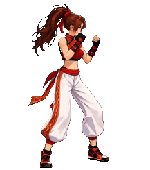
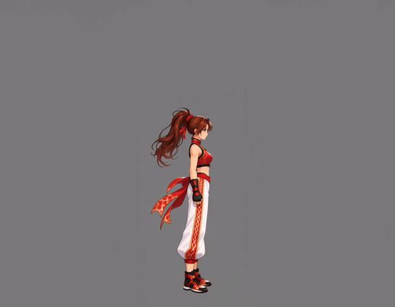
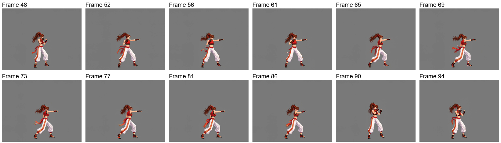
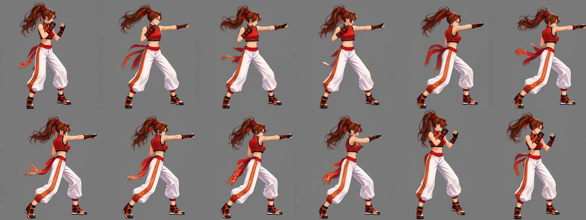
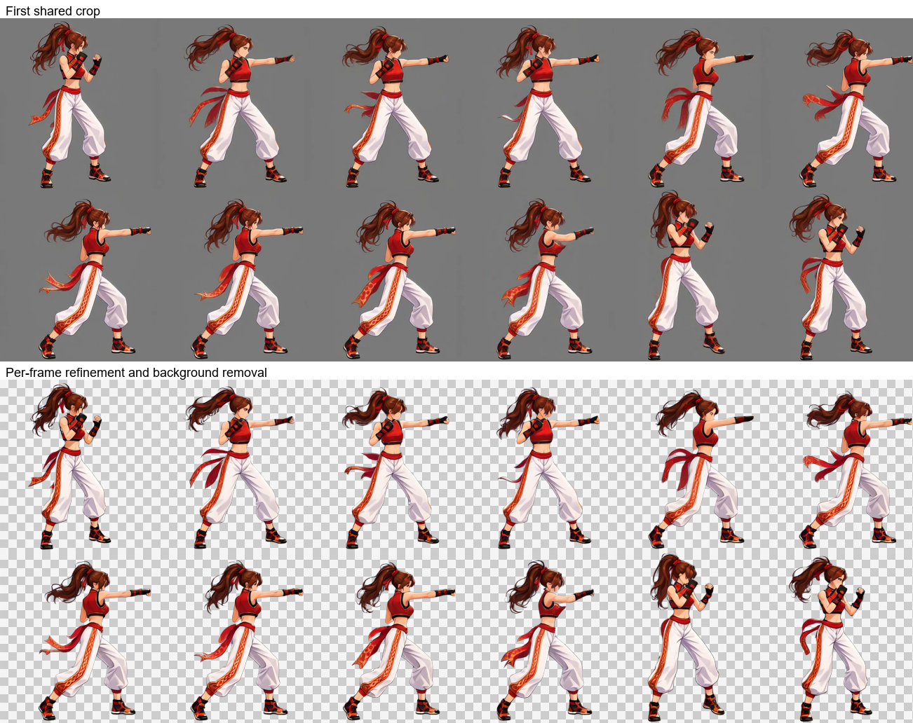
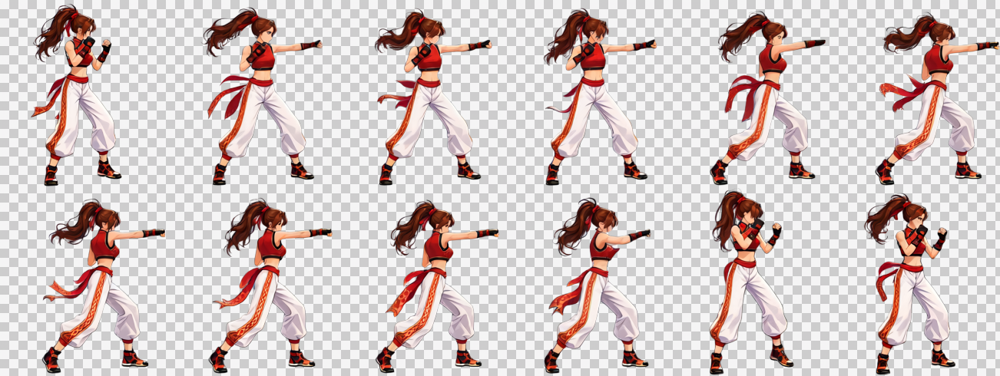
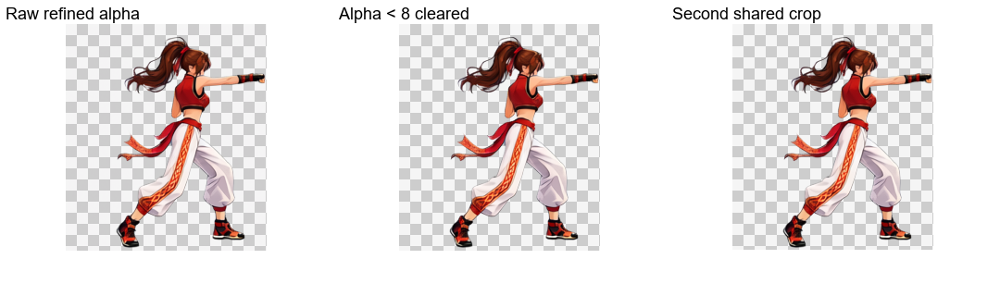
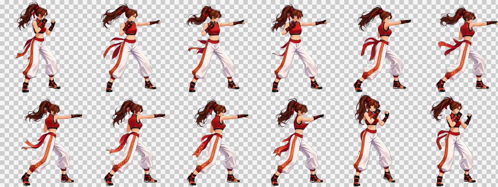

# 出拳攻擊：非連續循環

[繁體中文](README.md) · [简体中文](README.zh-CN.md) · [日本語](README.ja.md) · [한국어](README.ko.md) · [English](README.en.md)

[← 回到安裝與使用說明](../../README.md)

沿用自然站立參考與演出版面生成動作影片；自動選段及共同裁切後，逐張 Refine、去特效並去背，再清理 Alpha、共同裁切及合併交付。

<table><tr><th>角色參考圖</th><th>透明成品</th></tr><tr><td align="center"></td><td align="center"></td></tr></table>

> 面朝右的出拳攻擊，最後回到戰鬥架勢，角色基準大小 256×256。

本例使用 MiniMax H3 生成影片、Qwen Image 2.1 處理圖片。下列皆為實際使用的素材與提示詞。

## 1. 上傳角色參考圖

**使用者**提供角色參考與需求。**Codex**判斷這張帶有透視與動態姿勢的宣傳圖，需先準備完整的自然站立參考。

[下載原圖](images/character-reference.png)

## 2. 建立自然站立參考與固定站位

**ComfyUI**建立自然站立參考；**Python**整理短邊 3% 的內距。本次參考圖為 **1024×1536、內距 31 px**。建立演出版面時，以站姿腳下位置作為水平錨點及底部基準，避免頭髮與飄帶改變身體站位。**Codex**展示參考供確認。

左側為實際透明 PNG，右側為灰底與黃色內距框的確認圖。灰底與框線不會畫進透明原檔。

[透明站立圖](images/standing.png) · [實際站立提示詞](prompts/standing.txt)

## 3. 直接建立影片輸入版面

**演出版面為動作伸展預留空間，降低四肢、頭髮或配件超出畫面而被裁切的機會。** **Python**直接放入自然站姿，保持固定錨點，依像素預算決定生成尺度，再補齊工作流的尺寸倍數。交付時依完整動作共同裁切。

| 項目 | 本次結果 |
| --- | --- |
| 角色目標基準框 | 256×256 |
| 生成畫布 | 1152×896 |
| 背景 | 純灰 RGB（128, 128, 128） |
| 像素預算 | 對齊前 998,280；對齊後 1,032,192，允許補邊餘量 |
| 統一縮回倍率 | 256÷564 ≈ 0.453901 |

[下載實際影片輸入圖](images/video-input.png)

## 4. 從站姿生成目標動作

**Codex**準備由自然站姿進入戰鬥架勢、再演出目標動作的提示詞；**Python**提交、在本機等待並下載；**ComfyUI**產生影片。

本片實際演出連續出拳後回到架勢；下方成品忠實保留所選區段的動作。

原片：**1152×896、24 FPS、107 格、約 4.46 秒**。上圖為網頁預覽 GIF；MP4 保留原始解析度。

[觀看／下載 MP4](video/source.mp4) · [實際影片提示詞](prompts/video.txt)

來源影片與實際生成提示詞保留原樣；以下成品以目前後段流程重新處理。

## 5. 自動選段與取樣

`paused` · 48–94 · 12 frames

`48, 52, 56, 61, 65, 69, 73, 77, 81, 86, 90, 94` (0-based source indices)

## 6. 第一次共同裁切

217×245 px / frame

## 7. 逐張 Refine、去特效與去背

逐張圖片工作流保留姿勢、尺度與位置，修復動態模糊並同時清理背景。上排為第一次共同裁切，下排為圖片工作流的原始輸出。

[實際 Refine 提示詞](prompts/refine.txt)

## 8. Alpha 清理、再次共同裁切與交付

僅將 Alpha 小於 8 的值清為 0，保留其餘半透明邊緣；依全部影格共同裁切，底部保留 1 px 透明留白。棋盤格僅供預覽。

| 影格數 | 單格尺寸 | 排列 | 影格表 | 播放時間 |
| --- | --- | --- | --- | --- |
| 12 | 217×245 | 6×2 | 1302×490 | 0.8 s |

[PNG](result/spritesheet.png) · [GIF](result/preview.gif) · [JSON](result/animation.json) · [完整素材包](attack-complete.zip)

[Workflow / validation](../../references/spritesheet.md)

完整 ZIP 包含來源影片、全部來源影格、選中影格、裁切影格、工作流輸入、原始 Refine 輸出、最終影格、提示詞，以及 PNG／GIF／JSON。
