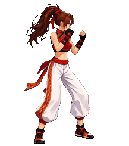
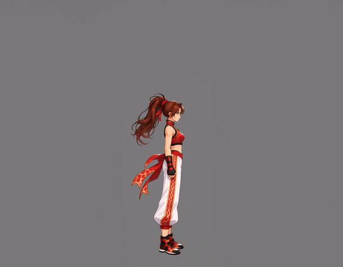
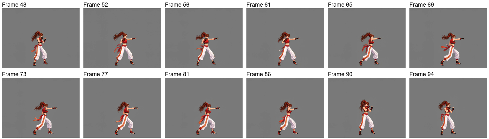
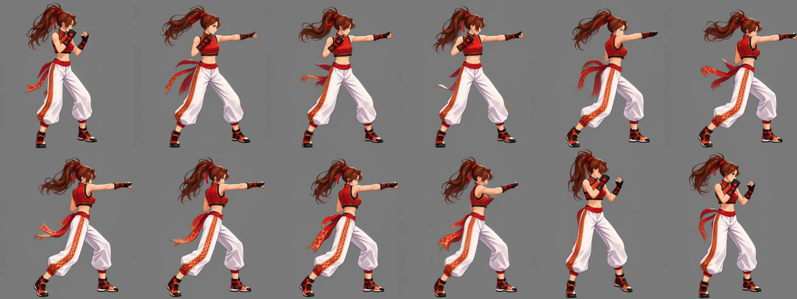
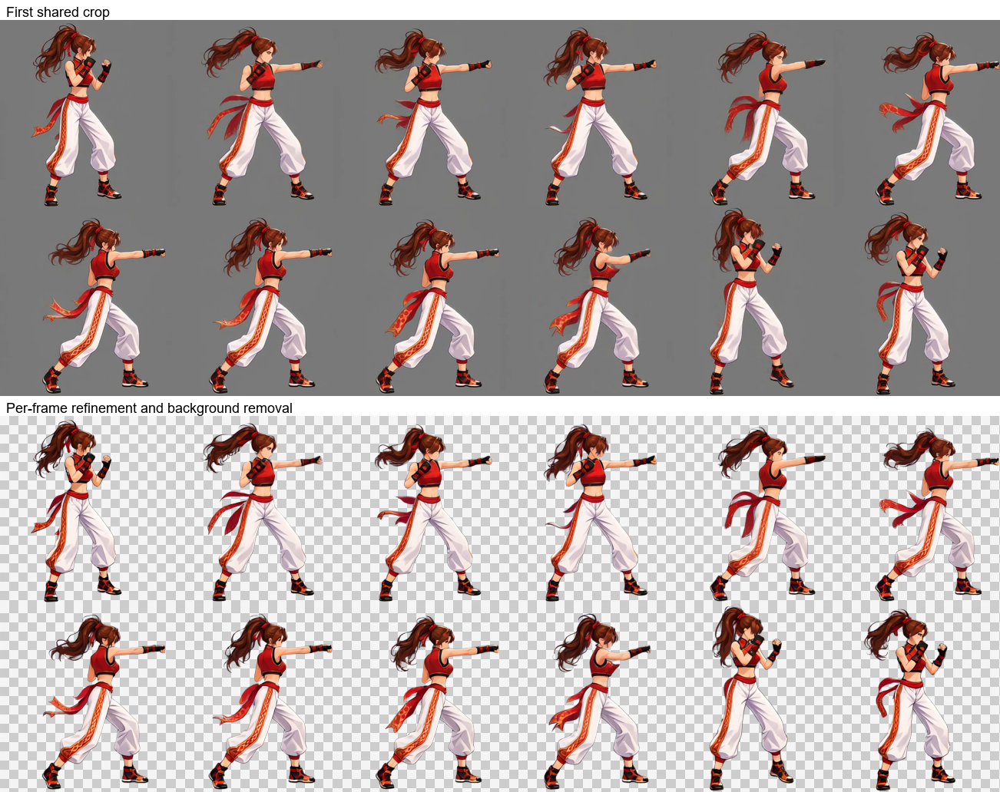
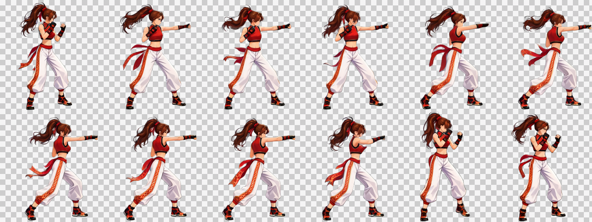
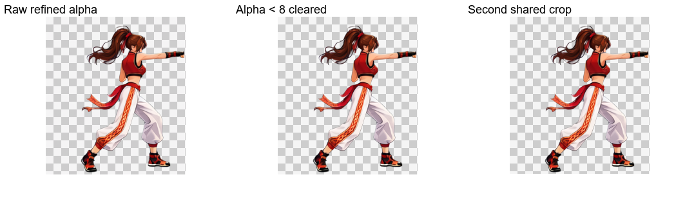
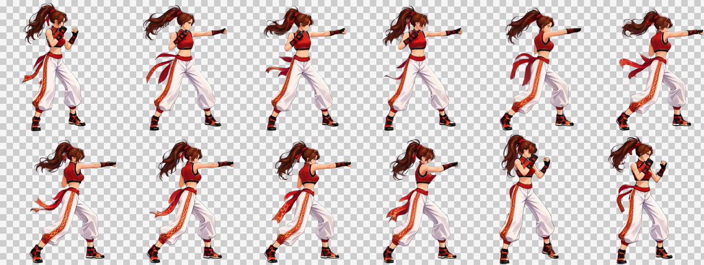

# 出拳攻击：非连续循环

[繁體中文](README.md) · [简体中文](README.zh-CN.md) · [日本語](README.ja.md) · [한국어](README.ko.md) · [English](README.en.md)

[← 返回安装与使用说明](../../README.zh-CN.md)

沿用自然站立参考与演出版面生成动作视频；自动选段及共同裁切后，逐帧 Refine、去特效并去背，再清理 Alpha、共同裁切及合并交付。

<table><tr><th>角色参考图</th><th>透明成品</th></tr><tr><td align="center"></td><td align="center"></td></tr></table>

> 面朝右的出拳攻击，最后回到战斗架势，角色基准大小 256×256。

本例使用 MiniMax H3 生成视频、Qwen Image 2.1 处理图片。下列均为实际使用的素材与提示词。

## 1. 上传角色参考图

**用户**提供角色参考与需求。**Codex**判断这张带有透视与动态姿势的宣传图，需要先准备完整的自然站立参考。

[下载原图](images/character-reference.png)

## 2. 建立自然站立参考与固定站位

**ComfyUI**生成自然站立参考；**Python**整理短边 3% 的内边距。本次参考图为 **1024×1536、内边距 31 px**。建立动作画布时，以脚下位置作为水平锚点和底部基准，避免头发与飘带改变身体站位。**Codex**展示参考供确认。

左侧是实际透明 PNG，右侧是灰底与黄色内边距框的确认图。背景与框线不进入透明原图。共用图片内的标签为繁体中文。

[透明站立图](images/standing.png) · [实际站立提示词](prompts/standing.txt)

## 3. 直接建立视频输入画布

**动作画布为动作伸展预留空间，降低四肢、头发与配件超出画面被截断的可能。** **Python**直接放入自然站姿，保持固定锚点，按像素预算确定生成尺度，再补齐工作流的尺寸倍数。交付时按完整动作统一裁剪。

| 项目 | 本次结果 |
| --- | --- |
| 角色目标基准框 | 256×256 |
| 生成画布 | 1152×896 |
| 背景 | 纯灰 RGB（128, 128, 128） |
| 像素预算 | 对齐前 998,280；对齐后 1,032,192，允许补边余量 |
| 统一缩回倍率 | 256÷564 ≈ 0.453901 |

[下载实际视频输入图](images/video-input.png)

## 4. 从站姿生成目标动作

**Codex**编写从自然站姿进入战斗架势、再进行目标动作的提示词；**Python**提交、在本机等待并下载；**ComfyUI**生成视频。

本片实际演出连续出拳后回到架势；成品保留所选区间的实际动作。

原片：**1152×896、24 FPS、107 帧、约 4.46 秒**。上图为网页 GIF；MP4 保留原始分辨率。

[观看／下载 MP4](video/source.mp4) · [实际视频提示词](prompts/video.txt)

来源视频与实际生成提示词保留原样；以下成品以当前后段流程重新处理。

## 5. 自动选段与采样

`paused` · 48–94 · 12 frames

`48, 52, 56, 61, 65, 69, 73, 77, 81, 86, 90, 94` (0-based source indices)

## 6. 第一次共同裁切

217×245 px / frame

## 7. 逐帧 Refine、去特效与去背

逐帧图片工作流保留姿势、尺度与位置，修复动态模糊并同时清理背景。上排为第一次共同裁切，下排为图片工作流的原始输出。

[实际 Refine 提示词](prompts/refine.txt)

## 8. Alpha 清理、再次共同裁切与交付

仅将 Alpha 小于 8 的值清为 0，保留其余半透明边缘；依全部帧共同裁切，底部保留 1 px 透明留白。棋盘格仅供预览。

| 帧数 | 单帧尺寸 | 排列 | 帧表 | 播放时间 |
| --- | --- | --- | --- | --- |
| 12 | 217×245 | 6×2 | 1302×490 | 0.8 s |

[PNG](result/spritesheet.png) · [GIF](result/preview.gif) · [JSON](result/animation.json) · [完整素材包](attack-complete.zip)

[Workflow / validation](../../references/spritesheet.md)

完整 ZIP 包含来源视频、全部来源帧、选中帧、裁切帧、工作流输入、原始 Refine 输出、最终帧、提示词，以及 PNG／GIF／JSON。
