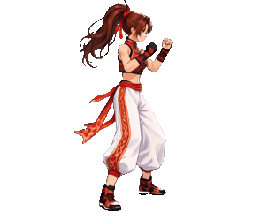
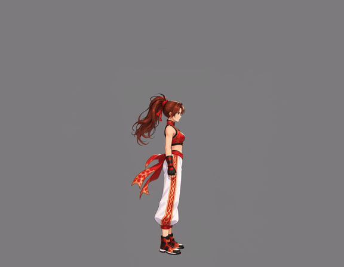
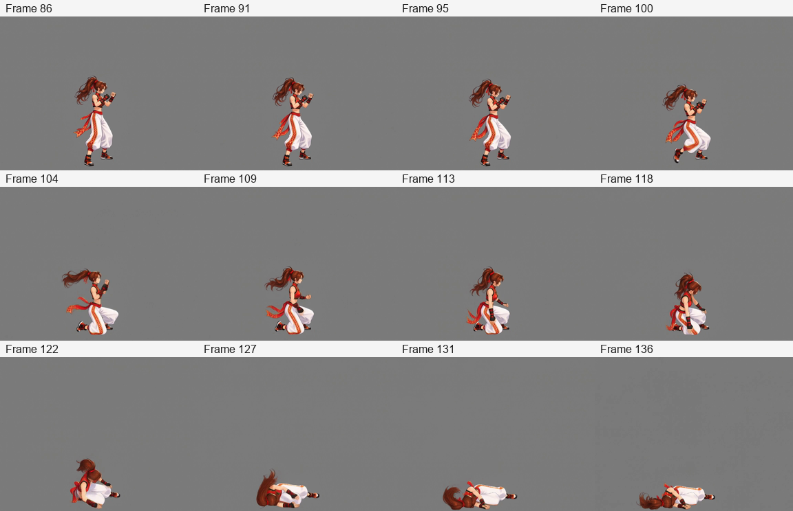
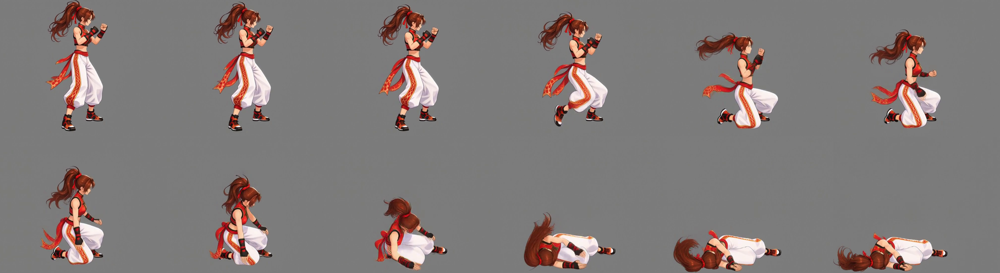
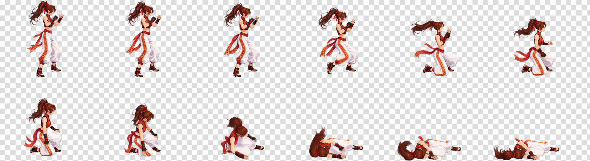

# Defeated collapse: a non-looping action

[繁體中文](README.md) · [简体中文](README.zh-CN.md) · [日本語](README.ja.md) · [한국어](README.ko.md) · [English](README.en.md)

[← Installation and usage](../../README.en.md)

Reuse a natural standing reference and grayscale performance canvas to generate the action directly. Python excludes posture transitions, selects an interval, samples evenly, then crops, packs, removes the background, and delivers the results.

<table><tr><th>Character reference</th><th>Transparent result</th></tr><tr><td align="center"></td><td align="center"></td></tr></table>

> A right-facing defeated collapse ending in a motionless lying pose, with a 256×256 character baseline.

This example uses MiniMax H3 for video and Qwen Image 2.1 for images. The assets and prompts shown are those actually used.

## 1. Upload the character reference

The **user** supplies the reference and request. **Codex** identifies that the promotional illustration has perspective and a dynamic pose, requiring a complete natural standing reference first.

[Download original](images/character-reference.png)

## 2. Establish the standing reference and fixed position

**ComfyUI** creates the standing reference; **Python** applies an inset of 3% of the shorter side. The reference is **1024×1536 with a 31 px inset**. When building the performance canvas, the ground position defines the horizontal anchor and bottom reference, so hair and trailing fabric do not shift the body forward. **Codex** displays the reference for approval.

Left: the actual transparent PNG. Right: a gray background and yellow inset guide for review only; neither is drawn into the asset. Labels inside this shared image are in Traditional Chinese.

[Transparent standing image](images/standing.png) · [Actual standing prompt](prompts/standing.txt)

## 3. Build the video input canvas directly

**The performance canvas reserves room for movement, reducing clipping of limbs, hair, and accessories.** **Python** places the standing character using a fixed anchor, adjusts scale to the pixel budget, then pads to workflow dimension multiples. Delivery uses a shared crop enclosing the full action.

| Item | Actual value |
| --- | --- |
| Target character baseline | 256×256 |
| Generation canvas | 1152×896 |
| Background | Solid gray RGB (128, 128, 128) |
| Pixel budget | 998,280 before alignment; 1,032,192 after padding, allowing the small excess |
| Uniform restoration scale | 256÷564 ≈ 0.453901 |

[Download actual video input](images/video-input.png)

## 4. Generate the target action from standing

**Codex** describes a transition from standing into a fighting guard, followed by the requested action. **Python** submits, waits locally, and downloads; **ComfyUI** generates the video.

The video transitions from standing to guard, then collapses and ends lying motionless.

Source: **1152×896, 24 FPS, 158 frames, approximately 6.58 seconds**. The GIF is a webpage preview; the MP4 retains full resolution.

[Watch/download MP4](video/source.mp4) · [Actual video prompt](prompts/video.txt)

## 5. Automatically select an interval and frames

**Codex** specifies `once`: the action does not return to the starting pose. **Python** finds the terminal stable lying interval, then searches backward for the last eligible starting stable interval, excluding the initial standing-to-guard transition.

Automatic interval: **frames 86–136**, including both endpoints. **12** evenly sampled frames: **86, 91, 95, 100, 104, 109, 113, 118, 122, 127, 131, 136**. Indices start at zero.

## 6. Restore scale, crop jointly, and pack

**Python** applies one restoration scale to all selected frames and calculates a common crop symmetric about the video centerline. It does not recenter, bottom-align, or rescale individual frames. A 1 px bottom margin is added, and frames are packed left to right, top to bottom in **6 columns × 2 rows**.

Cells: **303×249 px**. Sheet: **1818×498 px**. The 256×256 baseline defines character scale; the crop encloses the whole action and preserves relative movement.

[Download sheet before background removal](images/spritesheet-before-removal.png)

## 7. Remove the background and deliver

**ComfyUI** removes the background from the entire sheet once. **Python** verifies dimensions, transparency, and GIF duration, and packages the assets. **Codex** reviews and displays the result. The checkerboard is for display only; the original PNG is transparent.

The GIF repeats a **1.2-second** sequence for convenient viewing. The jump from lying to standing is only the preview restarting; in a game, play this action once and hold the final pose.

| Download | Contents |
| --- | --- |
| [Transparent PNG sheet](result/spritesheet.png) | 12 · 6×2 · 303×249 px |
| [GIF preview](result/preview.gif) | 1.2 s |
| [Complete asset ZIP](death-complete.zip) | About 39 MB: original image, standing reference, input canvas, source video, all 158 frames, 12 selected frames, actual prompts, and results. |
| [Output JSON](result/animation.json) | Automatic interval, sampling, crop, and playback timing |
| [Background-removal prompt](prompts/background-removal.txt) | Actual whole-sheet removal prompt |

## Assets worth keeping

- Standing reference and canvas: reuse character scale, position, and appearance for other actions.
- Source video and all frames: reselect intervals, choose frames manually, or change timing without generating again.
- Actual prompts and input image: experiment in ComfyUI and return a video to the Skill for processing.

[Continuous loop: walking](../right-profile-walk/README.en.md) · [Loop with a pause: attack](../right-profile-attack/README.en.md) · [Non-looping action: death](../right-profile-death/README.en.md)
