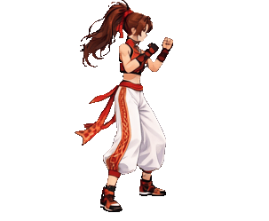
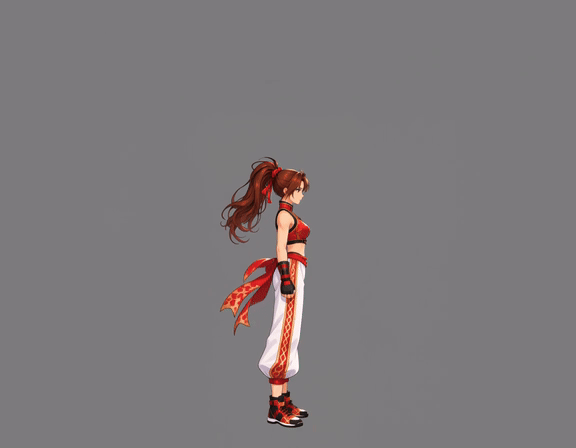
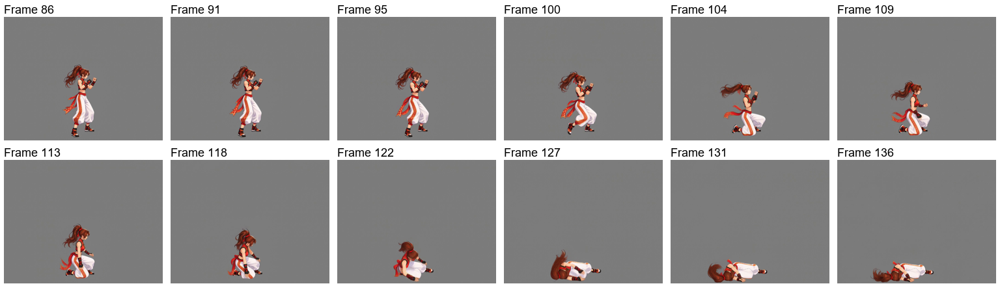
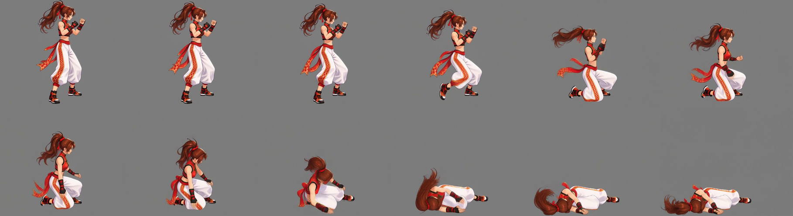
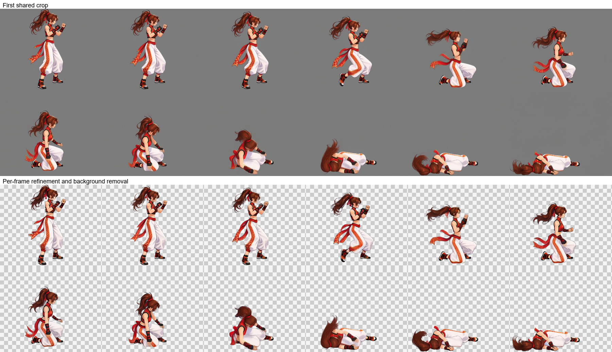
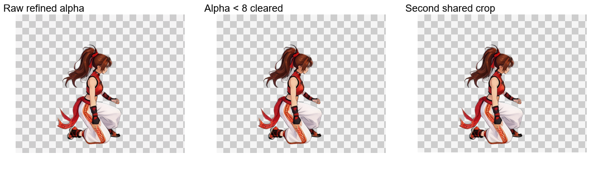
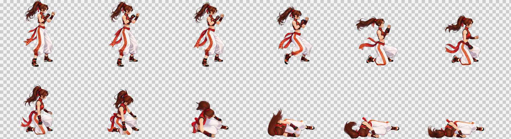

# Defeated collapse: a non-looping action

[繁體中文](README.md) · [简体中文](README.zh-CN.md) · [日本語](README.ja.md) · [한국어](README.ko.md) · [English](README.en.md)

[← Installation and usage](../../README.en.md)

Reuse the standing reference and performance canvas to generate a video. After selection and a shared crop, refine each frame and remove effects and background, then clean alpha, crop jointly again and pack the results.

<table><tr><th>Character reference</th><th>Transparent result</th></tr><tr><td align="center"></td><td align="center"></td></tr></table>

> A right-facing defeated collapse ending in a motionless lying pose, with a 256×256 character baseline.

This example uses MiniMax H3 for video and Qwen Image 2.1 for images. The assets and prompts shown are those actually used.

## 1. Upload the character reference

The **user** supplies the reference and request. **Codex** identifies that the promotional illustration has perspective and a dynamic pose, requiring a complete natural standing reference first.

[Download original](images/character-reference.png)

## 2. Establish the standing reference and fixed position

**ComfyUI** creates the standing reference; **Python** applies an inset of 3% of the shorter side. The reference is **1024×1536 with a 31 px inset**. When building the performance canvas, the ground position defines the horizontal anchor and bottom reference, so hair and trailing fabric do not shift the body forward. **Codex** displays the reference for approval.

Left: the actual transparent PNG. Right: a gray background and yellow inset guide for review only; neither is drawn into the asset. Labels inside this shared image are in Traditional Chinese.

[Transparent standing image](images/standing.png) · [Actual standing prompt](prompts/standing.txt)

## 3. Build the video input canvas directly

**The performance canvas reserves room for movement, reducing clipping of limbs, hair, and accessories.** **Python** places the standing character using a fixed anchor, adjusts scale to the pixel budget, then pads to workflow dimension multiples. Delivery uses a shared crop enclosing the full action.

| Item | Actual value |
| --- | --- |
| Target character baseline | 256×256 |
| Generation canvas | 1152×896 |
| Background | Solid gray RGB (128, 128, 128) |
| Pixel budget | 998,280 before alignment; 1,032,192 after padding, allowing the small excess |
| Uniform restoration scale | 256÷564 ≈ 0.453901 |

[Download actual video input](images/video-input.png)

## 4. Generate the target action from standing

**Codex** describes a transition from standing into a fighting guard, followed by the requested action. **Python** submits, waits locally, and downloads; **ComfyUI** generates the video.

The video transitions from standing to guard, then collapses and ends lying motionless.

Source: **1152×896, 24 FPS, 158 frames, approximately 6.58 seconds**. The GIF is a webpage preview; the MP4 retains full resolution.

[Watch/download MP4](video/source.mp4) · [Actual video prompt](prompts/video.txt)

The source video and its actual generation prompts are retained. The results below were processed with the current backend.

## 5. Automatic selection and sampling

`once` · 86–136 · 12 frames

`86, 91, 95, 100, 104, 109, 113, 118, 122, 127, 131, 136` (0-based source indices)

## 6. First shared crop

303×249 px / frame

## 7. Per-frame Refine, effect and background removal

The image workflow preserves pose, scale and position while repairing motion blur and removing the background. Top: first shared crop. Bottom: raw image-workflow output.

[Actual Refine prompt](prompts/refine.txt)

## 8. Alpha cleanup, second shared crop and delivery

Alpha values below 8 become 0; other translucent edges remain. All frames share a second crop with 1 px of transparent bottom padding. Checkerboards are preview backgrounds only.

| Frames | Cell | Grid | Sheet | Duration |
| --- | --- | --- | --- | --- |
| 12 | 303×249 | 6×2 | 1818×498 | 1.2 s |

[PNG](result/spritesheet.png) · [GIF](result/preview.gif) · [JSON](result/animation.json) · [Complete asset bundle](death-complete.zip)

[Workflow / validation](../../references/spritesheet.md)

ZIP: source video, all source frames, selected frames, cropped frames, workflow inputs, raw refined frames, final frames, prompts, PNG / GIF / JSON.
