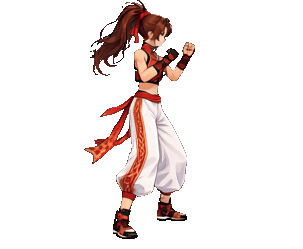
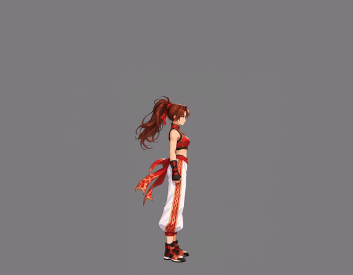
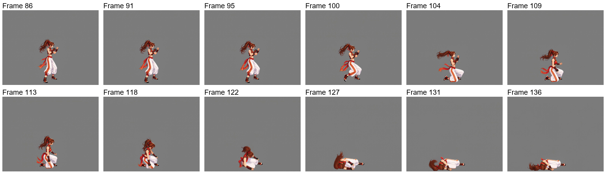
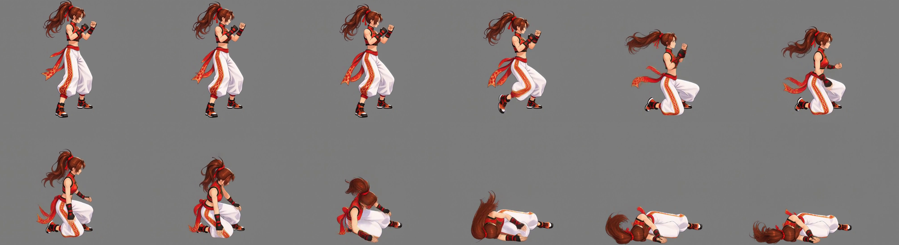
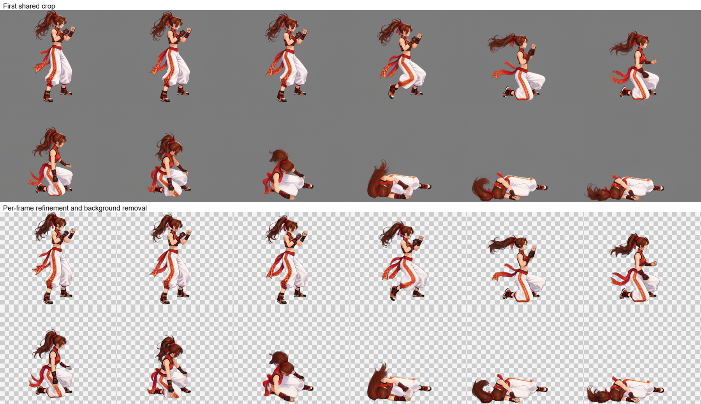
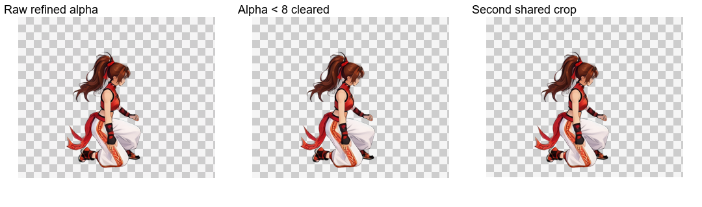
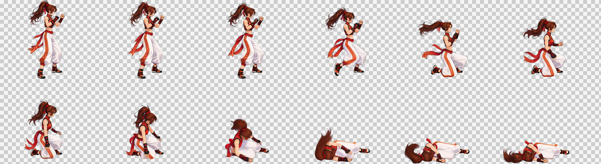

# 倒れる動作：非ループ

[繁體中文](README.md) · [简体中文](README.zh-CN.md) · [日本語](README.ja.md) · [한국어](README.ko.md) · [English](README.en.md)

[← インストールと使い方](../../README.ja.md)

立ち姿と演出用キャンバスを再利用して動画を生成します。自動選択と共通クロップ後、各フレームを Refine してエフェクトと背景を除去し、Alpha 整理と再共通クロップを経て統合します。

<table><tr><th>キャラクター参考画像</th><th>透過成果物</th></tr><tr><td align="center"></td><td align="center"></td></tr></table>

> 右向きで力尽きて倒れ、最後は横たわったまま静止する動作。基準サイズは 256×256。

動画には MiniMax H3、画像には Qwen Image 2.1 を使用しました。以下は実際に使った素材とプロンプトです。

## 1. 参考画像をアップロード

**利用者**が画像と要望を渡します。**Codex**は、遠近感と動きのある宣伝イラストのため、全身の自然な立ち姿を先に用意すると判断します。

[元画像](images/character-reference.png)

## 2. 自然な立ち姿と固定位置を確立

**ComfyUI**が立ち姿を作成し、**Python**が短辺の 3% の内側余白を設けます。参考画像は **1024×1536、余白 31 px**。動作用キャンバスでは足元を水平アンカーと下端基準にして、髪や帯で身体の位置がずれないようにします。**Codex**が確認用に表示します。

左は実際の透過 PNG、右は確認用のグレー背景と黄色い余白ガイドです。背景と枠は原本に入りません。共用画像内の表記は繁体字中国語です。

[透過立ち姿](images/standing.png) · [立ち姿プロンプト](prompts/standing.txt)

## 3. 動画入力キャンバスを直接作成

**動作用キャンバスは手足、髪、装飾が動く空間を確保し、見切れを減らします。** **Python**が固定アンカーで立ち姿を配置し、画素数予算に合わせてスケールを決め、寸法の倍数制約に合わせます。納品時は動作全体を共通範囲で切り抜きます。

| 項目 | 実測値 |
| --- | --- |
| 目標基準枠 | 256×256 |
| 生成キャンバス | 1152×896 |
| 背景 | 単色グレー RGB（128, 128, 128） |
| 画素数 | 寸法補正前 998,280、補正後 1,032,192。余白による少量の超過を許容 |
| 共通の縮小倍率 | 256÷564 ≈ 0.453901 |

[実際の入力画像](images/video-input.png)

## 4. 立ち姿から目標動作を生成

**Codex**が立ち姿から構えに移り、動作するプロンプトを作成します。**Python**が送信、ローカルでの待機、取得を担当し、**ComfyUI**が動画を生成します。

立ち姿から構えに移り、力を失って倒れ、最後は横たわったまま静止します。

元動画：**1152×896、24 FPS、158 フレーム、約 6.58 秒**。GIF はウェブ用プレビューで、MP4 は元の解像度を保持します。

[MP4 を表示・取得](video/source.mp4) · [動画プロンプト](prompts/video.txt)

元動画と実際の生成プロンプトはそのまま保持し、以下の成果物は現在の後段処理で作成しています。

## 5. 自動区間選択とサンプリング

`once` · 86–136 · 12 frames

`86, 91, 95, 100, 104, 109, 113, 118, 122, 127, 131, 136` (0-based source indices)

## 6. 最初の共通クロップ

303×249 px / frame

## 7. 各フレームの Refine・エフェクト除去・背景除去

画像ワークフローは姿勢・大きさ・位置を維持し、動きのぼけを修復して背景も除去します。上段は最初の共通クロップ、下段は画像ワークフローの未加工出力です。

[実際の Refine プロンプト](prompts/refine.txt)

## 8. Alpha 整理・再共通クロップ・納品

Alpha が 8 未満の値のみ 0 にし、他の半透明の縁は維持します。全フレームで共通範囲を再クロップし、下端に透明な 1 px を残します。市松模様はプレビュー専用です。

| フレーム数 | セルサイズ | 配置 | シート | 再生時間 |
| --- | --- | --- | --- | --- |
| 12 | 303×249 | 6×2 | 1818×498 | 1.2 s |

[PNG](result/spritesheet.png) · [GIF](result/preview.gif) · [JSON](result/animation.json) · [全素材 ZIP](death-complete.zip)

[Workflow / validation](../../references/spritesheet.md)

ZIP には元動画、全元フレーム、選択フレーム、クロップ画像、ワークフロー入力、未加工の Refine 出力、最終フレーム、プロンプト、PNG／GIF／JSON を含みます。
