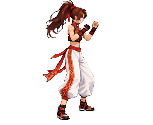
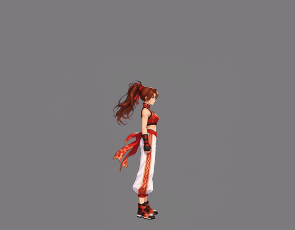
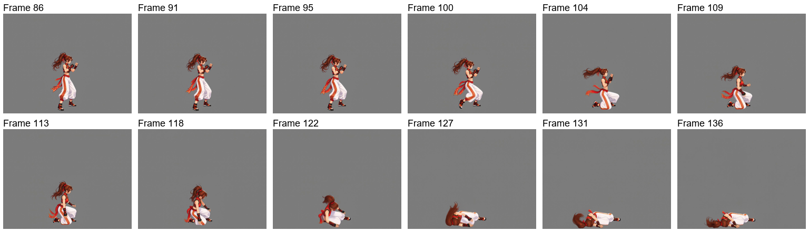
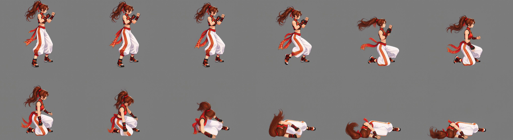
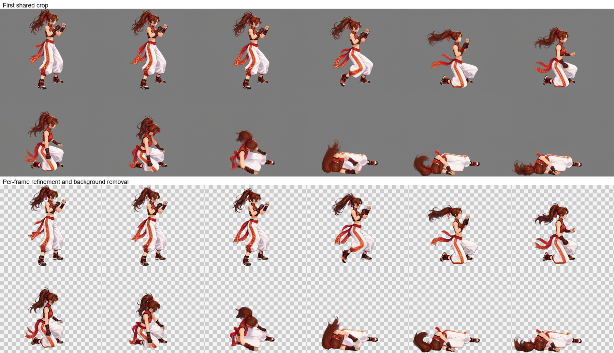
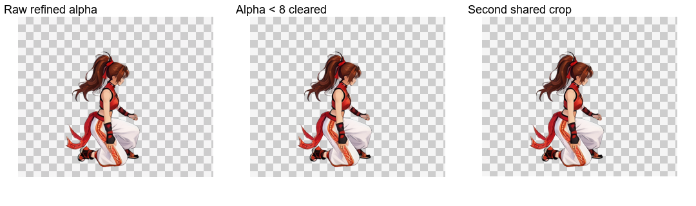
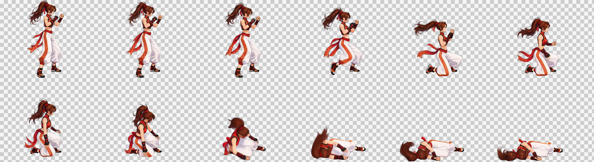

# 쓰러지는 동작: 비반복 애니메이션

[繁體中文](README.md) · [简体中文](README.zh-CN.md) · [日本語](README.ja.md) · [한국어](README.ko.md) · [English](README.en.md)

[← 설치 및 사용 안내](../../README.ko.md)

서 있는 참조와 연출 캔버스를 재사용하여 영상을 생성합니다. 자동 선택과 공통 자르기 후 각 프레임을 Refine하며 효과와 배경을 제거하고, Alpha 정리와 재공통 자르기를 거쳐 합칩니다.

<table><tr><th>캐릭터 참고 이미지</th><th>투명 결과물</th></tr><tr><td align="center"></td><td align="center"></td></tr></table>

> 오른쪽을 향해 쓰러진 뒤 누운 상태로 멈추는 동작. 캐릭터 기준 크기 256×256.

동영상은 MiniMax H3, 이미지는 Qwen Image 2.1을 사용했습니다. 아래는 실제 사용한 자료와 프롬프트입니다.

## 1. 참고 이미지 업로드

**사용자**가 참고 이미지와 요청을 제공합니다. **Codex**는 원근과 역동적인 자세가 있는 홍보 이미지이므로 온전하게 서 있는 참고 이미지를 먼저 준비합니다.

[원본 다운로드](images/character-reference.png)

## 2. 서 있는 참고 이미지와 고정 위치 설정

**ComfyUI**가 서 있는 참고 이미지를 만들고 **Python**이 짧은 변의 3%를 안쪽 여백으로 정합니다. **1024×1536, 여백 31 px**입니다. 동작 캔버스에서는 발밑 위치를 가로 앵커와 하단 기준으로 삼아 머리카락과 띠가 몸 위치를 바꾸지 않게 합니다. **Codex**가 확인용으로 표시합니다.

왼쪽은 실제 투명 PNG, 오른쪽은 회색 배경과 노란 여백 가이드입니다. 배경과 선은 원본에 포함되지 않습니다. 공용 이미지 안의 표기는 번체 중국어입니다.

[투명 서 있는 이미지](images/standing.png) · [서 있는 자세 프롬프트](prompts/standing.txt)

## 3. 동영상 입력 캔버스 바로 만들기

**동작 캔버스는 팔다리, 머리카락, 장식이 움직일 공간을 확보하여 잘림을 줄입니다.** **Python**이 고정 앵커로 캐릭터를 배치하고 픽셀 예산에 맞춰 생성 배율을 정한 뒤 치수 배수에 맞춥니다. 결과물은 전체 동작을 담는 공통 영역으로 자릅니다.

| 항목 | 실제 결과 |
| --- | --- |
| 목표 기준 틀 | 256×256 |
| 생성 캔버스 | 1152×896 |
| 배경 | 단색 회색 RGB (128, 128, 128) |
| 픽셀 예산 | 정렬 전 998,280, 정렬 후 1,032,192. 추가 여백의 소폭 초과 허용 |
| 공통 복원 배율 | 256÷564 ≈ 0.453901 |

[실제 입력 이미지](images/video-input.png)

## 4. 서 있는 자세에서 목표 동작 생성

**Codex**가 서 있는 자세에서 전투 자세로 전환한 뒤 목표 동작을 하는 프롬프트를 작성합니다. **Python**이 제출, 로컬 대기, 다운로드를 담당하고 **ComfyUI**가 동영상을 생성합니다.

서 있는 자세에서 전투 자세로 전환한 뒤 힘을 잃고 쓰러지며 마지막에는 누운 채 멈춥니다.

원본: **1152×896, 24 FPS, 158 프레임, 약 6.58초**. GIF는 웹 미리보기이고 MP4는 원본 해상도를 유지합니다.

[MP4 보기／다운로드](video/source.mp4) · [동영상 프롬프트](prompts/video.txt)

원본 영상과 실제 생성 프롬프트를 유지하며 아래 결과물은 현재 후반 처리로 만들었습니다.

## 5. 자동 구간 선택 및 샘플링

`once` · 86–136 · 12 frames

`86, 91, 95, 100, 104, 109, 113, 118, 122, 127, 131, 136` (0-based source indices)

## 6. 첫 번째 공통 자르기

303×249 px / frame

## 7. 프레임별 Refine 및 효과·배경 제거

이미지 워크플로는 자세, 크기, 위치를 유지하며 동작 흐림을 보정하고 배경도 제거합니다. 위쪽은 첫 번째 공통 자르기, 아래쪽은 이미지 워크플로의 원본 출력입니다.

[실제 Refine 프롬프트](prompts/refine.txt)

## 8. Alpha 정리, 두 번째 공통 자르기 및 전달

Alpha가 8 미만인 값만 0으로 만들고 나머지 반투명 가장자리는 유지합니다. 모든 프레임을 공통 범위로 다시 자르고 하단에 투명 여백 1 px을 남깁니다. 체크무늬는 미리보기 전용입니다.

| 프레임 수 | 셀 크기 | 배치 | 시트 | 재생 시간 |
| --- | --- | --- | --- | --- |
| 12 | 303×249 | 6×2 | 1818×498 | 1.2 s |

[PNG](result/spritesheet.png) · [GIF](result/preview.gif) · [JSON](result/animation.json) · [전체 소재 ZIP](death-complete.zip)

[Workflow / validation](../../references/spritesheet.md)

ZIP에는 원본 영상, 모든 원본 프레임, 선택 프레임, 자른 프레임, 워크플로 입력, 원본 Refine 출력, 최종 프레임, 프롬프트, PNG／GIF／JSON이 포함됩니다.
