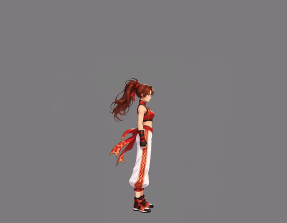
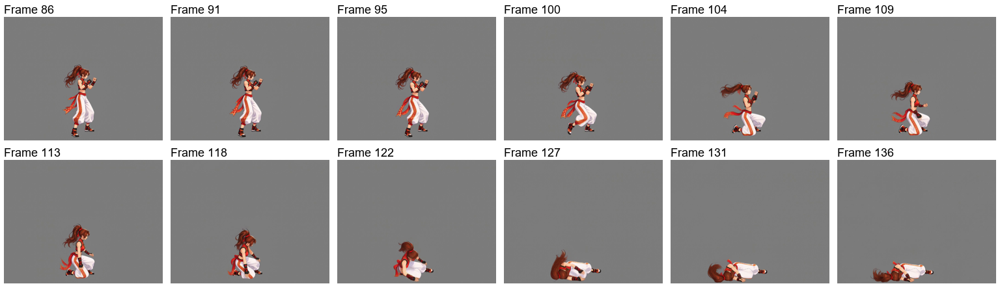
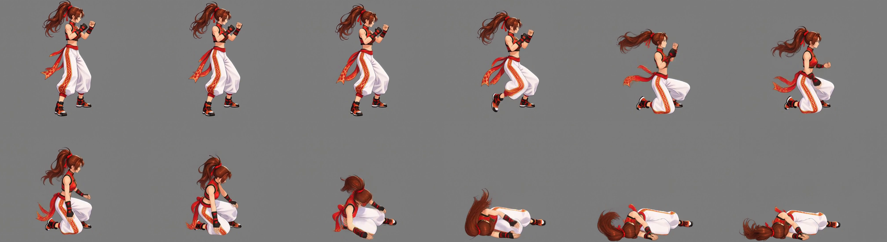
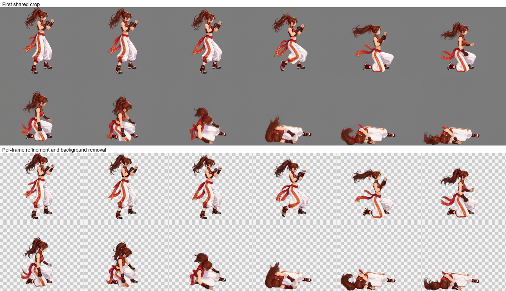
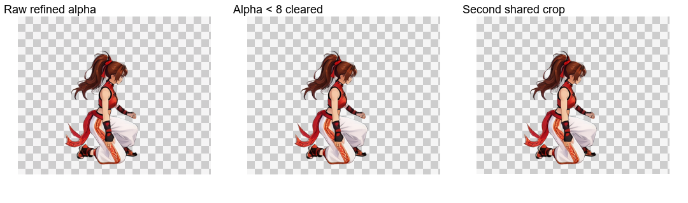
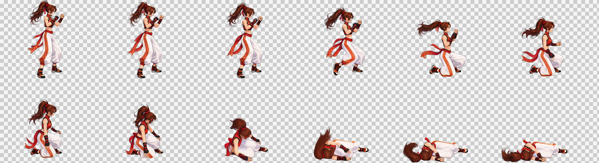
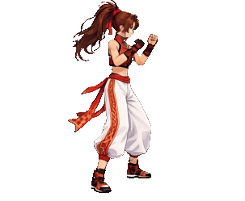

# 倒地死亡：保持結束姿態動作

[繁體中文](README.md) · [简体中文](README.zh-CN.md) · [日本語](README.ja.md) · [한국어](README.ko.md) · [English](README.en.md)

[← README](../../README.md)

本頁展示單一動作的實際素材與處理成果，不是新角色首次製作的完整操作步驟。開始製作請依主說明選擇姿態與動作；每個姿態都包含 Idle。

下方可比較來源影片、影格清理前後及最終成果，並下載實際素材與提示詞。

## 1. 角色參考圖

[PNG](images/character-reference.png)

## 2. 姿態參考

本例使用下方的自然站立參考；灰底與黃色框線只是確認用的預覽，不會畫入透明素材。

[PNG](images/standing.png) · [實際提示詞](prompts/standing.txt)

## 3. 影片輸入圖

為角色預留動作空間，降低四肢、頭髮或裝備超出畫面的機會。

[PNG](images/video-input.png)

## 4. 來源影片

[MP4](video/source.mp4) · [實際提示詞](prompts/video.txt)

## 5. 選中的影格

## 6. 共同裁切

所有選中影格使用相同範圍裁切，保留角色動作中的位置關係。

## 7. 影格修整與去背

修復動態模糊、清理多餘效果並移除背景。比較圖上排為清理前，下排為清理後。

[實際提示詞](prompts/refine.txt)

## 8. 透明邊緣整理與成品

整理透明邊緣後，依全部影格的角色範圍再次共同裁切。棋盤格只是顯示透明區域的預覽背景。

| 影格數 | 單格尺寸 | 排列 | 影格表 | 播放時間 |
| --- | --- | --- | --- | --- |
| 12 | 303×249 | 6×2 | 1818×498 | 1.2 s |

[PNG](result/spritesheet.png) · [GIF](result/preview.gif) · [JSON](result/animation.json) · [完整素材包](death-complete.zip)

素材包包含角色參考、影片輸入、來源影片、各階段影格、實際提示詞與 PNG／GIF／JSON 成品。
