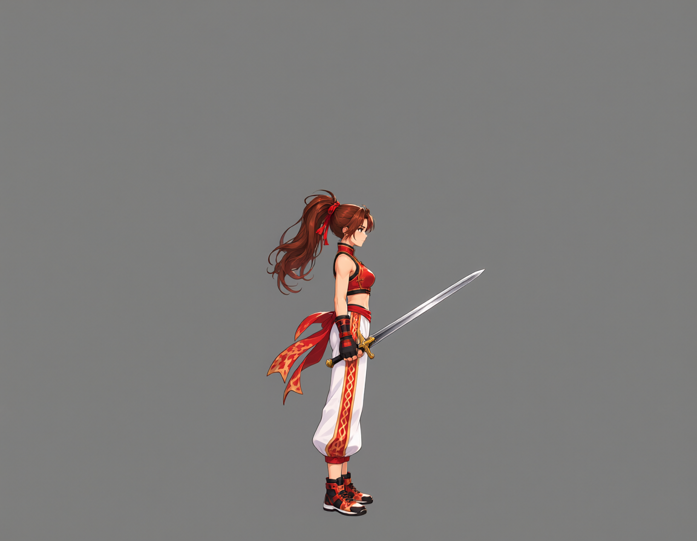
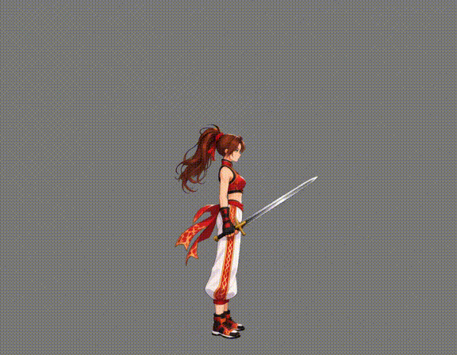
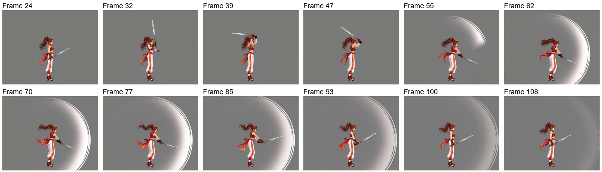
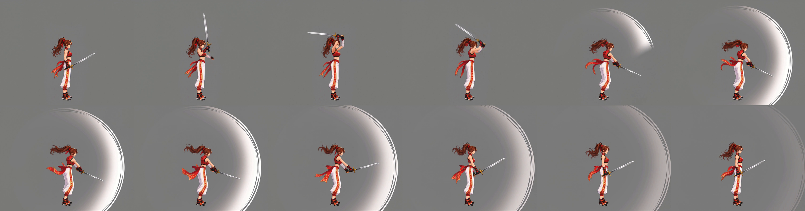
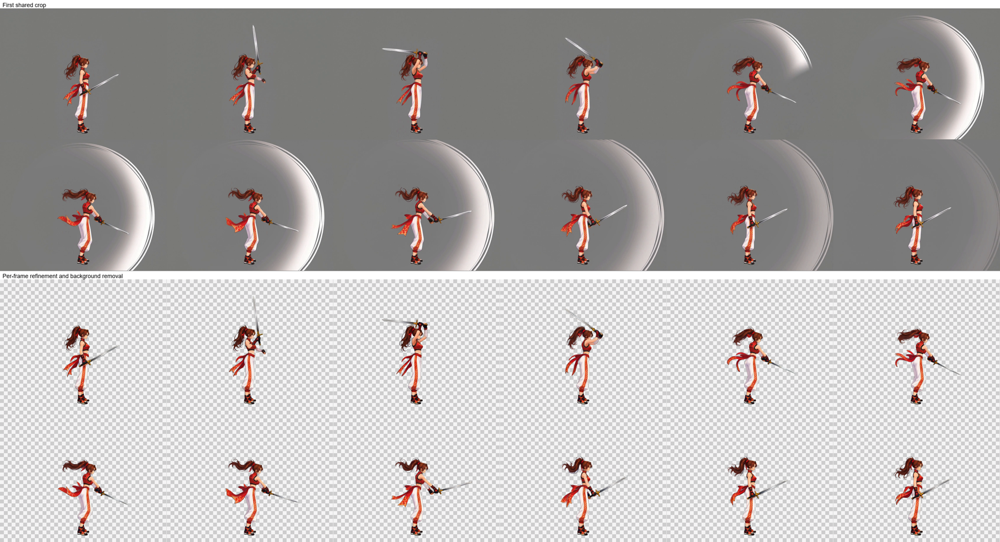
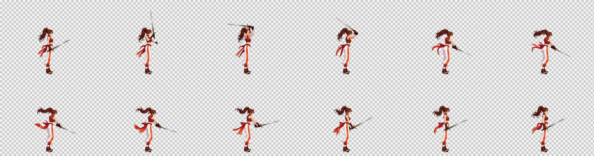
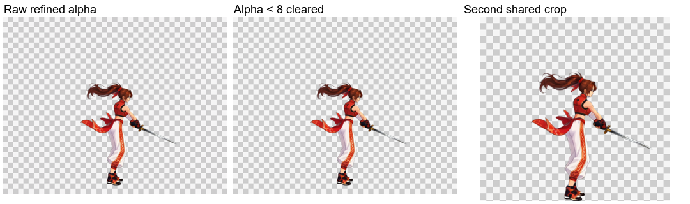
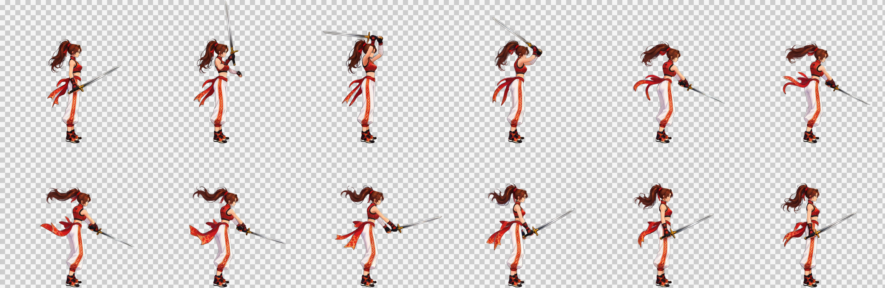
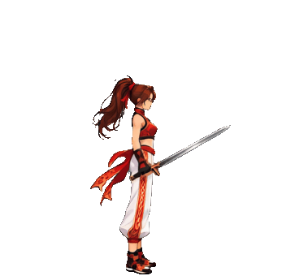

# Sword attack: preserve the physical weapon and remove incidental effects

[繁體中文](README.md) · [简体中文](README.zh-CN.md) · [日本語](README.ja.md) · [한국어](README.ko.md) · [English](README.en.md)

[← README](../../README.en.md)

A physical sword is added to the same standing canvas before generating the sword action. The standing reference has no sword; the actual video input includes it.

## 1. Character reference

## 2. Standing reference

[PNG](images/standing.png) · [Prompt](prompts/standing.txt)

## 3. Video input + physical weapon

[Base canvas](images/pre-weapon-input.png) · [Weapon edit prompt](prompts/weapon-input.txt)

## 4. Source video

1152×896 · 24 FPS · 124 frames · 5.17 s

[MP4](video/source.mp4) · [Prompt](prompts/video.txt)

The source video and its actual generation prompts are retained. The results below were processed with the current backend.

## 5. Automatic selection and sampling

`paused` · 24–108 · 12 frames

`24, 32, 39, 47, 55, 62, 70, 77, 85, 93, 100, 108` (0-based source indices)

## 6. First shared crop

517×408 px / frame

## 7. Per-frame Refine, effect and background removal

The image workflow preserves pose, scale and position while repairing motion blur and removing the background. Top: first shared crop. Bottom: raw image-workflow output.

[Actual Refine prompt](prompts/refine.txt)

## 8. Alpha cleanup, second shared crop and delivery

Alpha values below 8 become 0; other translucent edges remain. All frames share a second crop with 1 px of transparent bottom padding. Checkerboards are preview backgrounds only.

| Frames | Cell | Grid | Sheet | Duration |
| --- | --- | --- | --- | --- |
| 12 | 347×340 | 6×2 | 2082×680 | 1.2 s |

[PNG](result/spritesheet.png) · [GIF](result/preview.gif) · [JSON](result/animation.json) · [Complete asset bundle](sword-complete.zip)

[Workflow / validation](../../references/spritesheet.md)

ZIP: source video, all source frames, selected frames, cropped frames, workflow inputs, raw refined frames, final frames, prompts, PNG / GIF / JSON.
