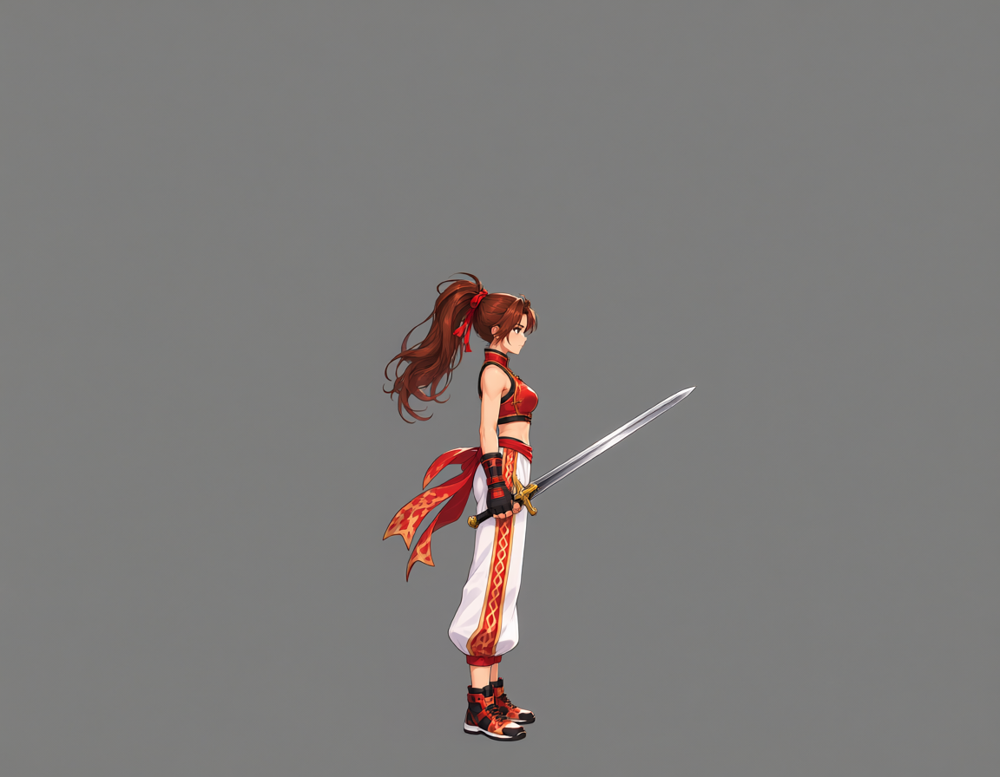
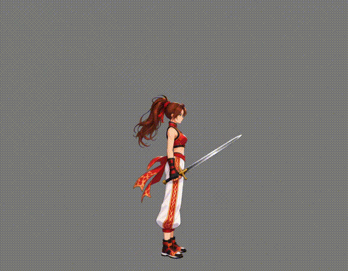
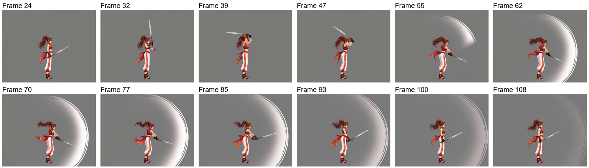
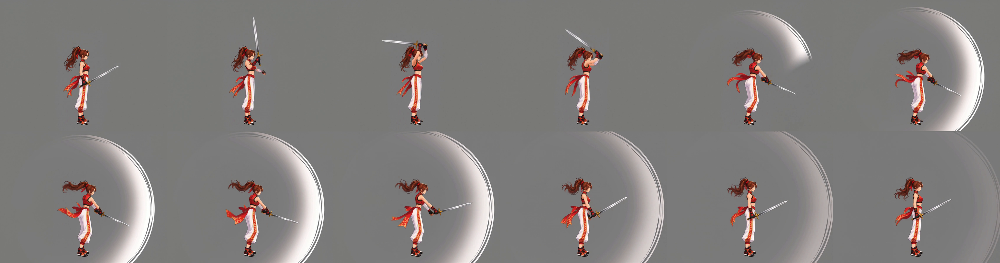
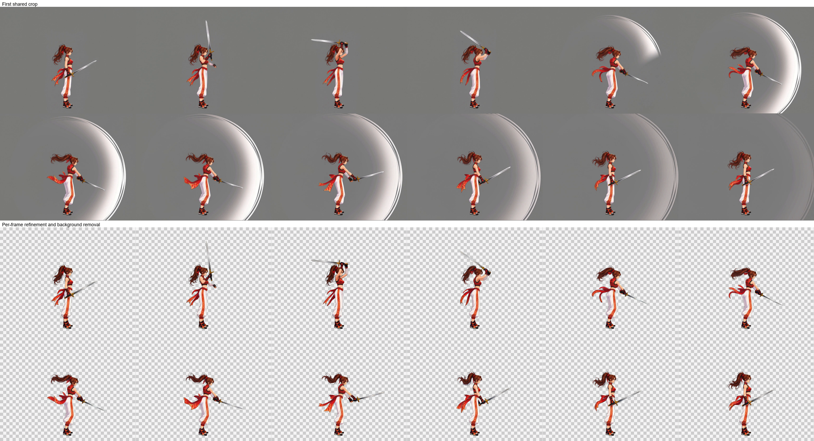
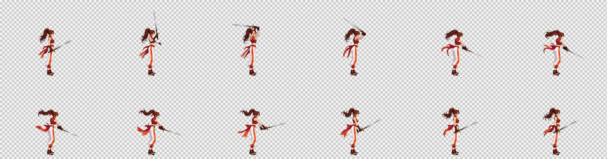
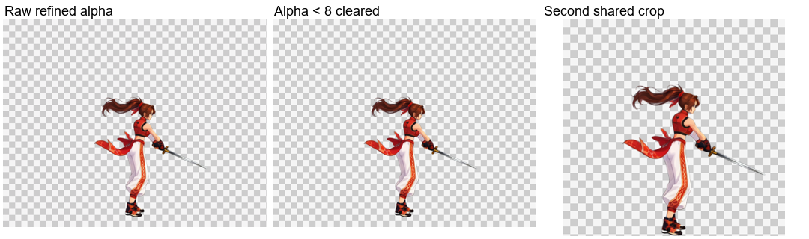
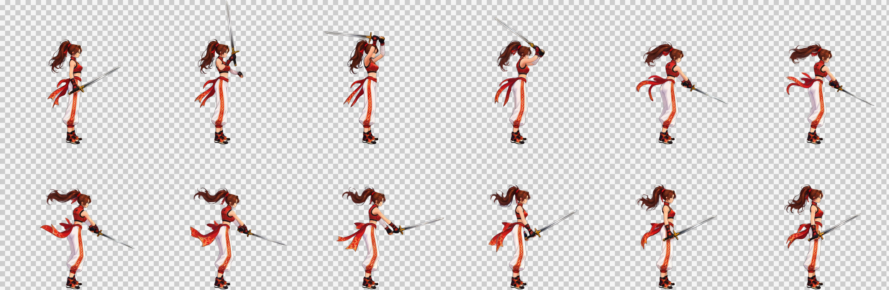
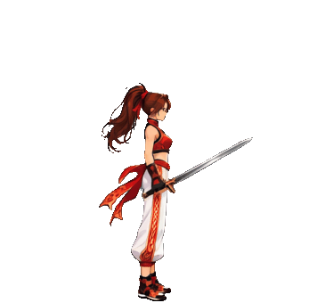

# 剣攻撃：実体の武器を維持し付随エフェクトを除去

[繁體中文](README.md) · [简体中文](README.zh-CN.md) · [日本語](README.ja.md) · [한국어](README.ko.md) · [English](README.en.md)

[← README](../../README.ja.md)

同じ立ち姿のキャンバスに実体の剣を追加してから剣攻撃の動画を生成します。立ち姿の参照画像には剣がなく、動画の入力画像には剣があります。

## 1. キャラクター参考画像

## 2. 立ち姿の参照

[PNG](images/standing.png) · [Prompt](prompts/standing.txt)

## 3. 動画入力と実体の武器

[元のキャンバス](images/pre-weapon-input.png) · [武器追加プロンプト](prompts/weapon-input.txt)

## 4. 元動画

1152×896 · 24 FPS · 124 frames · 5.17 s

[MP4](video/source.mp4) · [Prompt](prompts/video.txt)

元動画と実際の生成プロンプトはそのまま保持し、以下の成果物は現在の後段処理で作成しています。

## 5. 自動区間選択とサンプリング

`paused` · 24–108 · 12 frames

`24, 32, 39, 47, 55, 62, 70, 77, 85, 93, 100, 108` (0-based source indices)

## 6. 最初の共通クロップ

517×408 px / frame

## 7. 各フレームの Refine・エフェクト除去・背景除去

画像ワークフローは姿勢・大きさ・位置を維持し、動きのぼけを修復して背景も除去します。上段は最初の共通クロップ、下段は画像ワークフローの未加工出力です。

[実際の Refine プロンプト](prompts/refine.txt)

## 8. Alpha 整理・再共通クロップ・納品

Alpha が 8 未満の値のみ 0 にし、他の半透明の縁は維持します。全フレームで共通範囲を再クロップし、下端に透明な 1 px を残します。市松模様はプレビュー専用です。

| フレーム数 | セルサイズ | 配置 | シート | 再生時間 |
| --- | --- | --- | --- | --- |
| 12 | 347×340 | 6×2 | 2082×680 | 1.2 s |

[PNG](result/spritesheet.png) · [GIF](result/preview.gif) · [JSON](result/animation.json) · [全素材 ZIP](sword-complete.zip)

[Workflow / validation](../../references/spritesheet.md)

ZIP には元動画、全元フレーム、選択フレーム、クロップ画像、ワークフロー入力、未加工の Refine 出力、最終フレーム、プロンプト、PNG／GIF／JSON を含みます。
