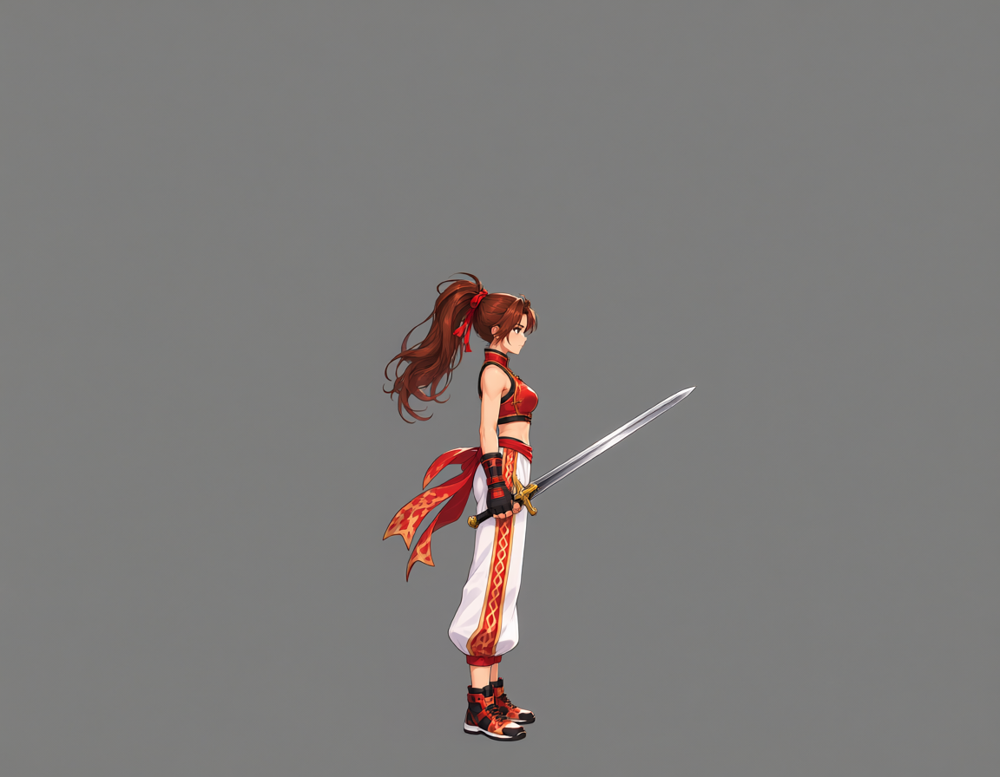
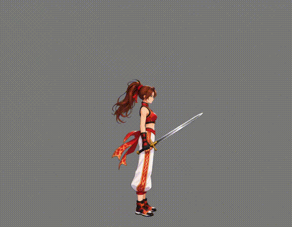
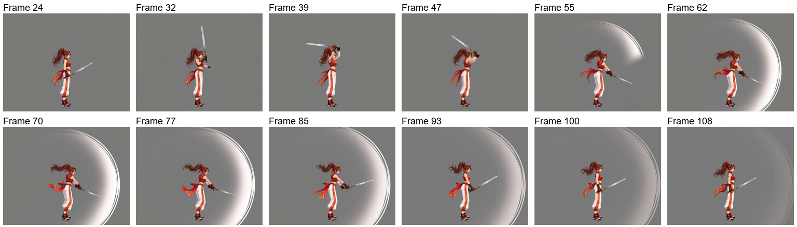
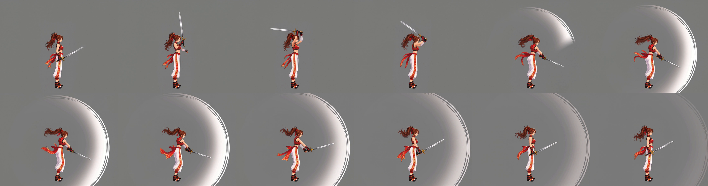
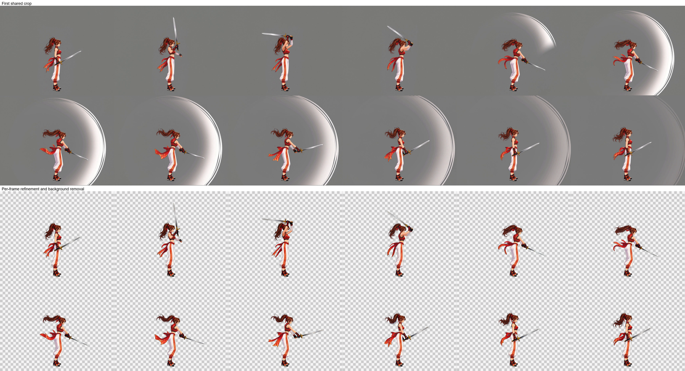
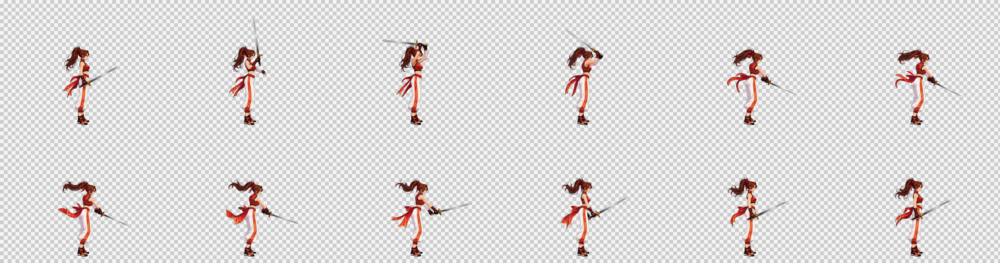
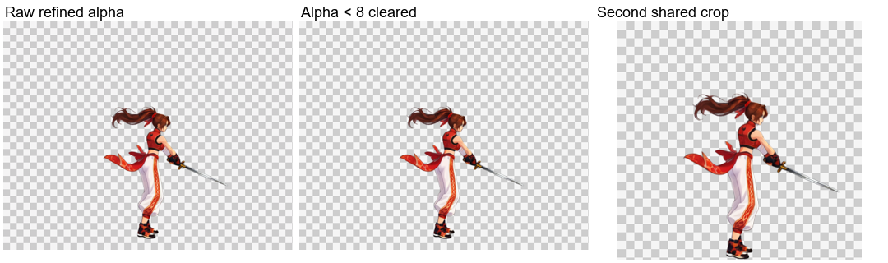
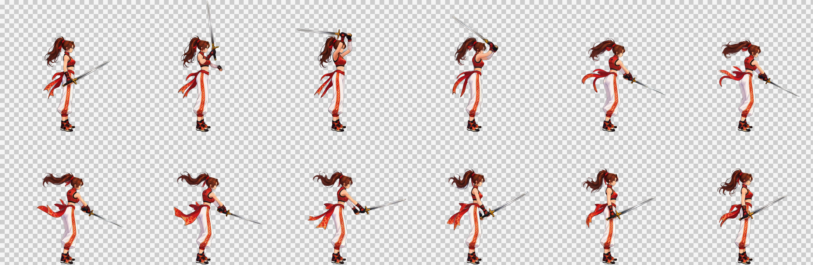
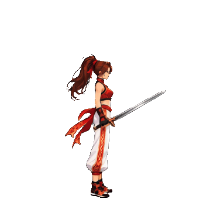

# 검 공격: 실제 무기는 보존하고 부가 효과는 제거

[繁體中文](README.md) · [简体中文](README.zh-CN.md) · [日本語](README.ja.md) · [한국어](README.ko.md) · [English](README.en.md)

[← README](../../README.ko.md)

동일한 서 있는 캔버스에 실제 검을 추가한 뒤 검 공격 영상을 생성합니다. 서 있는 참조에는 검이 없고 실제 영상 입력에는 검이 있습니다.

## 1. 캐릭터 참조

## 2. 서 있는 참조

[PNG](images/standing.png) · [Prompt](prompts/standing.txt)

## 3. 영상 입력 및 실제 무기

[원래 캔버스](images/pre-weapon-input.png) · [무기 추가 프롬프트](prompts/weapon-input.txt)

## 4. 원본 영상

1152×896 · 24 FPS · 124 frames · 5.17 s

[MP4](video/source.mp4) · [Prompt](prompts/video.txt)

원본 영상과 실제 생성 프롬프트를 유지하며 아래 결과물은 현재 후반 처리로 만들었습니다.

## 5. 자동 구간 선택 및 샘플링

`paused` · 24–108 · 12 frames

`24, 32, 39, 47, 55, 62, 70, 77, 85, 93, 100, 108` (0-based source indices)

## 6. 첫 번째 공통 자르기

517×408 px / frame

## 7. 프레임별 Refine 및 효과·배경 제거

이미지 워크플로는 자세, 크기, 위치를 유지하며 동작 흐림을 보정하고 배경도 제거합니다. 위쪽은 첫 번째 공통 자르기, 아래쪽은 이미지 워크플로의 원본 출력입니다.

[실제 Refine 프롬프트](prompts/refine.txt)

## 8. Alpha 정리, 두 번째 공통 자르기 및 전달

Alpha가 8 미만인 값만 0으로 만들고 나머지 반투명 가장자리는 유지합니다. 모든 프레임을 공통 범위로 다시 자르고 하단에 투명 여백 1 px을 남깁니다. 체크무늬는 미리보기 전용입니다.

| 프레임 수 | 셀 크기 | 배치 | 시트 | 재생 시간 |
| --- | --- | --- | --- | --- |
| 12 | 347×340 | 6×2 | 2082×680 | 1.2 s |

[PNG](result/spritesheet.png) · [GIF](result/preview.gif) · [JSON](result/animation.json) · [전체 소재 ZIP](sword-complete.zip)

[Workflow / validation](../../references/spritesheet.md)

ZIP에는 원본 영상, 모든 원본 프레임, 선택 프레임, 자른 프레임, 워크플로 입력, 원본 Refine 출력, 최종 프레임, 프롬프트, PNG／GIF／JSON이 포함됩니다.
