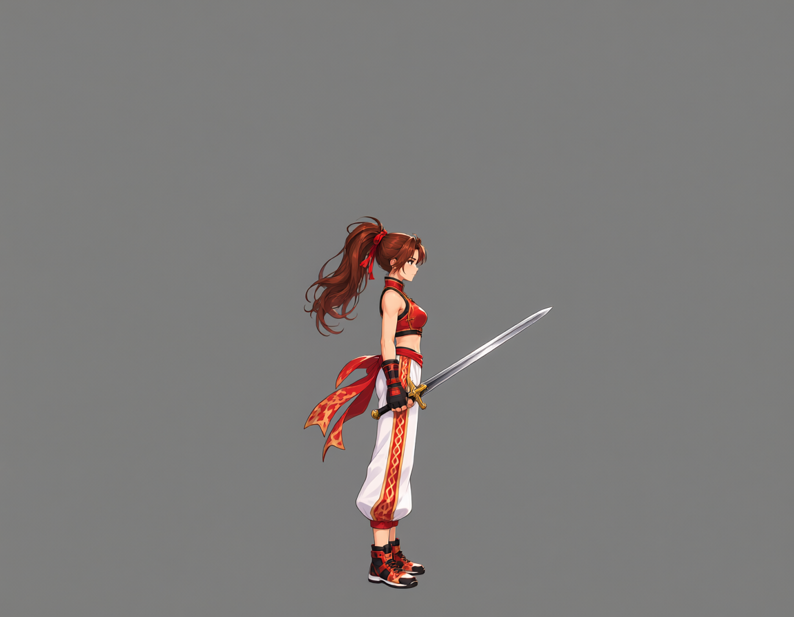
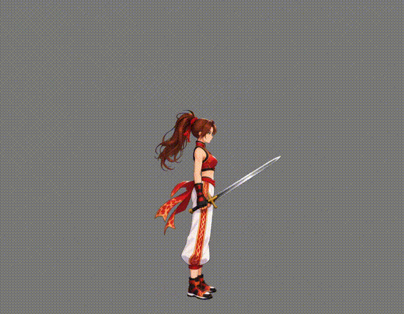
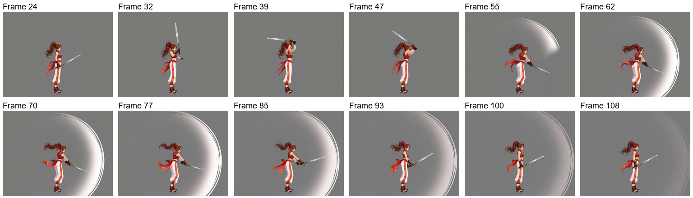
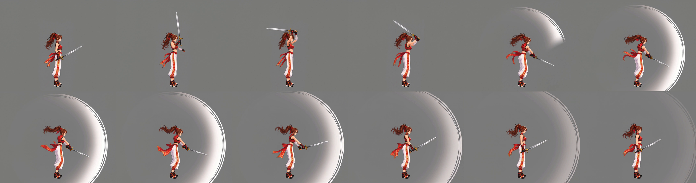
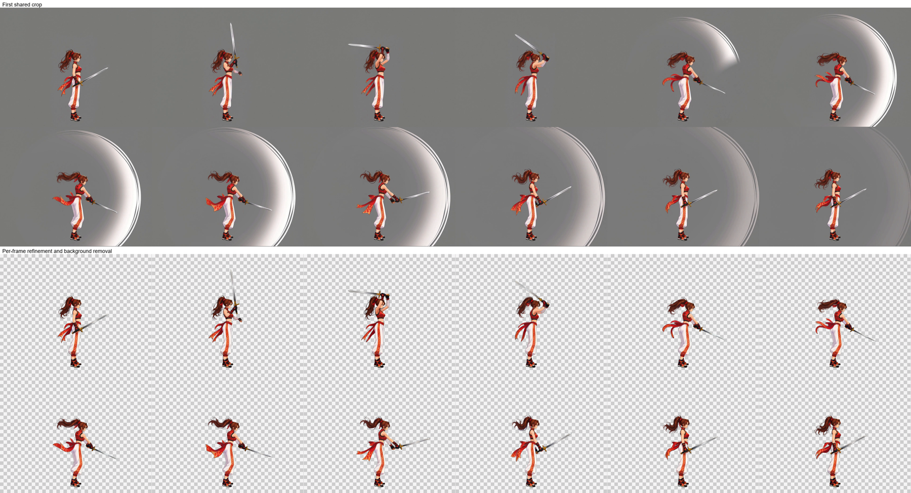
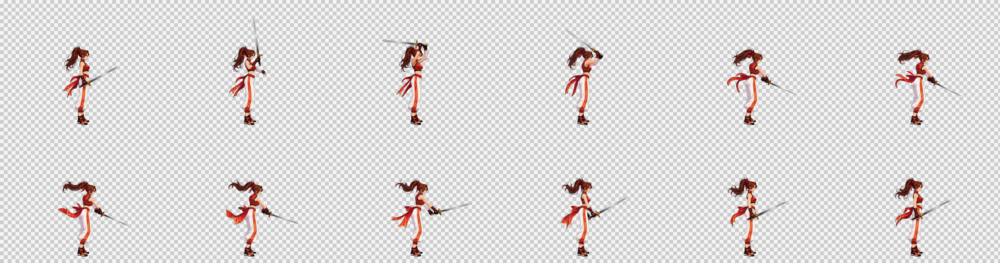
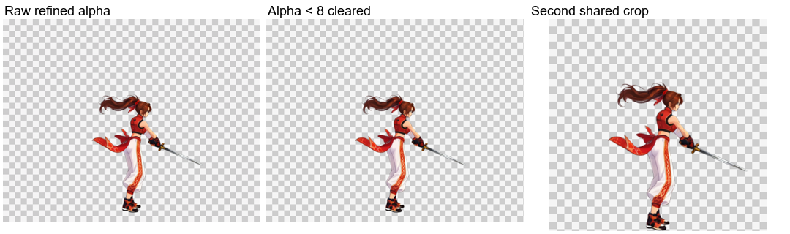
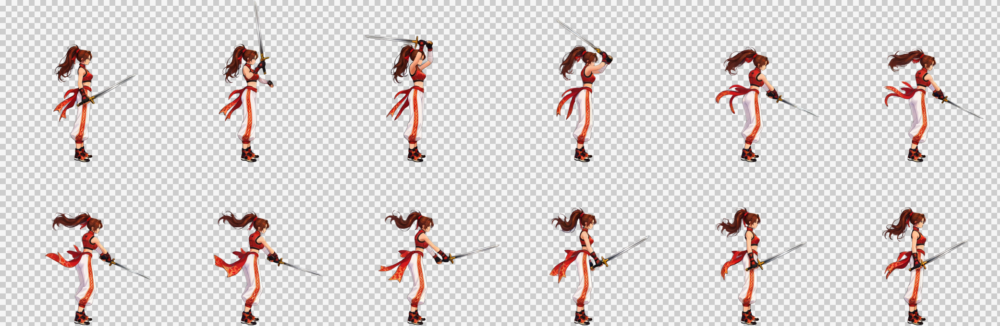
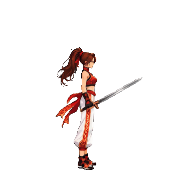

# 揮劍：保留實體武器並移除附帶特效

[繁體中文](README.md) · [简体中文](README.zh-CN.md) · [日本語](README.ja.md) · [한국어](README.ko.md) · [English](README.en.md)

[← README](../../README.md)

以同一角色站立版面加入實體劍，再生成揮劍影片。站立參考圖尚未加入武器；實際影片輸入圖包含武器。

## 1. 角色參考圖

## 2. 自然站立參考

[PNG](images/standing.png) · [Prompt](prompts/standing.txt)

## 3. 影片輸入與實體武器

[原始版面](images/pre-weapon-input.png) · [加入武器提示詞](prompts/weapon-input.txt)

## 4. 來源影片

1152×896 · 24 FPS · 124 frames · 5.17 s

[MP4](video/source.mp4) · [Prompt](prompts/video.txt)

來源影片與實際生成提示詞保留原樣；以下成品以目前後段流程重新處理。

## 5. 自動選段與取樣

`paused` · 24–108 · 12 frames

`24, 32, 39, 47, 55, 62, 70, 77, 85, 93, 100, 108` (0-based source indices)

## 6. 第一次共同裁切

517×408 px / frame

## 7. 逐張 Refine、去特效與去背

逐張圖片工作流保留姿勢、尺度與位置，修復動態模糊並同時清理背景。上排為第一次共同裁切，下排為圖片工作流的原始輸出。

[實際 Refine 提示詞](prompts/refine.txt)

## 8. Alpha 清理、再次共同裁切與交付

僅將 Alpha 小於 8 的值清為 0，保留其餘半透明邊緣；依全部影格共同裁切，底部保留 1 px 透明留白。棋盤格僅供預覽。

| 影格數 | 單格尺寸 | 排列 | 影格表 | 播放時間 |
| --- | --- | --- | --- | --- |
| 12 | 347×340 | 6×2 | 2082×680 | 1.2 s |

[PNG](result/spritesheet.png) · [GIF](result/preview.gif) · [JSON](result/animation.json) · [完整素材包](sword-complete.zip)

[Workflow / validation](../../references/spritesheet.md)

完整 ZIP 包含來源影片、全部來源影格、選中影格、裁切影格、工作流輸入、原始 Refine 輸出、最終影格、提示詞，以及 PNG／GIF／JSON。
