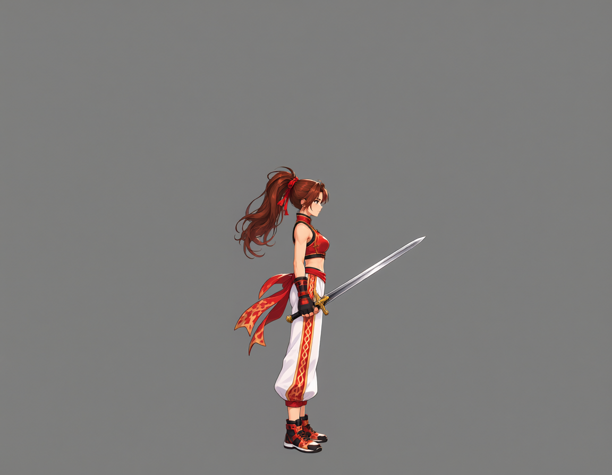
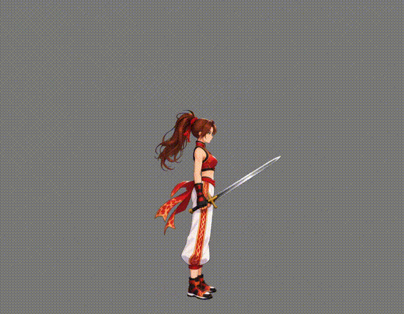
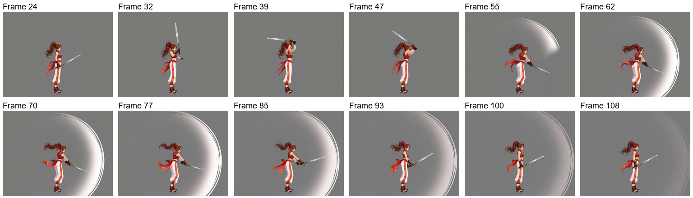
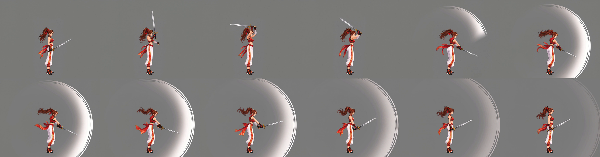
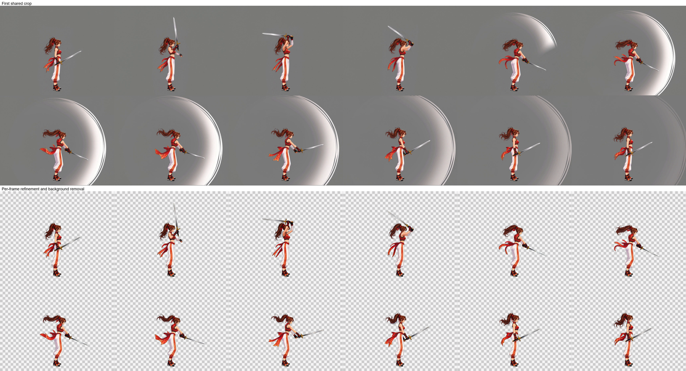
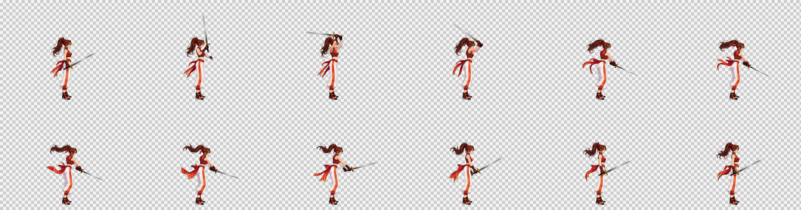
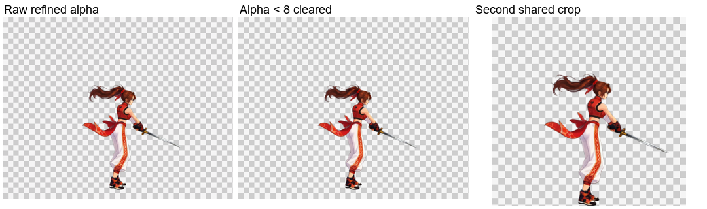
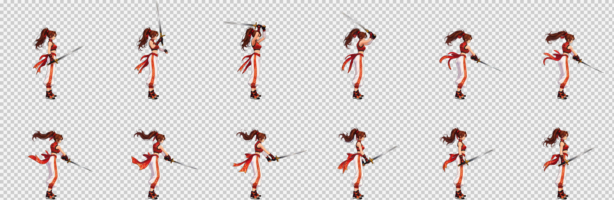
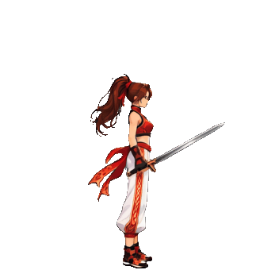

# 挥剑：保留实体武器并移除附带特效

[繁體中文](README.md) · [简体中文](README.zh-CN.md) · [日本語](README.ja.md) · [한국어](README.ko.md) · [English](README.en.md)

[← README](../../README.zh-CN.md)

本页展示单个动作的实际素材与处理成果，不是新角色首次制作的完整操作步骤。开始制作请按主说明选择姿态与动作；每个姿态都包含 Idle。

下方可比较来源视频、清理前后的帧与最终成果，并下载实际素材和提示词。

本例先在站立画布加入实体剑，再生成挥剑视频；下方参考尚未持剑，视频输入图已包含剑。

## 1. 角色参考图

[PNG](images/character-reference.png)

## 2. 姿态参考

本例使用下方自然站立参考；灰底与黄色框线仅供确认，不会画入透明素材。

[PNG](images/standing.png) · [实际提示词](prompts/standing.txt)

## 3. 视频输入图

为角色预留动作空间，减少四肢、头发或装备超出画面的情况。

[PNG](images/video-input.png)

[下载素材](images/pre-weapon-input.png) · [实际提示词](prompts/weapon-input.txt)

## 4. 来源视频

[MP4](video/source.mp4) · [实际提示词](prompts/video.txt)

## 5. 选中的帧

## 6. 共同裁切

全部选中帧使用相同范围裁切，保持动作中的位置关系。

## 7. 帧修整与去背

修复动态模糊、清理多余效果并移除背景。比较图上排为清理前，下排为清理后。

[实际提示词](prompts/refine.txt)

## 8. 透明边缘整理与成品

整理透明边缘后，按所有帧的角色范围再次共同裁切。棋盘格只是显示透明区域的预览背景。

| 帧数 | 单帧尺寸 | 排列 | 帧表 | 播放时间 |
| --- | --- | --- | --- | --- |
| 12 | 347×340 | 6×2 | 2082×680 | 1.2 s |

[PNG](result/spritesheet.png) · [GIF](result/preview.gif) · [JSON](result/animation.json) · [完整素材包](sword-complete.zip)

素材包包含角色参考、视频输入、来源视频、各阶段帧、实际提示词与 PNG／GIF／JSON 成品。
