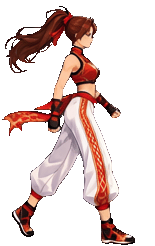
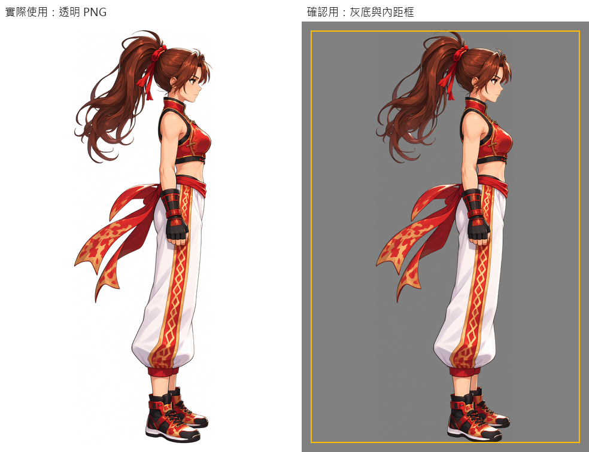
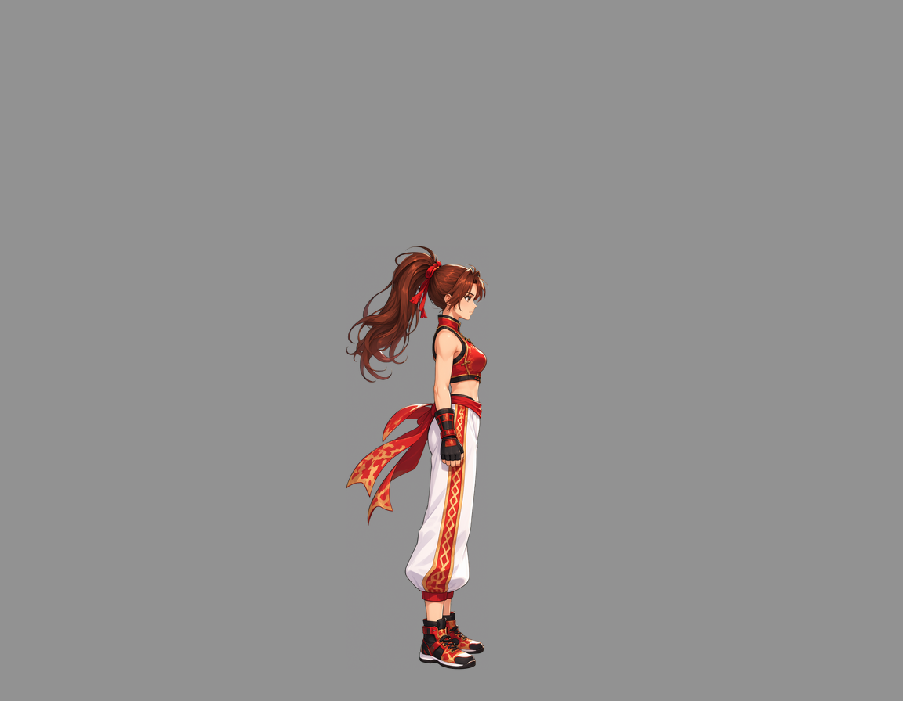
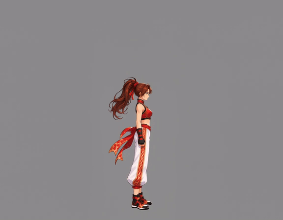
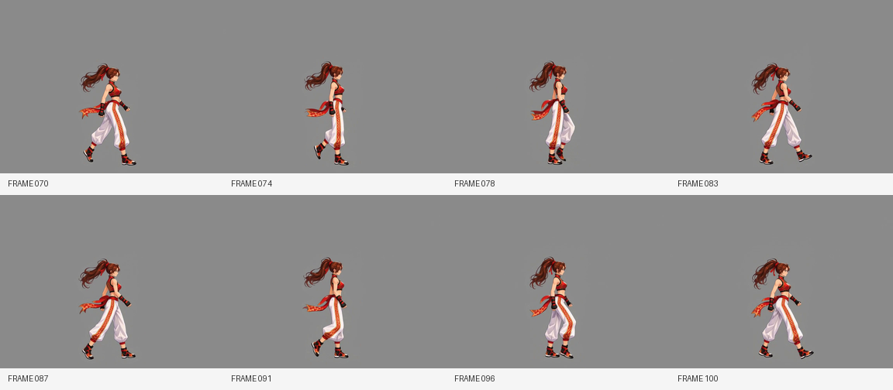
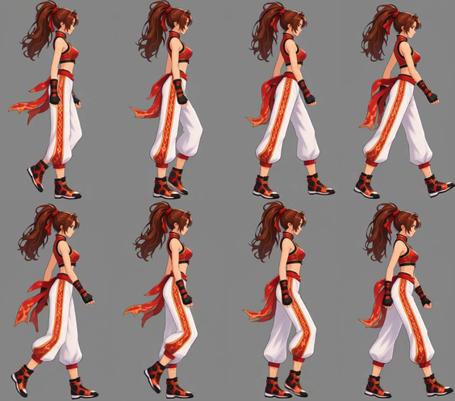
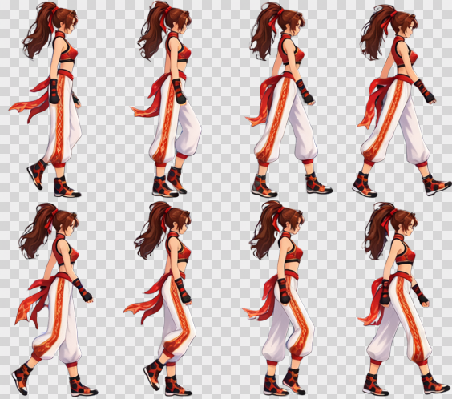

# From character reference to walking loop

[繁體中文](README.md) · [简体中文](README.zh-CN.md) · [日本語](README.ja.md) · [한국어](README.ko.md) · [English](README.en.md)

[← Installation and usage](../../README.en.md)

Upload a character reference, approve the natural standing pose, and generate the action directly from the standing canvas. Python excludes the posture transition, selects a loop, and produces transparent deliverables.

<table>
  <tr><th>Uploaded reference</th><th>Finished walking loop</th></tr>
  <tr><td align="center"></td><td align="center"> 8 frames · 0.8 seconds · Transparent</td></tr>
</table>

> **Request:** A walking loop facing right in a strict side view, with a 256×256 character baseline.

This example uses MiniMax H3 for video and Qwen Image 2.1 for images. All assets below come from the same grayscale-background workflow.

## 1. Upload the character reference

The **user** provides the image and request. **Codex** identifies that this promotional illustration has perspective and a dynamic pose, so it first needs a complete natural standing reference.

[Download original](images/character-reference.png)

## 2. Establish the standing reference and fixed position

**ComfyUI** generates a natural standing pose in side view. **Python** applies an inset of 3% of the shorter side, establishes a horizontal ground anchor and bottom reference, and preserves scale. Hair and trailing fabric do not shift the body's standing position forward. **Codex** shows the result for approval.

Original size: **1024×1536**, inset: **31 px**. The left side preserves transparency; the right-side gray background and yellow guide are only for review and are not drawn into the asset. Text inside this shared preview image is in Traditional Chinese.

[Transparent standing image](images/standing.png) · [Actual standing prompt](prompts/standing.txt)

**Reusable:** Other actions for this character can share the standing reference, scale, and position anchor.

## 3. Build the video input canvas directly

**The performance canvas reserves room for movement.** Limbs, hair, and accessories may extend beyond the standing silhouette. A video model may not fully obey instructions to stay in frame, so padding reduces the risk of clipping. Delivery uses a shared crop enclosing the complete action.

**Python** places the standing character on a grayscale canvas using the fixed anchor, adds padding, adjusts generation scale to the pixel budget, and pads to the workflow's dimension multiples.

| Item | Actual value |
| --- | --- |
| Target character baseline | 256×256 |
| Generation canvas | 1152×896; both dimensions are multiples of 32 |
| Background | Solid gray RGB (146, 146, 146) |
| Pixel budget | 998,280 before alignment; 1,032,192 after padding, allowing the small excess |
| Uniform restoration scale | 256÷564, approximately 0.453901 |

[Download actual video input](images/video-input.png)

**Reusable:** Use this canvas with other action prompts, or test it yourself in ComfyUI.

## 4. Generate the action from standing

**Codex** describes the transition from standing into regular walking. **Python** submits the job, waits locally, and downloads the result. **ComfyUI** generates the transition and action.

Source: **1152×896, 24 FPS, 107 frames, approximately 4.46 seconds**. This GIF is a webpage preview; the original video retains full resolution.

[Watch/download MP4](video/source.mp4) · [Actual video prompt](prompts/video.txt)

**Reusable:** Reselect intervals or frames and change delivery playback timing without generating another video.

## 5. Automatically select a loop and frames

**Codex** classifies the action as `continuous`: there is no pause at the loop boundary. **Python** finds similar start/end poses, excludes preparation and transitions, and samples evenly.

Selected interval: **frames 70–103**. Frame **104** is the matching tail pose and is omitted. The 8 selected frames are **70, 74, 78, 83, 87, 91, 96, 100**, numbered from zero.

| Action type | Selection |
| --- | --- |
| Continuous loop | Similar start/end; start through end−1 |
| Loop with a pause | Similar preparation/recovery poses; include both endpoints to retain the pause |
| Non-looping | Work backward from the final stable pose to the last eligible starting stable interval; include both endpoints |

If no qualifying interval is found, Codex reviews and specifies one. All source frames and selected frames are also stored in the ZIP.

## 6. Restore scale, crop jointly, and pack

**Python** applies one scale to all selected frames, then calculates a shared crop. The crop is horizontally symmetric about the video centerline, preserving movement without recentering each frame. It adds 1 px at the bottom and packs **4 columns × 2 rows**, left to right, top to bottom.

Cells: **155×246 px**. Sheet: **620×492 px**. The 256×256 baseline defines character scale; the delivery cells enclose the full action and can be rectangular.

[Download sheet before background removal](images/spritesheet-before-removal.png)

## 7. Remove the background and deliver

**ComfyUI** removes the background from the whole sheet once. **Python** verifies size and transparency, creates the GIF from the final sheet, and packages actual assets, all frames, selected frames, prompts, and outputs. **Codex** reviews and displays the deliverables with a ZIP link.

The checkerboard is for display only; the original PNG is transparent.

| Download | Contents |
| --- | --- |
| [Transparent PNG sheet](result/spritesheet.png) | 8 frames, 4×2, each 155×246 |
| [GIF preview](result/preview.gif) | Transparent, 0.8-second loop |
| [Complete ZIP](walk-complete.zip) | About 24 MB: original, standing reference, input canvas, source video, all 107 frames, 8 selected frames, prompts, outputs |
| [Output JSON](result/animation.json) | Interval selection, sampling, crop, playback timing |
| [Background-removal prompt](prompts/background-removal.txt) | Actual prompt used for the whole sheet |

## Assets worth keeping

| Asset | Reuse |
| --- | --- |
| Standing reference | Shared character scale, position, and appearance |
| Standing canvas and prompts | Other actions or settings in ComfyUI |
| Source video and all frames | Different intervals, samples, and playback timing |
| Transparent sheet | Import into a game engine or create other previews |

[Install and start →](../../README.en.md)
