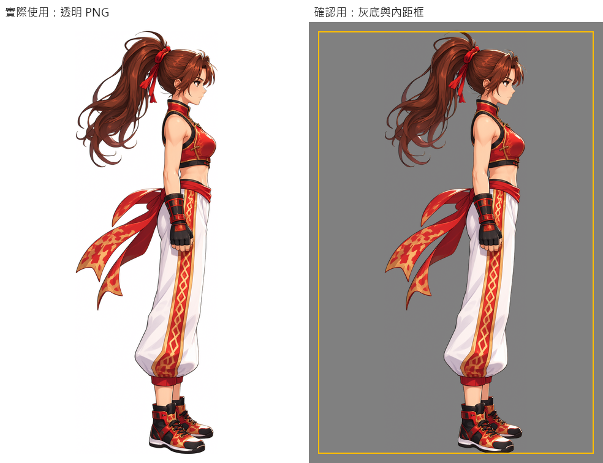
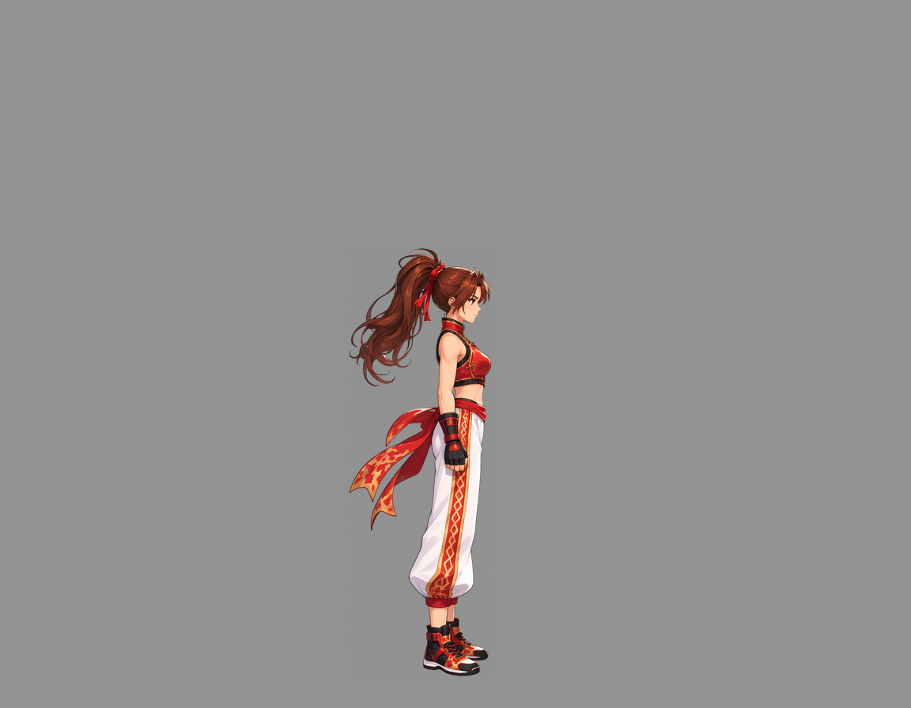
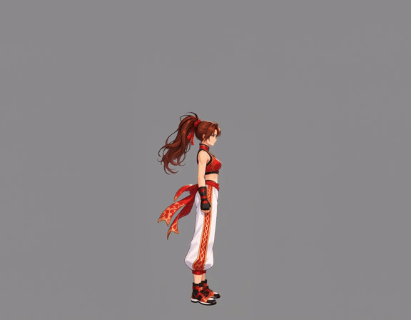
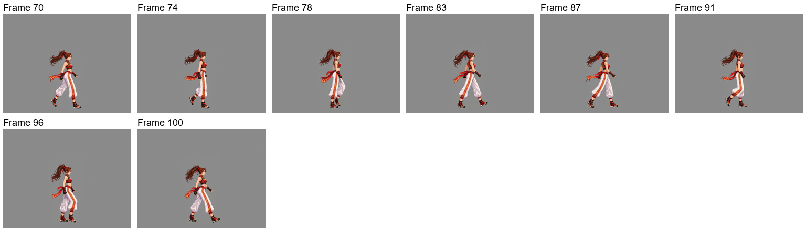
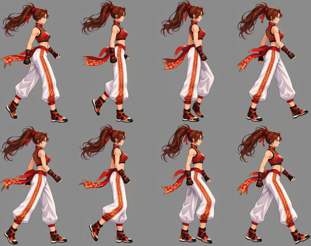
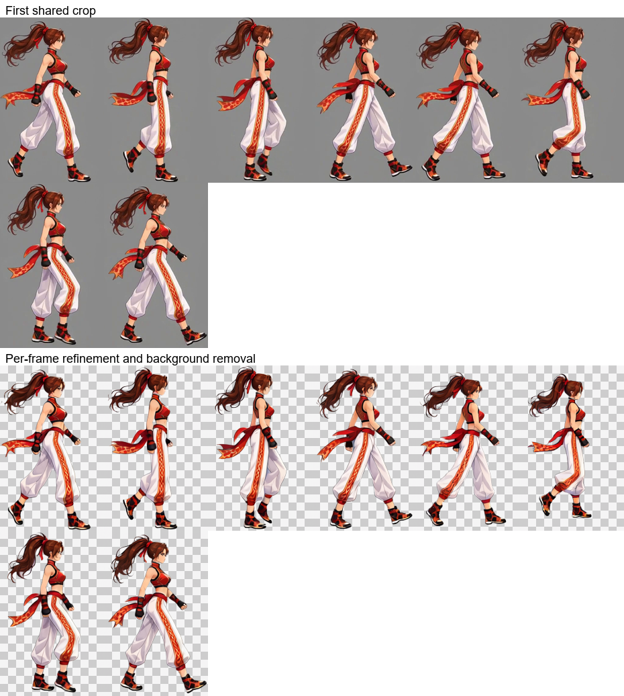
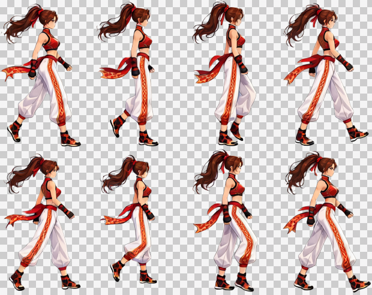
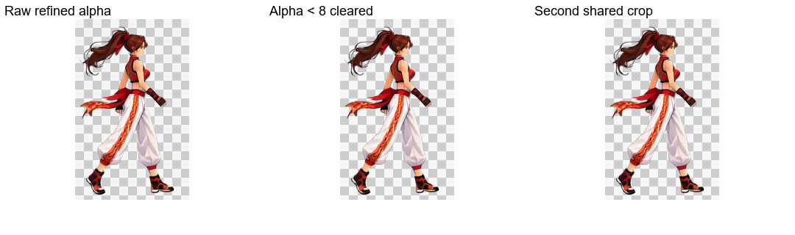
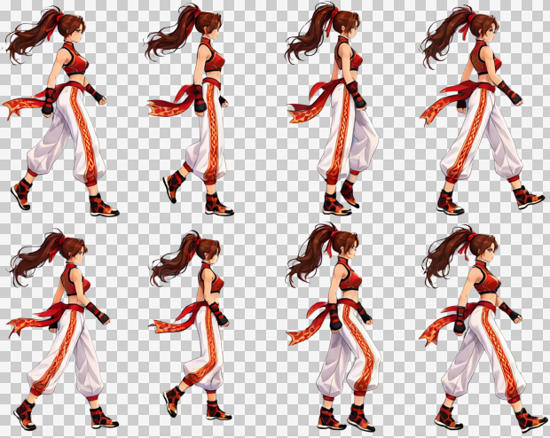

# From character reference to walking loop

[繁體中文](README.md) · [简体中文](README.zh-CN.md) · [日本語](README.ja.md) · [한국어](README.ko.md) · [English](README.en.md)

[← Installation and usage](../../README.en.md)

Reuse the standing reference and performance canvas to generate a video. After selection and a shared crop, refine each frame and remove effects and background, then clean alpha, crop jointly again and pack the results.

<table>
  <tr><th>Uploaded reference</th><th>Finished walking loop</th></tr>
  <tr><td align="center"></td><td align="center"> 8 frames · 0.8 seconds · Transparent</td></tr>
</table>

> **Request:** A walking loop facing right in a strict side view, with a 256×256 character baseline.

This example uses MiniMax H3 for video and Qwen Image 2.1 for images. All assets below come from the same grayscale-background workflow.

## 1. Upload the character reference

The **user** provides the image and request. **Codex** identifies that this promotional illustration has perspective and a dynamic pose, so it first needs a complete natural standing reference.

[Download original](images/character-reference.png)

## 2. Establish the standing reference and fixed position

**ComfyUI** generates a natural standing pose in side view. **Python** applies an inset of 3% of the shorter side, establishes a horizontal ground anchor and bottom reference, and preserves scale. Hair and trailing fabric do not shift the body's standing position forward. **Codex** shows the result for approval.

Original size: **1024×1536**, inset: **31 px**. The left side preserves transparency; the right-side gray background and yellow guide are only for review and are not drawn into the asset. Text inside this shared preview image is in Traditional Chinese.

[Transparent standing image](images/standing.png) · [Actual standing prompt](prompts/standing.txt)

**Reusable:** Other actions for this character can share the standing reference, scale, and position anchor.

## 3. Build the video input canvas directly

**The performance canvas reserves room for movement.** Limbs, hair, and accessories may extend beyond the standing silhouette. A video model may not fully obey instructions to stay in frame, so padding reduces the risk of clipping. Delivery uses a shared crop enclosing the complete action.

**Python** places the standing character on a grayscale canvas using the fixed anchor, adds padding, adjusts generation scale to the pixel budget, and pads to the workflow's dimension multiples.

| Item | Actual value |
| --- | --- |
| Target character baseline | 256×256 |
| Generation canvas | 1152×896; both dimensions are multiples of 32 |
| Background | Solid gray RGB (146, 146, 146) |
| Pixel budget | 998,280 before alignment; 1,032,192 after padding, allowing the small excess |
| Uniform restoration scale | 256÷564, approximately 0.453901 |

[Download actual video input](images/video-input.png)

**Reusable:** Use this canvas with other action prompts, or test it yourself in ComfyUI.

## 4. Generate the action from standing

**Codex** describes the transition from standing into regular walking. **Python** submits the job, waits locally, and downloads the result. **ComfyUI** generates the transition and action.

Source: **1152×896, 24 FPS, 107 frames, approximately 4.46 seconds**. This GIF is a webpage preview; the original video retains full resolution.

[Watch/download MP4](video/source.mp4) · [Actual video prompt](prompts/video.txt)

**Reusable:** Reselect intervals or frames and change delivery playback timing without generating another video.

The source video and its actual generation prompts are retained. The results below were processed with the current backend.

## 5. Automatic selection and sampling

`continuous` · 70–103 · 8 frames

`70, 74, 78, 83, 87, 91, 96, 100` (0-based source indices)

## 6. First shared crop

155×246 px / frame

## 7. Per-frame Refine, effect and background removal

The image workflow preserves pose, scale and position while repairing motion blur and removing the background. Top: first shared crop. Bottom: raw image-workflow output.

[Actual Refine prompt](prompts/refine.txt)

## 8. Alpha cleanup, second shared crop and delivery

Alpha values below 8 become 0; other translucent edges remain. All frames share a second crop with 1 px of transparent bottom padding. Checkerboards are preview backgrounds only.

| Frames | Cell | Grid | Sheet | Duration |
| --- | --- | --- | --- | --- |
| 8 | 155×247 | 4×2 | 620×494 | 0.8 s |

[PNG](result/spritesheet.png) · [GIF](result/preview.gif) · [JSON](result/animation.json) · [Complete asset bundle](walk-complete.zip)

[Workflow / validation](../../references/spritesheet.md)

ZIP: source video, all source frames, selected frames, cropped frames, workflow inputs, raw refined frames, final frames, prompts, PNG / GIF / JSON.
