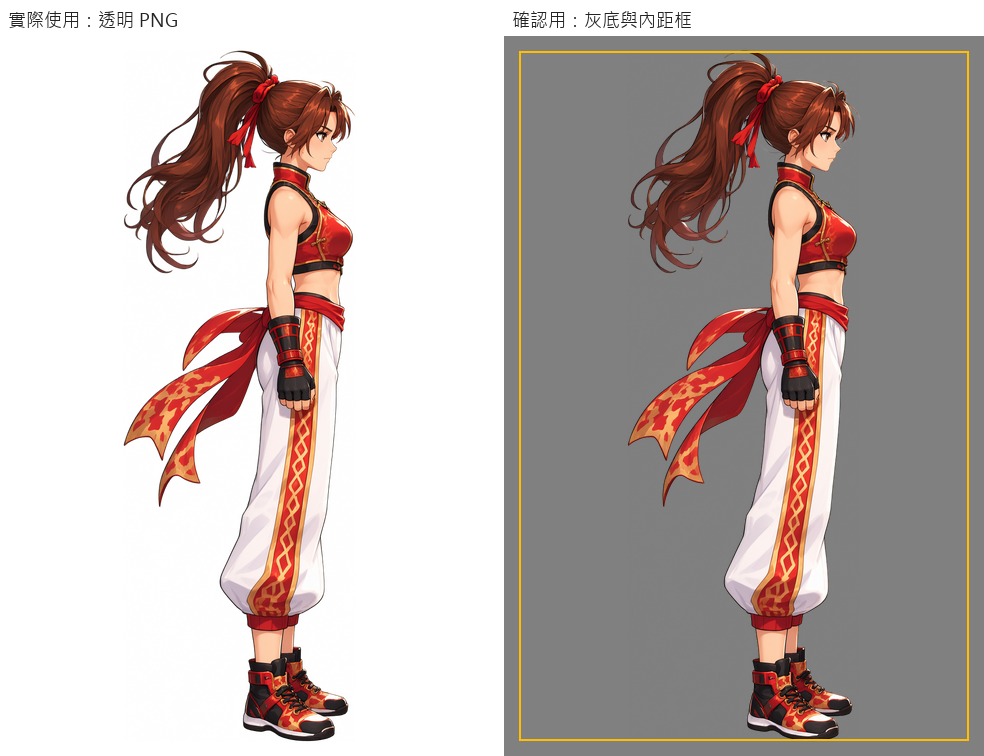
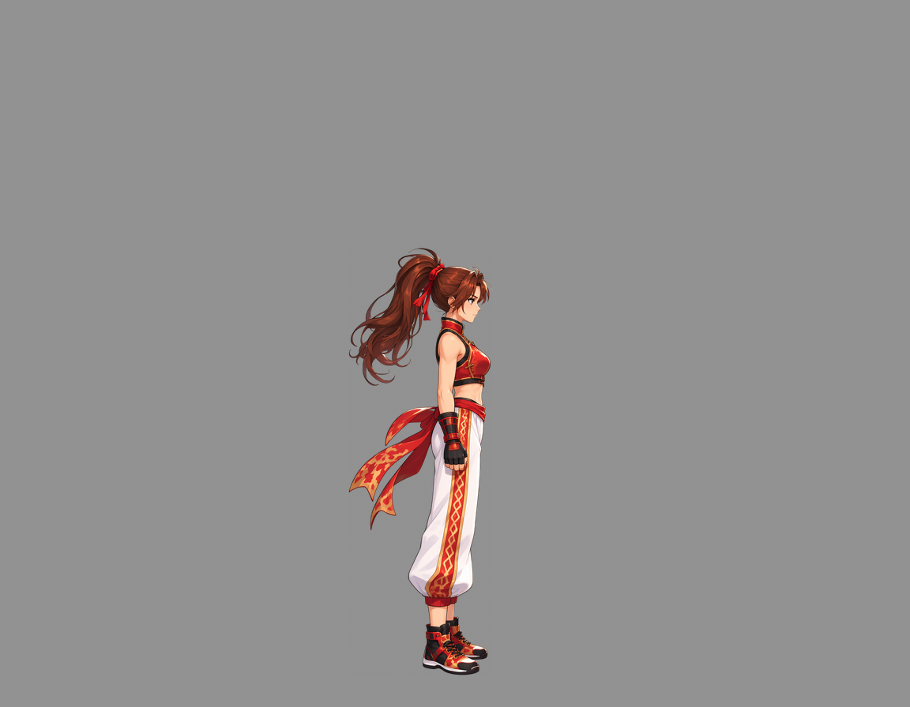
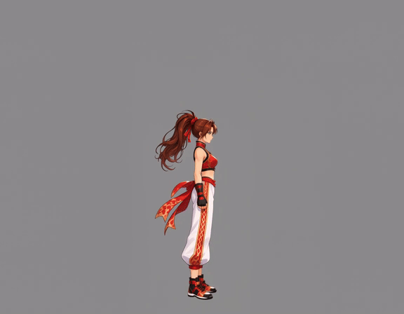
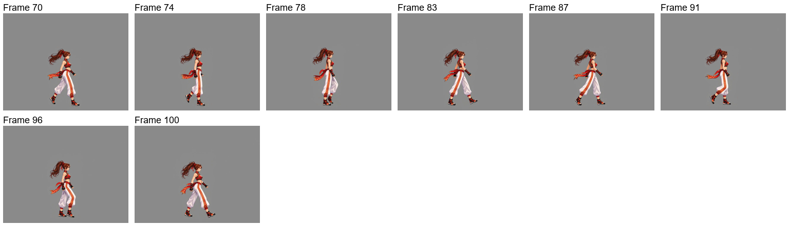
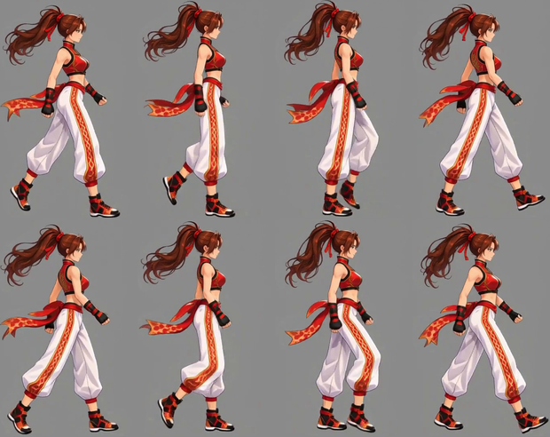
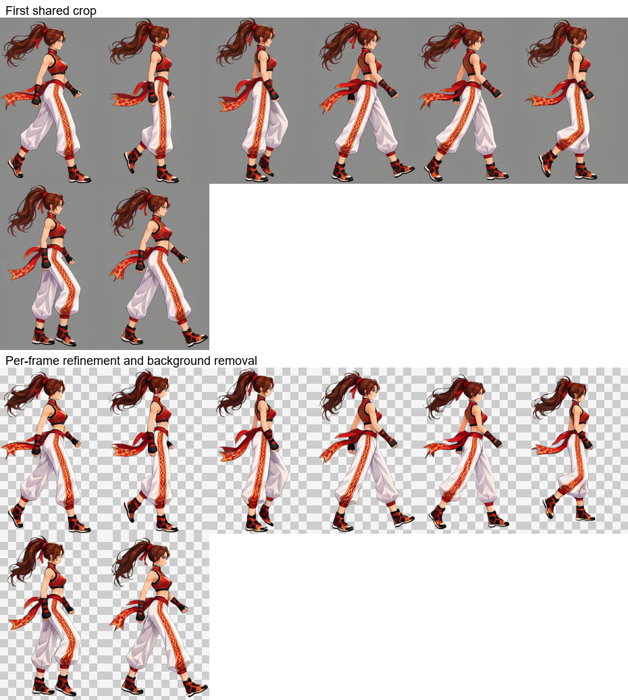
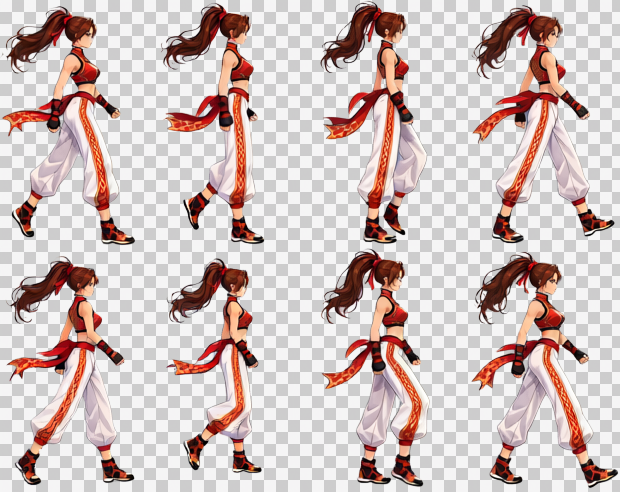
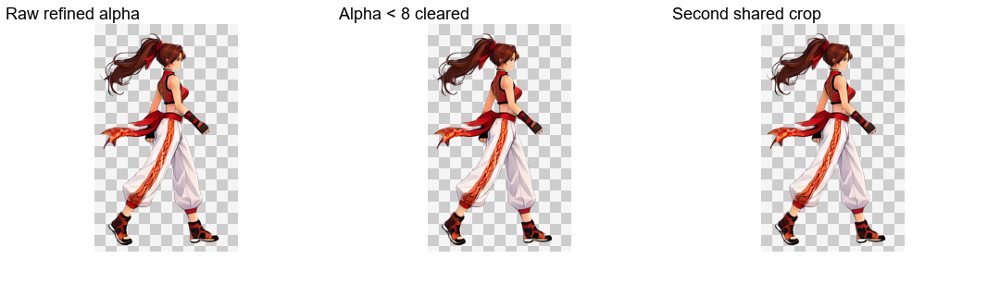
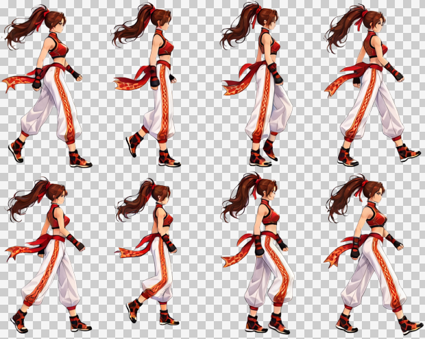

# キャラクター参考画像から歩行ループまで

[繁體中文](README.md) · [简体中文](README.zh-CN.md) · [日本語](README.ja.md) · [한국어](README.ko.md) · [English](README.en.md)

[← インストールと使い方](../../README.ja.md)

立ち姿と演出用キャンバスを再利用して動画を生成します。自動選択と共通クロップ後、各フレームを Refine してエフェクトと背景を除去し、Alpha 整理と再共通クロップを経て統合します。

<table>
  <tr><th>アップロードした参考画像</th><th>完成した歩行ループ</th></tr>
  <tr><td align="center"></td><td align="center"> 8 フレーム · 0.8 秒 · 透過背景</td></tr>
</table>

> **依頼内容：** 右向き、真横視点の歩行ループ。キャラクターの基準サイズは 256×256。

動画には MiniMax H3、画像には Qwen Image 2.1 を使用しました。以下は同じグレースケール背景の処理で実際に使った素材です。

## 1. 参考画像をアップロード

**利用者**が画像と要望を渡します。**Codex**は、遠近感と動きのある宣伝用イラストのため、まず全身の自然な立ち姿を用意すると判断します。

[元画像をダウンロード](images/character-reference.png)

## 2. 自然な立ち姿と固定位置を確立

**ComfyUI**が真横の自然な立ち姿を生成します。**Python**が短辺の 3% の内側余白を設け、足元から水平アンカーと下端基準を求めてスケールを保持します。髪や帯が後ろに伸びていても、身体の立ち位置は前にずれません。**Codex**が確認用に表示します。

元の寸法は **1024×1536**、内側余白は **31 px**。左側は透過素材、右側の背景と黄色い枠は確認用です。原本には描き込みません。共用プレビュー内のラベルは繁体字中国語です。

[透過立ち姿 PNG](images/standing.png) · [実際の立ち姿プロンプト](prompts/standing.txt)

**再利用：** 同じキャラクターの別動作でも、立ち姿、スケール、位置基準を共有できます。

## 3. 動画入力キャンバスを直接作成

**動作用キャンバスは、キャラクターが動くための空間を確保します。** 手足、髪、装飾は立ち姿の範囲を越えることがあります。画面内に収めるプロンプトが完全に守られるとは限らないため、事前に余白を設けて見切れを減らします。納品時は動作全体を収める共通範囲で切り抜きます。

**Python**が固定アンカーで立ち姿を配置し、余白を追加します。画素数の予算に合わせて生成スケールを調整し、ワークフローの寸法倍数に合わせます。

| 項目 | 実測値 |
| --- | --- |
| キャラクターの目標基準枠 | 256×256 |
| 生成キャンバス | 1152×896、幅・高さともに 32 の倍数 |
| 背景 | 単色グレー RGB（146, 146, 146） |
| 画素数 | 寸法の倍数補正前は 998,280、補正後は 1,032,192。余白による少量の超過を許容 |
| 共通の縮小倍率 | 256÷564、約 0.453901 |

[実際の動画入力画像](images/video-input.png)

**再利用：** 動作プロンプトを変えて別の動作を生成したり、ComfyUI で直接試したりできます。

## 4. 立ち姿から目標動作を生成

**Codex**が立ち姿から歩行に移り、規則的に歩く流れを記述します。**Python**が送信、ローカルでの待機、取得を担当し、**ComfyUI**が姿勢の移行と動作を生成します。

元動画は **1152×896、24 FPS、107 フレーム、約 4.46 秒**。上はウェブ用 GIF で、MP4 は元の解像度を維持しています。

[MP4 を表示・ダウンロード](video/source.mp4) · [動画プロンプト](prompts/video.txt)

**再利用：** 区間、選択フレーム、納品時の再生時間を変更しても、動画を生成し直す必要はありません。

元動画と実際の生成プロンプトはそのまま保持し、以下の成果物は現在の後段処理で作成しています。

## 5. 自動区間選択とサンプリング

`continuous` · 70–103 · 8 frames

`70, 74, 78, 83, 87, 91, 96, 100` (0-based source indices)

## 6. 最初の共通クロップ

155×246 px / frame

## 7. 各フレームの Refine・エフェクト除去・背景除去

画像ワークフローは姿勢・大きさ・位置を維持し、動きのぼけを修復して背景も除去します。上段は最初の共通クロップ、下段は画像ワークフローの未加工出力です。

[実際の Refine プロンプト](prompts/refine.txt)

## 8. Alpha 整理・再共通クロップ・納品

Alpha が 8 未満の値のみ 0 にし、他の半透明の縁は維持します。全フレームで共通範囲を再クロップし、下端に透明な 1 px を残します。市松模様はプレビュー専用です。

| フレーム数 | セルサイズ | 配置 | シート | 再生時間 |
| --- | --- | --- | --- | --- |
| 8 | 155×247 | 4×2 | 620×494 | 0.8 s |

[PNG](result/spritesheet.png) · [GIF](result/preview.gif) · [JSON](result/animation.json) · [全素材 ZIP](walk-complete.zip)

[Workflow / validation](../../references/spritesheet.md)

ZIP には元動画、全元フレーム、選択フレーム、クロップ画像、ワークフロー入力、未加工の Refine 出力、最終フレーム、プロンプト、PNG／GIF／JSON を含みます。
