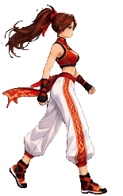
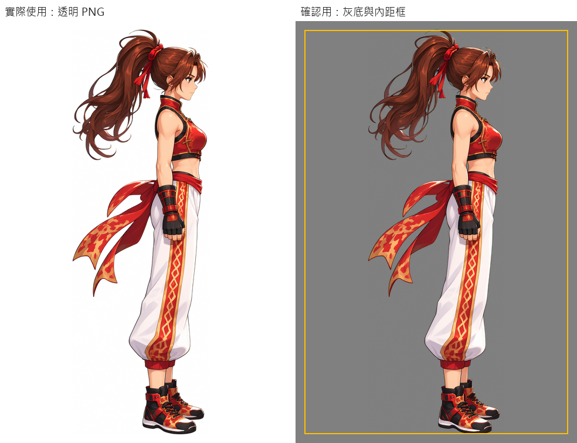
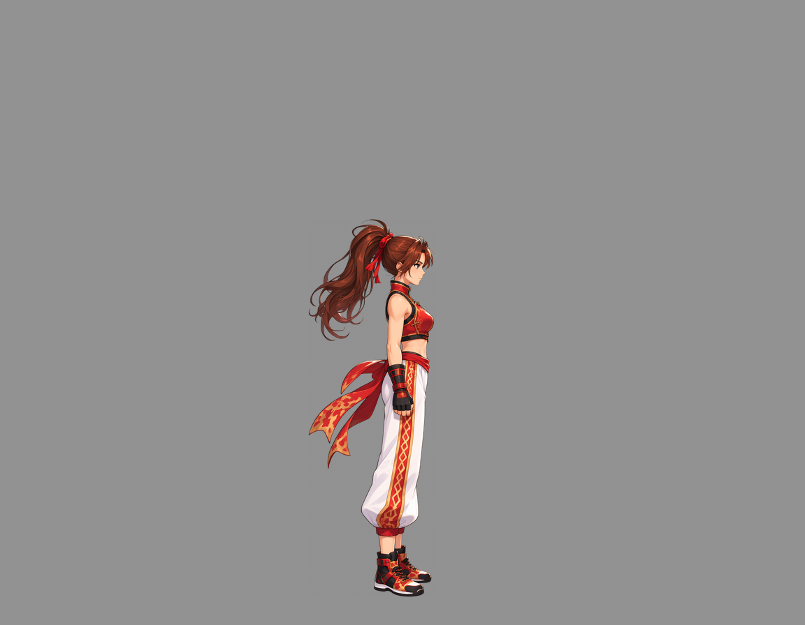
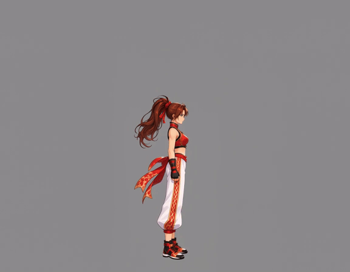
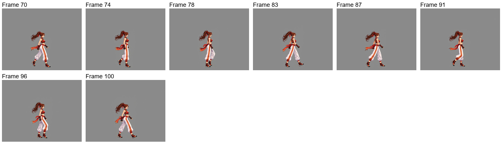
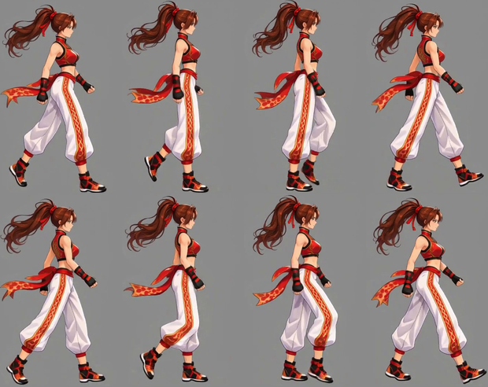
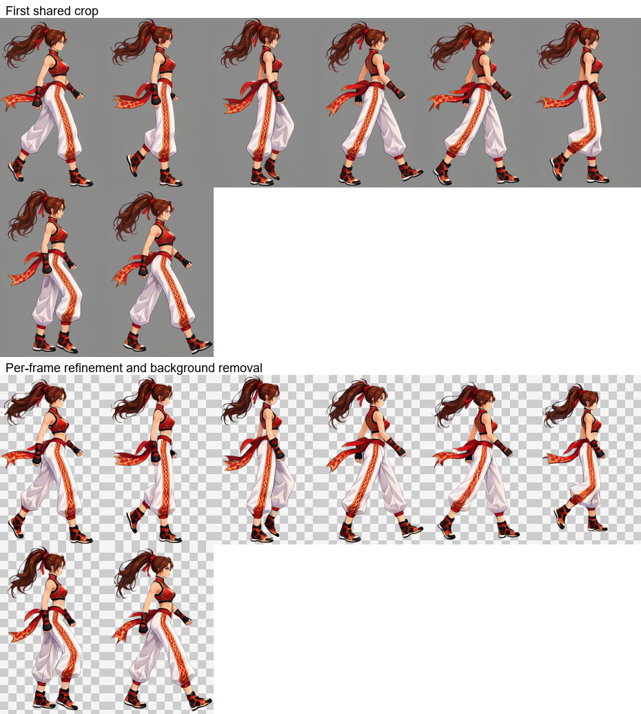
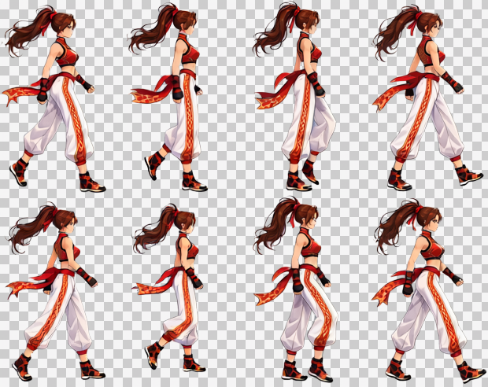
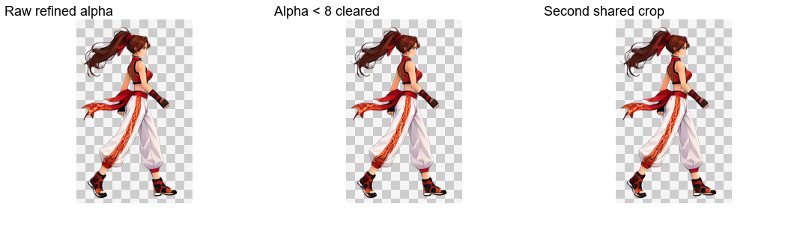
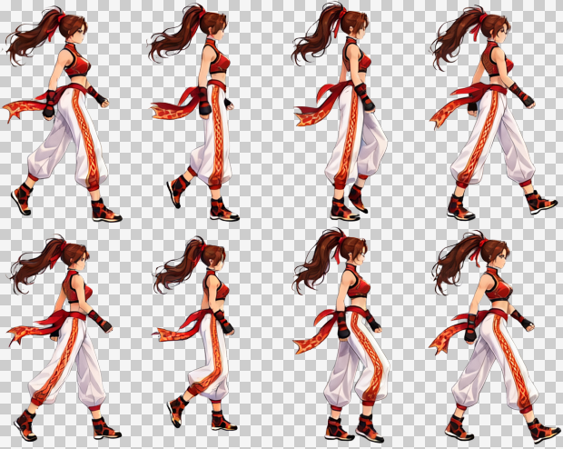

# 캐릭터 참고 이미지에서 걷기 루프까지

[繁體中文](README.md) · [简体中文](README.zh-CN.md) · [日本語](README.ja.md) · [한국어](README.ko.md) · [English](README.en.md)

[← 설치 및 사용 안내](../../README.ko.md)

서 있는 참조와 연출 캔버스를 재사용하여 영상을 생성합니다. 자동 선택과 공통 자르기 후 각 프레임을 Refine하며 효과와 배경을 제거하고, Alpha 정리와 재공통 자르기를 거쳐 합칩니다.

<table>
  <tr><th>업로드한 참고 이미지</th><th>완성된 걷기 루프</th></tr>
  <tr><td align="center"></td><td align="center"> 8 프레임 · 0.8초 · 투명 배경</td></tr>
</table>

> **요청:** 오른쪽을 바라보는 정확한 측면 걷기 루프. 캐릭터 기준 크기는 256×256.

동영상은 MiniMax H3, 이미지는 Qwen Image 2.1을 사용했습니다. 아래는 같은 회색조 배경 작업에서 실제로 사용한 자료입니다.

## 1. 캐릭터 참고 이미지 업로드

**사용자**가 이미지와 요청을 제공합니다. **Codex**는 원근과 역동적인 자세가 있는 홍보 이미지이므로, 먼저 온전한 자연스러운 서 있는 참고 이미지가 필요하다고 판단합니다.

[원본 다운로드](images/character-reference.png)

## 2. 서 있는 참고 이미지와 고정 위치 설정

**ComfyUI**가 정확한 측면의 자연스러운 서 있는 자세를 생성합니다. **Python**은 짧은 변의 3%를 안쪽 여백으로 설정하고, 발밑 위치에서 가로 앵커와 하단 기준을 정해 캐릭터 크기를 유지합니다. 머리카락과 띠 때문에 몸의 서 있는 위치가 앞으로 밀리지 않습니다. **Codex**가 확인용 결과를 보여줍니다.

원본 크기는 **1024×1536**, 안쪽 여백은 **31 px**입니다. 왼쪽은 투명 자료이며 오른쪽의 배경과 노란 선은 확인용으로 원본에 들어가지 않습니다. 공용 미리보기 이미지 안의 표기는 번체 중국어입니다.

[투명 서 있는 이미지](images/standing.png) · [실제 생성 프롬프트](prompts/standing.txt)

**재사용:** 같은 캐릭터의 다른 동작에서도 참고 이미지, 배율, 위치 기준을 공유합니다.

## 3. 동영상 입력 캔버스 바로 만들기

**동작용 캔버스는 캐릭터가 움직일 공간을 확보합니다.** 팔다리, 머리카락, 장식이 서 있는 자세의 범위를 벗어날 수 있습니다. 화면 안에 머물라는 지시를 동영상 모델이 완전히 따르지 않을 수 있으므로, 미리 여백을 두어 잘림 가능성을 줄입니다. 결과물은 전체 동작을 담는 공통 영역으로 자릅니다.

**Python**이 고정 앵커로 캐릭터를 회색조 캔버스에 배치하고 여백을 추가합니다. 픽셀 예산에 맞춰 생성 배율을 정한 뒤 워크플로의 치수 배수에 맞춥니다.

| 항목 | 실제 결과 |
| --- | --- |
| 캐릭터 목표 기준 틀 | 256×256 |
| 생성 캔버스 | 1152×896, 가로와 세로 모두 32의 배수 |
| 배경 | 단색 회색 RGB (146, 146, 146) |
| 픽셀 예산 | 배수 정렬 전 998,280, 정렬 후 1,032,192. 추가 여백의 소폭 초과 허용 |
| 공통 복원 배율 | 256÷564, 약 0.453901 |

[실제 동영상 입력 이미지 다운로드](images/video-input.png)

**재사용:** 다른 동작 프롬프트와 함께 쓰거나 ComfyUI에서 직접 시험할 수 있습니다.

## 4. 서 있는 자세에서 목표 동작 생성

**Codex**가 서 있는 자세에서 규칙적인 걷기로 이어지는 흐름을 작성합니다. **Python**은 제출, 로컬 대기, 다운로드를 담당하고 **ComfyUI**가 자세 전환과 동작을 생성합니다.

원본은 **1152×896, 24 FPS, 107 프레임, 약 4.46초**입니다. 위 GIF는 웹 미리보기이며 MP4는 전체 해상도를 유지합니다.

[MP4 보기／다운로드](video/source.mp4) · [실제 동영상 프롬프트](prompts/video.txt)

**재사용:** 동영상을 다시 생성하지 않고 구간, 샘플링, 최종 재생 시간을 변경할 수 있습니다.

원본 영상과 실제 생성 프롬프트를 유지하며 아래 결과물은 현재 후반 처리로 만들었습니다.

## 5. 자동 구간 선택 및 샘플링

`continuous` · 70–103 · 8 frames

`70, 74, 78, 83, 87, 91, 96, 100` (0-based source indices)

## 6. 첫 번째 공통 자르기

155×246 px / frame

## 7. 프레임별 Refine 및 효과·배경 제거

이미지 워크플로는 자세, 크기, 위치를 유지하며 동작 흐림을 보정하고 배경도 제거합니다. 위쪽은 첫 번째 공통 자르기, 아래쪽은 이미지 워크플로의 원본 출력입니다.

[실제 Refine 프롬프트](prompts/refine.txt)

## 8. Alpha 정리, 두 번째 공통 자르기 및 전달

Alpha가 8 미만인 값만 0으로 만들고 나머지 반투명 가장자리는 유지합니다. 모든 프레임을 공통 범위로 다시 자르고 하단에 투명 여백 1 px을 남깁니다. 체크무늬는 미리보기 전용입니다.

| 프레임 수 | 셀 크기 | 배치 | 시트 | 재생 시간 |
| --- | --- | --- | --- | --- |
| 8 | 155×247 | 4×2 | 620×494 | 0.8 s |

[PNG](result/spritesheet.png) · [GIF](result/preview.gif) · [JSON](result/animation.json) · [전체 소재 ZIP](walk-complete.zip)

[Workflow / validation](../../references/spritesheet.md)

ZIP에는 원본 영상, 모든 원본 프레임, 선택 프레임, 자른 프레임, 워크플로 입력, 원본 Refine 출력, 최종 프레임, 프롬프트, PNG／GIF／JSON이 포함됩니다.
