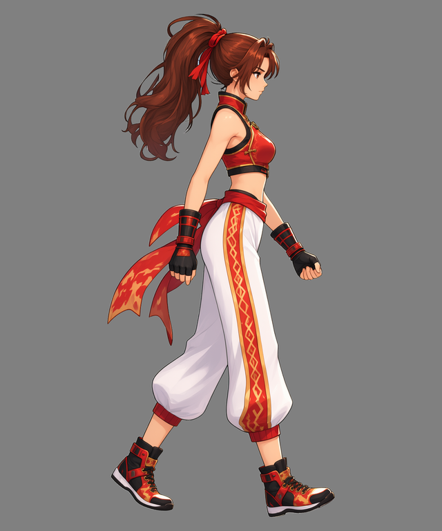

# 從角色參考圖到走路循環

[← 回到安裝與使用說明](../../README.md)

上傳一張角色宣傳圖，用一句話描述需求，逐步確認角色與首幀，最後取得透明影格表、GIF 與完整素材包。

<table>
  <tr><th align="center">上傳角色參考圖</th><th align="center">完成的走路循環</th></tr>
  <tr>
    <td align="center"></td>
    <td align="center"> 8 格 · 0.8 秒 · 透明背景</td>
  </tr>
</table>

> **本次需求：** 以這張角色參考圖，製作面朝右、正側視角的走路循環動畫，角色基準大小為 256×256。

本範例使用 MiniMax H3 生成影片、Qwen Image 2.1 處理圖片。以下均為同一套灰階背景流程的實際素材。

## 1. 上傳角色參考圖

**使用者**提供角色圖片與動作描述。**Codex**辨識角色外觀，判斷這張帶透視與動態姿勢的宣傳圖需要先整理成自然站立參考。

[下載原圖](images/character-reference.png)

## 2. 建立自然站立參考

**ComfyUI**產生面朝右的正側面站姿；**Python**以短邊 3% 計算內距，等比例配置、水平置中並對齊內框底邊。**Codex**展示結果，讓使用者確認外觀與比例。

灰底僅方便檢視，素材本身是透明 PNG。這張原尺寸為 **1024×1536**，內距為 **31 px**，不會畫出定位框。

[透明站立圖](images/standing.png) · [實際提示詞](prompts/standing.txt)

**可以重用：** 同一角色製作其他動作時，沿用這張站立圖建立的尺度依據。

## 3. 準備走路首幀

**Codex**描述自然跨步姿勢，**Python**先在角色畫布左右各補 128 px，保留角色原尺度；**ComfyUI**在 **1280×1536** 畫布產生走路首幀。**Python**只平移定位，依 39 px 內距整理確認預覽，不按新姿勢重新放大。

<table>
  <tr><th align="center">站立尺度參考</th><th align="center">走路動作首幀</th></tr>
  <tr>
    <td align="center"></td>
    <td align="center"></td>
  </tr>
</table>

**使用者確認這張姿勢後，才接續影片準備。** 若需要調整，先修改目前成果，再展示確認。

[透明首幀](images/first-frame.png) · [補邊後的姿勢輸入圖](images/pose-input.png) · [實際提示詞](prompts/first-frame.txt)

**可以重用：** 重試同一動作可沿用首幀，不必重新產生站姿或重新設計角色。

## 4. 建立影片演出版面

**Python**沿用站立尺度，加入演出留白與純灰背景，依像素預算調整生成尺度，再將寬高補齊工作流要求的 32 倍數。

| 項目 | 本次結果 |
| --- | --- |
| 角色目標基準框 | 256×256 |
| 影片輸入畫布 | 1152×896，寬高皆為 32 倍數 |
| 背景 | 純灰 RGB（137, 137, 137） |
| 像素預算 | 對齊前 998,280 像素；補齊後 1,032,192 像素，允許對齊餘量 |
| 最終縮回倍率 | 256÷564，約 0.453901 |

[下載影片輸入圖](images/video-input.png)

**可以重用：** 將這張圖與下一階段的提示詞帶到 ComfyUI，自行測試生成設定；得到滿意影片後再交給 Codex 接續處理。

## 5. 生成走路影片

**Codex**準備動作、場景與固定鏡頭的提示詞；**Python**提交工作流並在本機等待、下載；**ComfyUI**生成完整走路演出。

原影片為 **1152×896、24 FPS、39 格、1.625 秒**。上圖是方便網頁觀看的預覽 GIF，原始影片保留完整解析度。

[觀看／下載原始 MP4](video/source.mp4) · [實際影片提示詞](prompts/video.txt)

**可以重用：** 影片可重新選區間、取樣或設定成品播放時間，不必再次生成。

## 6. 選取循環與關鍵影格

**Codex**檢視動作、選定區間；**Python**在第 6～38 格區間等距取出 8 格，避免將下一次循環的重複起點一併收進來。

本次選中影格為 **6、10、14、18、22、27、31、35**，編號由 0 起算。此圖展示縮放、裁切前的來源影格；全部 39 格及這 8 格原圖均保存在素材 ZIP 的獨立子資料夾。

## 7. 統一縮回、共同裁切與拼接

**Python**對所有選中影格套用同一縮回倍率，再計算共用裁切框。各格保持相同座標與尺寸，保留動作相對位移，底部補 1 px；最後按左至右、上至下排列成 **4 欄×2 排**。

[下載尚未去背的影格表](images/spritesheet-before-removal.png)

這時每格為 **141×249 px**，整張為 **564×498 px**。256×256 是角色尺度基準，交付格子依完整動作範圍裁切，因此可以是長方形。

## 8. 整張去背

**ComfyUI**對拼接完成的影格表去背一次；**Python**處理工作流所需的暫時補邊，裁回原表尺寸並檢查透明度。

棋盤格只是展示襯底，下載的 PNG 保留真正透明背景。

[下載透明影格表](result/spritesheet.png) · [實際去背提示詞](prompts/background-removal.txt)

## 9. GIF 預覽與完整交付

**Python**直接從最終透明影格表製作 GIF，8 格合計 **0.8 秒**、循環播放；再收集實際素材、提示詞與影片全部影格，建立 ZIP。**Codex**檢視成品，在對話中展示 GIF 與影格表，並附素材包。

| 下載 | 內容 |
| --- | --- |
| [透明影格表 PNG](result/spritesheet.png) | 8 格，4 欄×2 排，每格 141×249 |
| [動畫預覽 GIF](result/preview.gif) | 透明背景，0.8 秒循環 |
| [完整製作素材 ZIP](walk-complete.zip) | 約 17.4 MB，含原圖、站姿、首幀、補邊圖、影片輸入、來源影片、全部影格、選中影格、提示詞與成品 |
| [成品規格 JSON](result/animation.json) | 取樣編號、縮放倍率、共同裁切框及播放時間 |

## 哪些素材值得保存？

| 素材 | 之後可以怎麼用 |
| --- | --- |
| 自然站立參考圖 | 同一角色其他動作的尺度與外觀參考 |
| 動作首幀 | 重試影片生成，或從目前成果調整姿勢 |
| 演出輸入圖與影片提示詞 | 自行在 ComfyUI 嘗試生成設定 |
| 原始影片與全部影格 | 重新選動作區間與關鍵影格 |
| 最終透明影格表 | 匯入遊戲引擎、調整播放節奏或製作其他預覽 |

[開始安裝與使用 →](../../README.md#複製這句話給-codex)
