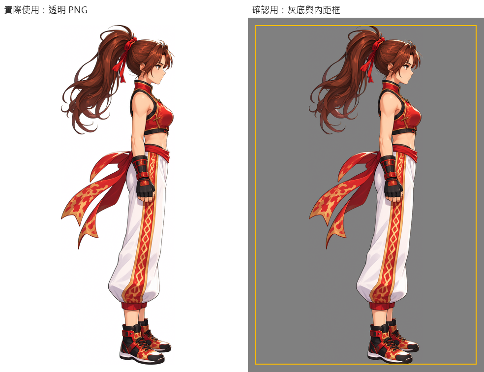
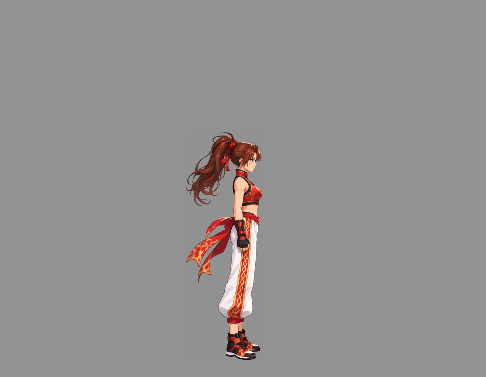
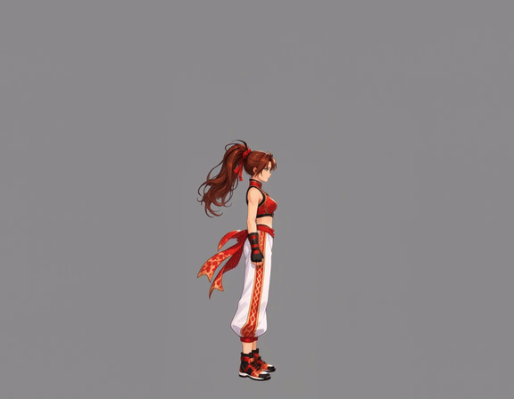
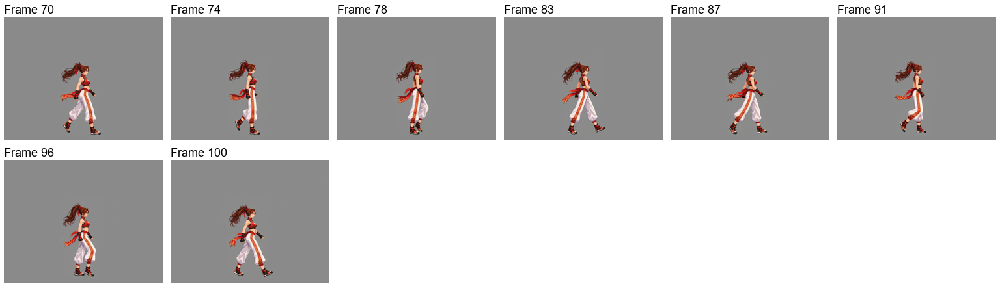
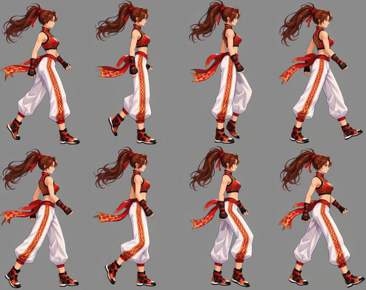
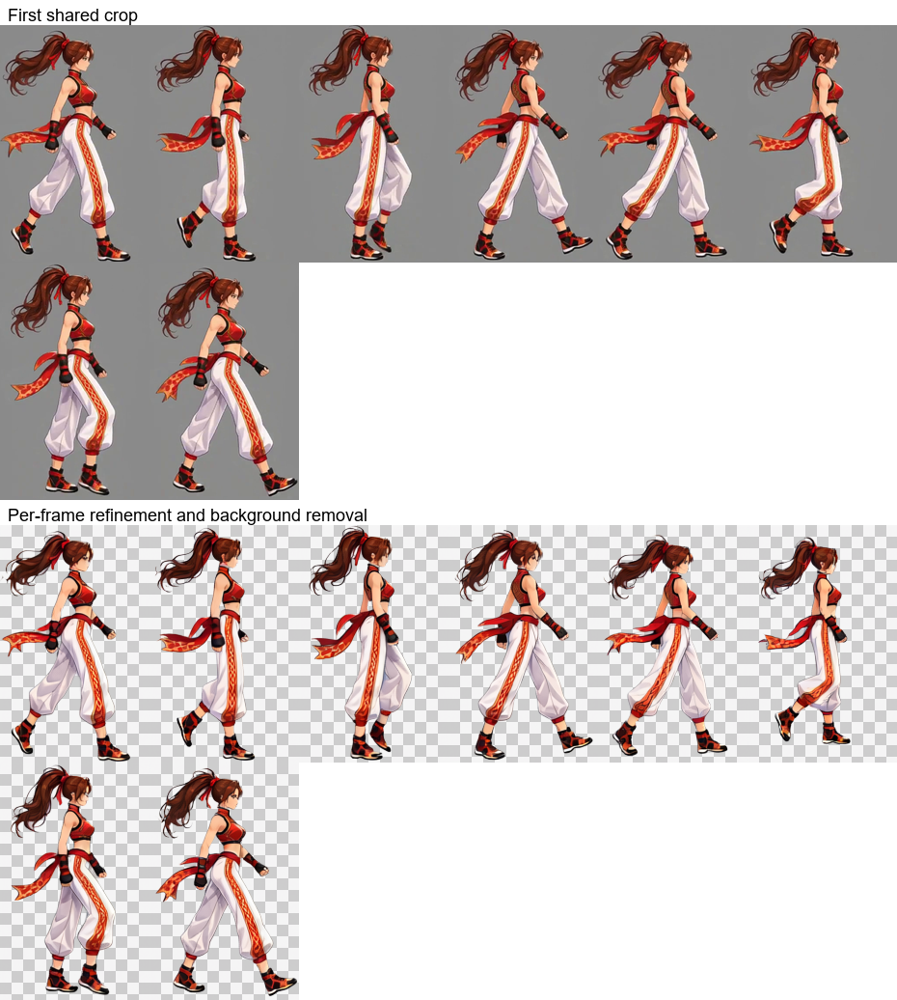
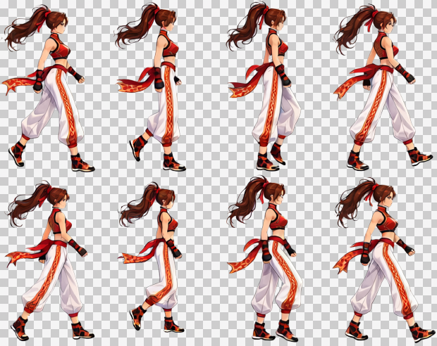
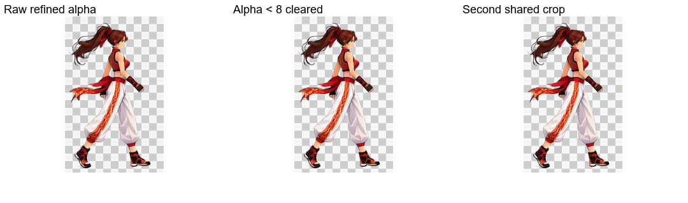
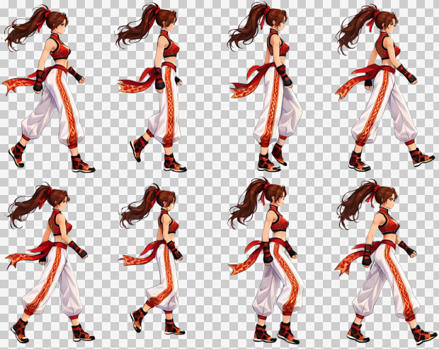

# 從角色參考圖到走路循環

[繁體中文](README.md) · [简体中文](README.zh-CN.md) · [日本語](README.ja.md) · [한국어](README.ko.md) · [English](README.en.md)

[← 回到安裝與使用說明](../../README.md)

沿用自然站立參考與演出版面生成動作影片；自動選段及共同裁切後，逐張 Refine、去特效並去背，再清理 Alpha、共同裁切及合併交付。

<table>
  <tr><th align="center">上傳的角色參考</th><th align="center">走路循環成品</th></tr>
  <tr>
    <td align="center"></td>
    <td align="center"> 8 格 · 0.8 秒 · 透明背景</td>
  </tr>
</table>

> **本次需求：** 面朝右、正側視角的走路循環動畫，角色基準大小為 256×256。

本次使用 MiniMax H3 生成影片、Qwen Image 2.1 處理圖片。以下是同一套灰階背景流程的實際素材。

## 1. 上傳角色參考圖

**使用者**提供圖片與需求。**Codex**判斷這張帶有透視和動態姿勢的宣傳圖，需先整理成完整自然站立參考。

[下載原圖](images/character-reference.png)

## 2. 建立自然站立參考與固定站位

**ComfyUI**產生正側面自然站姿；**Python**整理短邊 3% 的內距，以腳下站位建立水平錨點與底部基準，保留角色尺度。頭髮與飄帶不會把身體站位推向前方。**Codex**展示結果供使用者確認。

原尺寸 **1024×1536**，內距 **31 px**。左側保留透明素材，右側的灰底與黃色框線僅供確認，不會畫進原檔。

[透明站立圖](images/standing.png) · [實際站立提示詞](prompts/standing.txt)

**可以重用：** 同一角色的其他動作共用這張自然站姿、角色尺度及站位基準。

## 3. 直接建立影片輸入版面

**演出版面的目的是為角色預留活動空間。** 動作過程中，四肢、頭髮或配件可能伸出自然站姿原本的範圍；即使提示詞要求角色保持在畫面內，影片模型也未必完全遵從。因此先在角色周圍留白，降低動作超出畫面、身體被裁切的機會。這些留白供影片生成時使用，交付時會依完整動作範圍共同裁切。

**Python**直接把自然站立角色放入灰階演出版面，以固定錨點定位。加入留白、按像素預算調整生成尺度，再補齊工作流要求的尺寸倍數。

| 項目 | 本次結果 |
| --- | --- |
| 角色目標基準框 | 256×256 |
| 實際生成畫布 | 1152×896，寬高皆為 32 倍數 |
| 背景 | 純灰 RGB（146, 146, 146） |
| 像素預算 | 對齊前 998,280；對齊後 1,032,192，允許補邊餘量 |
| 統一縮回倍率 | 256÷564，約 0.453901 |

[下載實際影片輸入圖](images/video-input.png)

**可以重用：** 此站立版面搭配不同的動作提示詞即可生成其他動作；也能帶到 ComfyUI 自行測試。

## 4. 從站姿生成目標動作

**Codex**在提示詞描述由站姿進入行走，再完成規律步態；**Python**提交並在本機等待與下載；**ComfyUI**負責姿態過渡及動作演出。

原片為 **1152×896、24 FPS、107 格、約 4.46 秒**。上圖是網頁預覽 GIF，原影片保留完整解析度。

[觀看／下載 MP4](video/source.mp4) · [實際影片提示詞](prompts/video.txt)

**可以重用：** 重新選段、取樣或調整交付播放時間，都不必再次生成影片。

來源影片與實際生成提示詞保留原樣；以下成品以目前後段流程重新處理。

## 5. 自動選段與取樣

`continuous` · 70–103 · 8 frames

`70, 74, 78, 83, 87, 91, 96, 100` (0-based source indices)

## 6. 第一次共同裁切

155×246 px / frame

## 7. 逐張 Refine、去特效與去背

逐張圖片工作流保留姿勢、尺度與位置，修復動態模糊並同時清理背景。上排為第一次共同裁切，下排為圖片工作流的原始輸出。

[實際 Refine 提示詞](prompts/refine.txt)

## 8. Alpha 清理、再次共同裁切與交付

僅將 Alpha 小於 8 的值清為 0，保留其餘半透明邊緣；依全部影格共同裁切，底部保留 1 px 透明留白。棋盤格僅供預覽。

| 影格數 | 單格尺寸 | 排列 | 影格表 | 播放時間 |
| --- | --- | --- | --- | --- |
| 8 | 155×247 | 4×2 | 620×494 | 0.8 s |

[PNG](result/spritesheet.png) · [GIF](result/preview.gif) · [JSON](result/animation.json) · [完整素材包](walk-complete.zip)

[Workflow / validation](../../references/spritesheet.md)

完整 ZIP 包含來源影片、全部來源影格、選中影格、裁切影格、工作流輸入、原始 Refine 輸出、最終影格、提示詞，以及 PNG／GIF／JSON。
