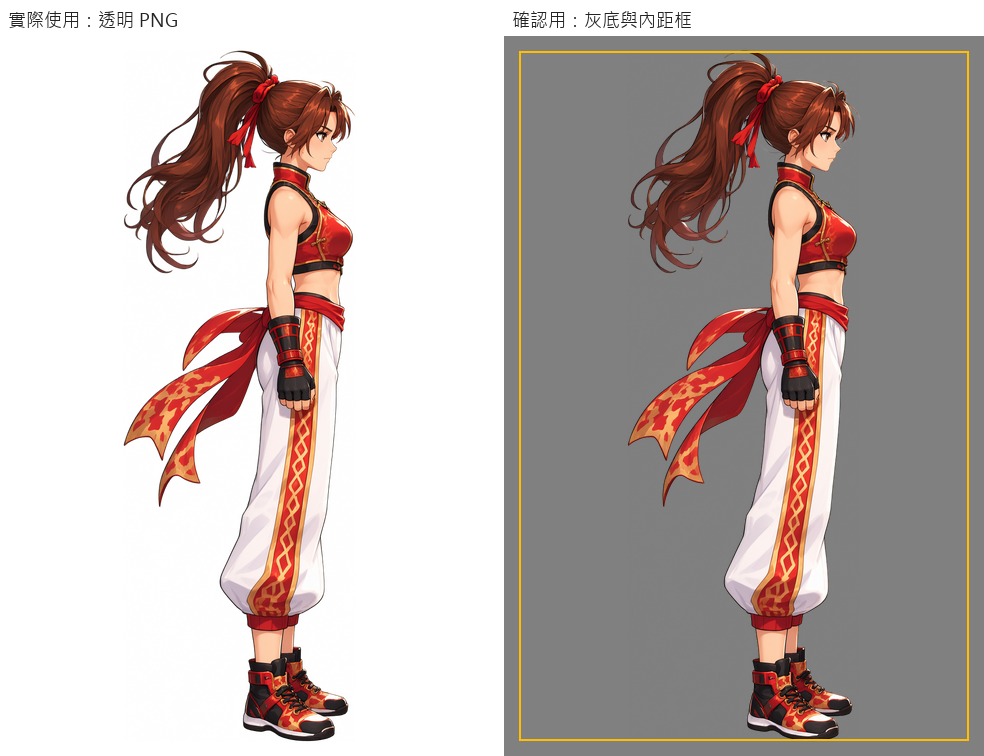
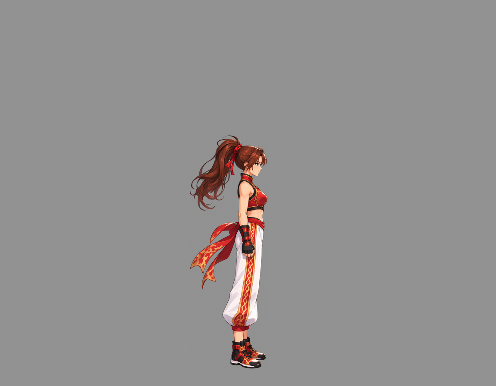
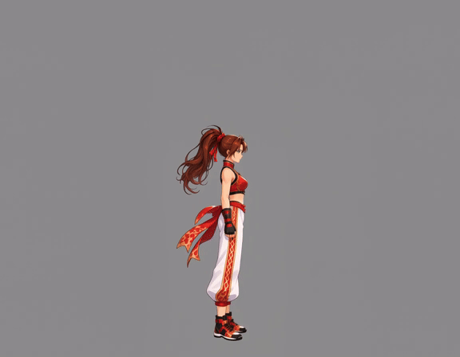
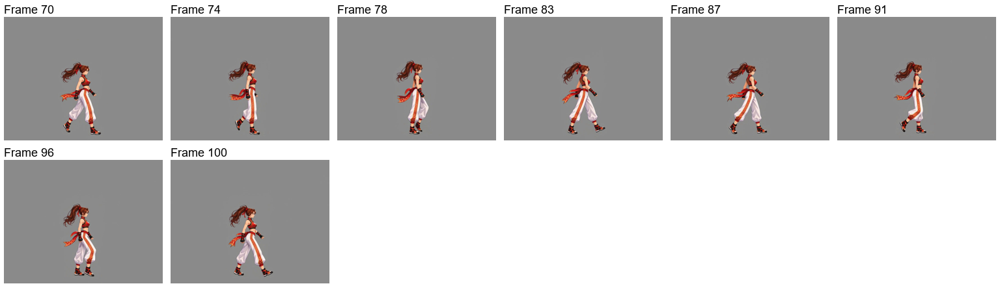
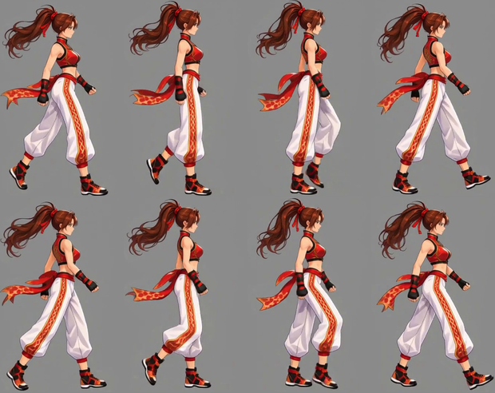
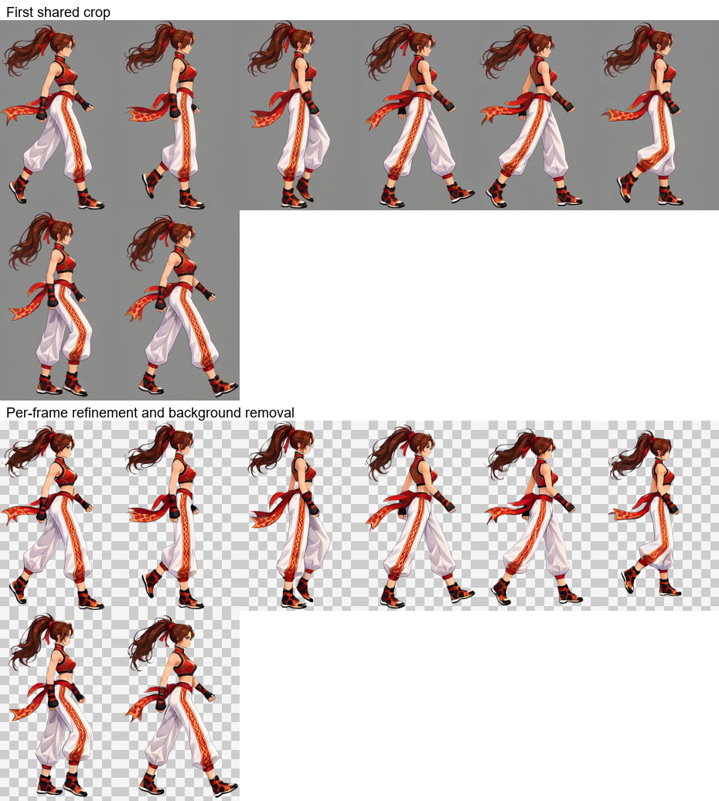
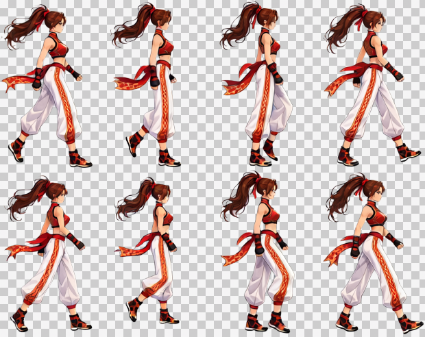
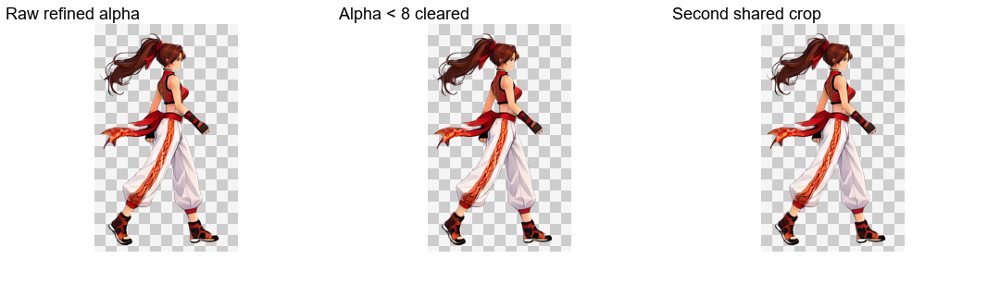
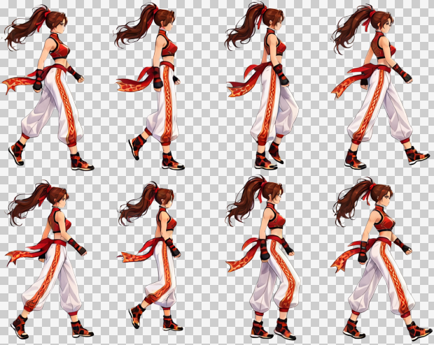

# 从角色参考图到行走循环

[繁體中文](README.md) · [简体中文](README.zh-CN.md) · [日本語](README.ja.md) · [한국어](README.ko.md) · [English](README.en.md)

[← 返回安装与使用说明](../../README.zh-CN.md)

沿用自然站立参考与演出版面生成动作视频；自动选段及共同裁切后，逐帧 Refine、去特效并去背，再清理 Alpha、共同裁切及合并交付。

<table>
  <tr><th>上传的角色参考</th><th>行走循环成品</th></tr>
  <tr><td align="center"></td><td align="center"> 8 帧 · 0.8 秒 · 透明背景</td></tr>
</table>

> **本次需求：** 面朝右、正侧视角的行走循环动画，角色基准大小为 256×256。

本次使用 MiniMax H3 生成视频、Qwen Image 2.1 处理图片。以下为同一套灰阶背景流程的实际素材。

## 1. 上传角色参考图

**用户**提供图片与需求。**Codex**判断这张带有透视和动态姿势的宣传图，需要先整理为完整的自然站立参考。

[下载原图](images/character-reference.png)

## 2. 建立自然站立参考与固定站位

**ComfyUI**生成正侧面的自然站姿；**Python**整理短边 3% 的内边距，以脚下站位建立水平锚点与底部基准，保留角色尺度。头发与飘带不会把身体站位推向前方。**Codex**展示结果供用户确认。

原尺寸 **1024×1536**，内边距 **31 px**。左侧保留透明素材；右侧灰底与黄色框线仅供确认，不会画进原文件。共用预览图内的标签为繁体中文。

[透明站立图](images/standing.png) · [实际站立提示词](prompts/standing.txt)

**可以复用：** 同一角色的其他动作共用自然站姿、角色尺度及站位基准。

## 3. 直接建立视频输入画布

**动作画布用于为角色预留活动空间。** 四肢、头发或配件可能伸出自然站姿原本的范围；即使提示词要求角色留在画面内，视频模型也未必完全遵从。因此先留白，降低动作超出画面、身体被截断的可能。交付时再按完整动作范围统一裁剪。

**Python**以固定锚点把自然站立角色放入灰阶画布，加入留白、按像素预算调整生成尺度，再补齐工作流要求的尺寸倍数。

| 项目 | 本次结果 |
| --- | --- |
| 角色目标基准框 | 256×256 |
| 生成画布 | 1152×896，宽高均为 32 的倍数 |
| 背景 | 纯灰 RGB（146, 146, 146） |
| 像素预算 | 对齐前 998,280；对齐后 1,032,192，允许补边余量 |
| 统一缩回倍率 | 256÷564，约 0.453901 |

[下载实际视频输入图](images/video-input.png)

**可以复用：** 搭配不同动作提示词生成其他动作，也能带到 ComfyUI 自行测试。

## 4. 从站姿生成目标动作

**Codex**描述从站姿进入行走，再完成规律步态；**Python**提交任务、在本机等待并下载；**ComfyUI**生成姿态过渡与动作。

原片为 **1152×896、24 FPS、107 帧、约 4.46 秒**。上图为网页预览 GIF，原视频保留完整分辨率。

[观看／下载 MP4](video/source.mp4) · [实际视频提示词](prompts/video.txt)

**可以复用：** 重新选段、采样或调整交付播放时间，不必再次生成视频。

来源视频与实际生成提示词保留原样；以下成品以当前后段流程重新处理。

## 5. 自动选段与采样

`continuous` · 70–103 · 8 frames

`70, 74, 78, 83, 87, 91, 96, 100` (0-based source indices)

## 6. 第一次共同裁切

155×246 px / frame

## 7. 逐帧 Refine、去特效与去背

逐帧图片工作流保留姿势、尺度与位置，修复动态模糊并同时清理背景。上排为第一次共同裁切，下排为图片工作流的原始输出。

[实际 Refine 提示词](prompts/refine.txt)

## 8. Alpha 清理、再次共同裁切与交付

仅将 Alpha 小于 8 的值清为 0，保留其余半透明边缘；依全部帧共同裁切，底部保留 1 px 透明留白。棋盘格仅供预览。

| 帧数 | 单帧尺寸 | 排列 | 帧表 | 播放时间 |
| --- | --- | --- | --- | --- |
| 8 | 155×247 | 4×2 | 620×494 | 0.8 s |

[PNG](result/spritesheet.png) · [GIF](result/preview.gif) · [JSON](result/animation.json) · [完整素材包](walk-complete.zip)

[Workflow / validation](../../references/spritesheet.md)

完整 ZIP 包含来源视频、全部来源帧、选中帧、裁切帧、工作流输入、原始 Refine 输出、最终帧、提示词，以及 PNG／GIF／JSON。
